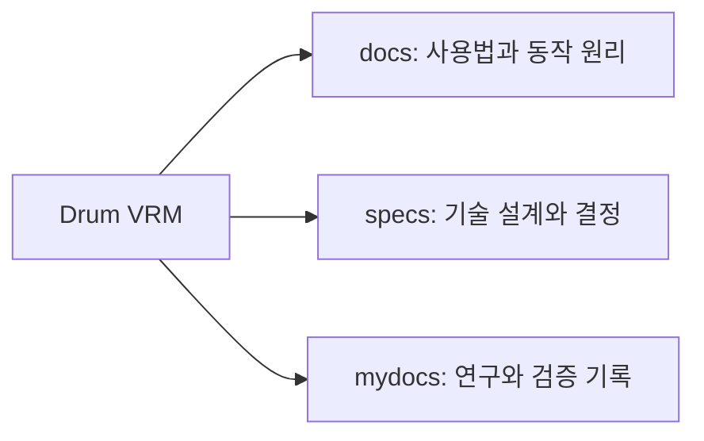

# Drum VRM

[English](README.md) · **한국어**

드럼 MIDI를 3D 드러머의 연주 영상으로 바꾸는 브라우저 도구입니다. Rust/WASM이 연주를 계산하고 Three.js가 리그·드럼·카메라 화면을 렌더링합니다.

[공개 데모 실행](https://postmelee.github.io/drum-vrm/) · [첫 영상 만들기](docs/tutorials/first-video.ko.md) · [기능 제공 범위](docs/reference/availability.ko.md)

MIDI를 불러와 준비 결과를 확인하고, 재생하거나 원하는 시점을 탐색한 뒤 합성 드럼 소리가 포함된 영상을 출력합니다. 선택한 MIDI와 모델은 브라우저 안에서 처리합니다. 원본 DAW의 음색을 재현하지는 않습니다.

## 문서 구조

- **배우기:** [첫 영상 만들기](docs/tutorials/first-video.ko.md).
- **작업하기:** [캐릭터 불러오기](docs/how-to/import-character.ko.md), [좌석·드럼 맞추기](docs/how-to/fit-character.ko.md), [드럼 부품 교체](docs/how-to/replace-drum-parts.ko.md), [영상 출력](docs/how-to/export-video.ko.md).
- **조회하기:** [지원 모델 파일](docs/reference/model-formats.ko.md), [MIDI·출력 제한](docs/reference/midi-and-export.ko.md), [드럼 프리셋](docs/reference/presets.ko.md).
- **이해하기:** [구조](docs/explanation/architecture.ko.md)와 [연주 표현의 원칙](docs/explanation/performance-principles.ko.md).
- **기술 설계 살펴보기:** [체형·키트 보정](specs/architecture/calibration.md), [리그 호환성](specs/architecture/rig-compatibility.md), [연주·표현](specs/architecture/performance-expression.md), [의존성 선택](specs/architecture/dependencies.md).
- **기여하기:** [로컬 실행](docs/how-to/local-development.ko.md), [설계 명세](specs/README.md), [연구·작업 기록](mydocs/README.md), [이슈](https://github.com/postmelee/drum-vrm/issues).

[문서 전체 탐색](docs/README.ko.md)

## 연주 표현 연구

**Keiichi Nagata의 Yamaha DTX402 Series — Drum Score / Instruction**과 그립 교육·애니메이션 연구를 함께 참고합니다. 프로젝트의 동작 규칙은 독립적으로 설계하고 검증합니다. [출처 대장](docs/reference/sources/README.ko.md)에서 저자를 밝히고 원자료의 설명, 프로젝트의 해석, 구현 근거를 구분합니다. 출처 표기는 공식 보증을 의미하지 않습니다.

## 라이선스와 출처

자체 코드는 [MIT](LICENSE)입니다. 의존성과 외부 드럼 모델에는 각각의 조건이 적용되며 [제3자 고지](THIRD_PARTY_NOTICES.md)와 [에셋 출처](public/models/README.ko.md)에서 확인할 수 있습니다. 외부 캐릭터·음원 샘플·모션 데이터셋·학습 가중치는 포함하지 않습니다. 불러온 에셋에는 제작자의 이용 조건이 계속 적용됩니다.
