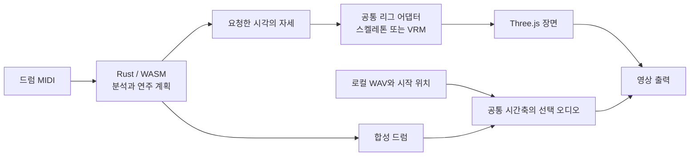

# Drum VRM

[English](README.md) · **한국어**

DAW에서 만든 드럼 MIDI를 브라우저에서 3D 드러머의 연주 영상으로 바꿉니다. Rust/WASM이 연주를 계획하고 Three.js가 드러머와 키트를 렌더링합니다.

**[앱 사용하기](https://postmelee.github.io/drum-vrm/?lang=ko) · [사용 안내](docs/README.ko.md) · [기술 설계](specs/README.ko.md)**

## 기능

- MIDI를 불러오고 트랙·채널을 선택하며, 마디·박자·음표가 표시된 피아노 롤을 확인합니다.
- General MIDI 또는 Logic Drum Kit Designer(GM 모드) 매핑을 선택하고 원본 이벤트를 보존하며 카운트인·하이햇 제어·동작 미배정 진단을 확인합니다.
- 합성 드럼 소리 또는 로컬 WAV 대체 음원과 함께 재생·일시정지·처음으로·시점 탐색을 사용합니다.
- 기본 스켈레톤, 캐릭터 드롭다운의 VRM 1.0 샘플 또는 자신의 로컬 VRM 또는 FBX를 선택합니다. 모두 실측 체형을 사용하는 같은 동작 계산을 적용합니다.
- 캐릭터를 불러오면 좌석과 손으로 치는 키트를 자동으로 맞춥니다. 되돌리거나 타점·손바닥 방향을 수동 조절할 수 있습니다. 공통 받침대·페달을 유지하면서 드럼 몸체를 교체합니다.
- 자체 도형으로 만든 Studio·Vintage·Electronic 키트와 Innerscene·Batoski·smoj 모델을 선택합니다.
- 흰색/검정 작업 화면, 간소화한 설정과 별도 분석 패널, 연주·정면·위·연주자 시점과 선택형 타격 반응을 제공합니다.
- 브라우저의 코덱에 따라 선택한 오디오가 포함된 1280 × 720, 30fps MP4 또는 WebM 영상을 내보냅니다.
- 원본 MIDI를 다시 쓰지 않고 개별 음표의 잘못된 타격을 제외하거나 연주할 손을 지정합니다. 실측 접촉 오차와 스틱 경로를 검수합니다.
- 해석·외형·보정·오디오 시작 위치·시점을 로컬 프로젝트로 저장하고, 다시 열 때 원본 파일을 연결합니다.
- 선택한 MIDI·WAV와 모델을 자동 업로드하지 않고 브라우저 안에서 처리합니다.

### 어떤 버전을 사용하고 있나요?

| 버전 | 제공 범위 |
| --- | --- |
| 저장소 / 로컬 빌드 | VRM 0.0/1.0 및 본을 연결한 FBX 로컬 불러오기와 이 문서의 MIDI 해석·프레이즈 계획·체형과 키트 맞춤·동작 검수·WAV·로컬 프로젝트 기능을 포함합니다. 공개 버전은 별도의 Pages 행에서 확인하세요. |
| [Pages 빌드](https://postmelee.github.io/drum-vrm/) | 배포된 배치 [`d23a940`](https://github.com/postmelee/drum-vrm/commit/d23a9400abc9461633f26a9b805659026626a633): 선택 가능한 공식 VRM 샘플, 영어·한국어 UI, 전체 곡 데모, 측정 장비·접촉 계획과 양 스틱 카운트인, 자동 맞춤·MIDI/WAV 미리보기·로컬 프로젝트. [배포 검증과 남은 제한](docs/verification/character-presets.md#pages-publication). |
| [태그 v0.2.0](https://github.com/postmelee/drum-vrm/releases/tag/v0.2.0) | 과거 릴리스: MIDI 재생·출력, 기본 스켈레톤, 자체 도형/Innerscene 키트와 정적 드럼 GLB 교체. [당시 검증](docs/verification/studio-0.2.md). |

안내 문서는 이 저장소 빌드를 설명합니다. 더 최신 로컬 변경이 공개되었다고 판단하기 전에 배포 커밋을 확인하세요. 상세 개발 검사는 연결된 [검증 기록](docs/README.ko.md#검증)에서 확인할 수 있습니다.

## 사용 방법

기본 언어는 영어이며 브라우저 저장소를 사용할 수 있으면 선택한 언어를 기억합니다. 도구 모음의 **EN / 한국어**로 전환해도 불러온 파일과 현재 재생 위치는 유지됩니다. 바로 접속하기: [English](https://postmelee.github.io/drum-vrm/?lang=en) · [한국어](https://postmelee.github.io/drum-vrm/?lang=ko).

1. **파일 · 오디오**에서 `.mid`/`.midi` 파일을 선택하거나 **데모**를 펼쳐 [데모 악보](docs/calibration.ko.md#데모-악보-사용하기)를 고르고 **불러오기**를 누릅니다. 첫 화면의 **데모 재생 준비**는 Studio Groove를 사용합니다.
2. **MIDI 설정**에서 트랙·채널·매핑을, **분석**에서 진단을 확인합니다. 카운트인·짧은 열림/닫힘 하이햇 해석은 관련 음표가 있을 때 표시되는 명시적 해석 정책입니다. 파일을 만든 DAW를 식별한다고 주장하지 않습니다. 변경 후 **설정 적용**을 누릅니다.
3. **재생**을 누릅니다. 타임라인으로 이동하고 시점 버튼이나 드래그·스크롤로 카메라를 조절합니다. **연주자** 시점은 회전·이동·확대를 고정하며, 드럼 편집을 닫으면 이전 시점으로 돌아옵니다.
4. **캐릭터**를 열고 드롭다운에서 포함된 샘플을 고르거나 **VRM / FBX 불러오기…**로 자신의 파일을 선택합니다. [모델 선택과 조건](docs/models.ko.md), [좌석·타점·드럼 부품 맞춤](docs/calibration.ko.md)을 참고하세요.
5. **파일 · 오디오 → 연주 오디오**에서 [WAV를 불러와 시작 위치를 맞춥니다](docs/export.ko.md). 재생·탐색으로 동기화를 확인합니다.
6. [로컬 프로젝트를 저장](docs/projects.ko.md)해 설정과 명시적 음표 편집을 보존합니다. 영상은 **내보내기**에서 추출하며, **오디오 없이 내보내기**를 선택하지 않으면 선택한 오디오를 포함합니다.

드럼 외형을 바꿔도 소리는 바뀌지 않으며, 원본 DAW의 악기 음색을 재현하지는 않습니다. 출력에는 시작 준비 0.5초와 끝 여운 0.25초가 포함됩니다. 정확히 30초인 곡은 923프레임, 약 30.7667초로 출력됩니다.

## 지원 입력과 제한

| 입력 | 지원 범위 |
| --- | --- |
| MIDI | `.mid` / `.midi`, SMF 0/1·PPQ 시간축. 10 MiB, 선택 트랙 기준 300초, 512트랙, 200,000이벤트, 선택한 지원 타격 50,000개까지. |
| WAV | PCM 또는 float, 모노·스테레오, 최대 100 MiB·300초. 시작 위치 ±300초. [형식과 자르기](docs/export.ko.md). |
| 캐릭터 | 리소스를 포함한 VRM 0.0/1.0 또는 리깅된 바이너리 FBX 7.4/7.5, 최대 50 MiB. FBX는 본·단위를 확인하고 로컬 PNG/JPEG를 연결합니다. [본·이미지·형식 제한](docs/models.ko.md#지원-파일). |
| 드럼 외형 | 리소스를 포함한 정적 GLB 2.0 단일 `.glb`, 최대 25 MiB. 스킨 모델 제외. [파일 준비와 맞춤](docs/calibration.ko.md#받침대페달을-유지하며-드럼-몸체-교체하기). |

휴머노이드 동작 준비에는 별도의 [제어 시각 6,000개 예산](specs/architecture/engine-contract.ko.md#준비와-worker-경계)이 있어 밀집된 악보는 MIDI 입력 상한보다 먼저 도달할 수 있습니다. 설정 재계획을 취소해도 기존 설정을 유지합니다.

SMF 2·SMPTE 시간축·손상된 파일은 이유와 함께 거절합니다. 매핑되지 않은 음표는 알림을 남기고 드럼 합성에서 제외합니다. 지원하지만 리그가 연주할 수 없는 타격은 원래 소리·시각·타점 강조를 유지합니다. 도달 문제를 숨기려고 음표를 이동하거나 뼈를 늘리지 않습니다.

동작은 규칙 기반입니다. 조밀한 타격, 먼 타점, 체형과 의상에 따라 자세가 어색하거나 서로 겹칠 수 있습니다. [모델 안내](docs/models.ko.md)는 입력 허용과 실측 호환성을 구분합니다. 일반 휴머노이드 GLB 매핑, 정밀 충돌·피부 보정, 명시적인 주법 선택, 표현량 조절, 고해상도·3D 동작 출력은 후속 범위입니다. 외형·보정을 다음 세션에도 유지하려면 프로젝트를 저장하세요. 원본 파일을 다시 연결해야 하며 정확한 재현에는 같은 엔진 빌드가 필요합니다.

## 로컬 개발

Node.js 24 이상, [rust-toolchain.toml](rust-toolchain.toml)의 Rust 1.94.1과 `wasm32-unknown-unknown`, wasm-pack 0.15.0을 사용합니다. 의존성은 `package-lock.json`과 `Cargo.lock`에 고정합니다.

```sh
npm ci
cargo install wasm-pack --version 0.15.0 --locked
npm run build:wasm
npm run dev
```

서버가 출력한 로컬 주소의 `/drum-vrm/`을 엽니다. 한국어로 열려면 `/drum-vrm/?lang=ko`를 사용하세요. `src/wasm/`은 생성 파일이며, Rust를 수정하면 `npm run build:wasm`으로 다시 만듭니다.

```sh
cargo fmt --check
cargo clippy --locked --all-targets -- -D warnings
cargo test --locked
npm run typecheck
npm test
npm run licenses
npm run build
npm run preview
```

`npm run licenses`는 설치된 npm 의존성, Cargo 잠금 그래프와 원본 라이선스에서 배포 고지를 생성합니다. 잠긴 Rust 의존성을 먼저 가져오거나 빌드하세요. 프로덕션 결과물은 `dist/`이고 Vite 기본 경로는 `/drum-vrm/`입니다.

## 브라우저와 출력 환경

검증 대상은 WebGL·WASM·Web Audio·WebCodecs를 제공하는 macOS의 데스크톱 Chromium입니다. 출력에는 HTTPS 또는 localhost가 필요합니다. 실제 설정과 짧은 인코딩·디코딩 검사로 MP4(H.264/AAC), WebM(VP9/Opus), WebM(VP8/Opus)를 확인합니다. 오디오 조합이 실패한 결과를 성공한 무음 영상으로 처리하지 않습니다.

코덱 지원은 브라우저와 OS에 따라 달라집니다. PCM과 인코딩 결과를 메모리에 보관하므로 긴 곡일수록 메모리가 더 필요하며, 입력 상한 5분이 성능 보장은 아닙니다. Safari·Firefox·모바일·최대 길이 성능은 별도 검증이 필요합니다. 탐색과 출력의 재현성을 위해 머리카락·의상 동역학은 초기화합니다.

## 동작 구조



[전체 구조](specs/architecture/overview.ko.md), [MIDI 해석 계약](specs/architecture/midi-interpretation.ko.md), [체형과 키트 보정](specs/architecture/calibration.ko.md), [VRM 호환성](specs/architecture/rig-compatibility.ko.md), [연주 표현 설계](specs/architecture/performance-expression.ko.md), [의존성 선택 근거](specs/architecture/dependencies.ko.md)를 읽어보세요. 범위는 [요구사항](specs/requirements.ko.md)에, 구현 작업은 [이슈](https://github.com/postmelee/drum-vrm/issues)에 기록합니다.

## 연구와 라이선스

연주 표현은 **Keiichi Nagata의 [Yamaha DTX402 Series — Drum Score / Instruction](https://data.yamaha.com/files/download/other_assets/7/1224887/DTX_DrumScore_Instruction_eng.pdf)**(© 2018 Yamaha Corporation), 다른 그립 교육 자료와 애니메이션 연구를 바탕으로 연구합니다. 이를 참고해 프로젝트의 동작 규칙을 독립적으로 설계·검증합니다. 저자·자료 위치·권리 범위는 [연주 원칙과 출처](docs/performance-foundations.ko.md), [연구·재사용 대장](docs/research/references.md)에서 확인하세요. 주법 프로필과 시각적 표현량 0–100 조절은 계획 단계입니다.

프로젝트 자체 코드는 [MIT](LICENSE)입니다. 외부 자료에는 각각의 이용 조건이 유지되며 출처 표기가 공식 보증을 뜻하지 않습니다. [배포 고지](public/licenses.txt)에 버전·출처·라이선스 전문과 Mediabunny MPL-2.0의 해당 소스 링크가 있습니다. [포함된 드럼 에셋](public/models/README.ko.md)은 Innerscene CC0, Batoski/smoj CC BY 3.0의 출처·저자·변형 정보를 보존합니다. 포함된 `투명소녀1.mid`에는 별도의 [출처와 배포 조건](public/demos/transparent-girl-1-provenance.json)이 적용되며, 이 프로젝트에서 배포하도록 허락받은 것이 MIT 적용을 뜻하지는 않습니다. [포함된 VRM 샘플](docs/models.ko.md#포함된-캐릭터-프리셋)에는 각 VRM Public License 설정과 추가 조건이 유지되며 Seed-san은 크레딧 표시가 필요합니다. 외부 사운드 샘플·모션 데이터셋·ML 가중치는 포함하지 않습니다. 논문의 라이선스를 데이터나 가중치에 적용되는 것으로 간주하지 않습니다.
