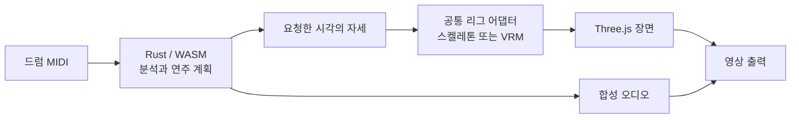

# Drum VRM

[English](README.md) · **한국어**

DAW에서 만든 드럼 MIDI를 브라우저에서 3D 드러머의 연주 영상으로 바꿉니다. Rust/WASM이 연주를 계획하고 Three.js가 드러머와 키트를 렌더링합니다.

**[앱 사용하기](https://postmelee.github.io/drum-vrm/) · [사용 안내](docs/README.ko.md) · [기술 설계](specs/README.ko.md)**

## 기능

- MIDI를 불러오고 트랙·채널을 선택하며, 마디·박자·음표가 표시된 피아노 롤을 확인합니다.
- 합성 드럼 소리와 함께 재생·일시정지·처음으로·시점 탐색을 사용합니다.
- 기본 스켈레톤과 로컬 VRM 1.0 캐릭터에 실측 체형을 사용하는 같은 동작 계산을 적용합니다.
- 좌석 높이·악기 타점·손바닥 방향을 조절하고, 공통 받침대·페달을 유지하면서 드럼 몸체를 교체합니다.
- 자체 도형으로 만든 Studio·Vintage·Electronic 키트와 Innerscene·Batoski·smoj 모델을 선택합니다.
- 흰색/검정 작업 화면, 네 설정 패널, 연주·정면·위·연주자 시점과 선택형 타격 반응을 제공합니다.
- 브라우저의 코덱에 따라 합성 오디오가 포함된 1280 × 720, 30fps MP4 또는 WebM 영상을 내보냅니다.
- 선택한 MIDI와 모델을 자동 업로드하지 않고 브라우저 안에서 처리합니다.

### 어떤 버전을 사용하고 있나요?

| 버전 | 제공 범위 |
| --- | --- |
| [Pages 빌드](https://postmelee.github.io/drum-vrm/) | 사용자가 승인한 main 빌드에 위 기능이 포함됩니다. 배포 커밋은 [성공한 Pages 작업](https://github.com/postmelee/drum-vrm/actions/workflows/pages.yml)에서 확인하세요. Pages 배포는 릴리스 태그 없이도 진행할 수 있습니다. |
| [태그 v0.2.0](https://github.com/postmelee/drum-vrm/releases/tag/v0.2.0) | 과거 릴리스: MIDI 재생·출력, 기본 스켈레톤, 자체 도형/Innerscene 키트와 정적 드럼 GLB 교체. [당시 검증](docs/verification/studio-0.2.md). |

안내 문서는 이 저장소 빌드를 설명합니다. 더 최신 로컬 변경이 공개되었다고 판단하기 전에 배포 커밋을 확인하세요. 상세 개발 검사는 연결된 [검증 기록](docs/README.ko.md#검증)에서 확인할 수 있습니다.

## 사용 방법

1. **업로드 · 연주정보**에서 **30초 데모** 또는 `.mid`/`.midi` 파일을 선택합니다.
2. 트랙·채널과 분석 알림을 확인합니다. 선택을 바꿨다면 **선택한 트랙으로 다시 준비**를 누릅니다.
3. **재생**을 누릅니다. 타임라인으로 이동하고 시점 버튼이나 드래그·스크롤로 카메라를 조절합니다. **연주자** 시점은 회전·이동·확대를 고정하며, 드럼 편집을 닫으면 이전 시점으로 돌아옵니다.
4. 필요하면 [캐릭터를 불러오고](docs/models.ko.md) [좌석·타점·드럼 부품을 맞춥니다](docs/calibration.ko.md).
5. **내보내기**에서 **영상 추출**을 누르고 완료된 파일을 다운로드합니다. **오디오 없이 내보내기**를 선택하지 않으면 합성 드럼 오디오를 포함합니다.

드럼 외형을 바꿔도 소리는 바뀌지 않으며, 원본 DAW의 악기 음색을 재현하지는 않습니다. 출력에는 시작 준비 0.5초와 끝 여운 0.25초가 포함됩니다. 정확히 30초인 곡은 923프레임, 약 30.7667초로 출력됩니다.

## 지원 입력과 제한

| 입력 | 지원 범위 |
| --- | --- |
| MIDI | `.mid` / `.midi`, SMF 0/1·PPQ 시간축. 10 MiB, 선택 트랙 기준 300초, 512트랙, 200,000이벤트, 선택한 지원 타격 50,000개까지. |
| 캐릭터 | 리소스를 포함한 VRM 1.0 단일 `.vrm`, 최대 50 MiB. [본·이미지·형식 제한](docs/models.ko.md#지원-파일). |
| 드럼 외형 | 리소스를 포함한 정적 GLB 2.0 단일 `.glb`, 최대 25 MiB. 스킨 모델 제외. [파일 준비와 맞춤](docs/calibration.ko.md#받침대페달을-유지하며-드럼-몸체-교체하기). |

SMF 2·SMPTE 시간축·손상된 파일은 이유와 함께 거절합니다. 매핑되지 않은 음표는 알림을 남기고 드럼 합성에서 제외합니다. 지원하지만 리그가 연주할 수 없는 타격은 원래 소리·시각·타점 강조를 유지합니다. 도달 문제를 숨기려고 음표를 이동하거나 뼈를 늘리지 않습니다.

동작은 규칙 기반입니다. 조밀한 타격, 먼 타점, 체형과 의상에 따라 자세가 어색하거나 서로 겹칠 수 있습니다. [모델 안내](docs/models.ko.md)는 입력 허용과 실측 호환성을 구분합니다. WAV 동기화, 일반 휴머노이드 GLB 매핑, 정밀 충돌·피부 보정, 명시적인 주법 선택, 표현량 조절, 프로젝트 저장, 고해상도·3D 동작 출력은 후속 범위입니다. 외형·보정 설정은 현재 세션에만 유지됩니다.

## 로컬 개발

Node.js 24 이상, [rust-toolchain.toml](rust-toolchain.toml)의 Rust 1.94.1과 `wasm32-unknown-unknown`, wasm-pack 0.15.0을 사용합니다. 의존성은 `package-lock.json`과 `Cargo.lock`에 고정합니다.

```sh
npm ci
cargo install wasm-pack --version 0.15.0 --locked
npm run build:wasm
npm run dev
```

서버가 출력한 로컬 주소의 `/drum-vrm/`을 엽니다. `src/wasm/`은 생성 파일이며, Rust를 수정하면 `npm run build:wasm`으로 다시 만듭니다.

```sh
cargo fmt --check
cargo clippy --locked --all-targets -- -D warnings
cargo test --locked
npm run typecheck
npm test
npm run licenses
npm run build
npm run preview
```

`npm run licenses`는 설치된 npm 의존성, Cargo 잠금 그래프와 원본 라이선스에서 배포 고지를 생성합니다. 잠긴 Rust 의존성을 먼저 가져오거나 빌드하세요. 프로덕션 결과물은 `dist/`이고 Vite 기본 경로는 `/drum-vrm/`입니다.

## 브라우저와 출력 환경

검증 대상은 WebGL·WASM·Web Audio·WebCodecs를 제공하는 macOS의 데스크톱 Chromium입니다. 출력에는 HTTPS 또는 localhost가 필요합니다. 실제 설정과 짧은 인코딩·디코딩 검사로 MP4(H.264/AAC), WebM(VP9/Opus), WebM(VP8/Opus)를 확인합니다. 오디오 조합이 실패한 결과를 성공한 무음 영상으로 처리하지 않습니다.

코덱 지원은 브라우저와 OS에 따라 달라집니다. PCM과 인코딩 결과를 메모리에 보관하므로 긴 곡일수록 메모리가 더 필요하며, 입력 상한 5분이 성능 보장은 아닙니다. Safari·Firefox·모바일·최대 길이 성능은 별도 검증이 필요합니다. 탐색과 출력의 재현성을 위해 머리카락·의상 동역학은 초기화합니다.

## 동작 구조



[전체 구조](specs/architecture/overview.ko.md), [체형과 키트 보정](specs/architecture/calibration.ko.md), [VRM 호환성](specs/architecture/rig-compatibility.ko.md), [연주 표현 설계](specs/architecture/performance-expression.ko.md), [의존성 선택 근거](specs/architecture/dependencies.ko.md)를 읽어보세요. 범위는 [요구사항](specs/requirements.ko.md)에, 구현 작업은 [이슈](https://github.com/postmelee/drum-vrm/issues)에 기록합니다.

## 연구와 라이선스

연주 표현은 **Keiichi Nagata의 [Yamaha DTX402 Series — Drum Score / Instruction](https://data.yamaha.com/files/download/other_assets/7/1224887/DTX_DrumScore_Instruction_eng.pdf)**(© 2018 Yamaha Corporation), 다른 그립 교육 자료와 애니메이션 연구를 바탕으로 연구합니다. 이를 참고해 프로젝트의 동작 규칙을 독립적으로 설계·검증합니다. 저자·자료 위치·권리 범위는 [연주 원칙과 출처](docs/performance-foundations.ko.md), [연구·재사용 대장](docs/research/references.md)에서 확인하세요. 주법 프로필과 시각적 표현량 0–100 조절은 계획 단계입니다.

프로젝트 자체 코드는 [MIT](LICENSE)입니다. 외부 자료에는 각각의 이용 조건이 유지되며 출처 표기가 공식 보증을 뜻하지 않습니다. [배포 고지](public/licenses.txt)에 버전·출처·라이선스 전문과 Mediabunny MPL-2.0의 해당 소스 링크가 있습니다. [포함된 드럼 에셋](public/models/README.ko.md)은 Innerscene CC0, Batoski/smoj CC BY 3.0의 출처·저자·변형 정보를 보존합니다. 외부 아바타·사운드 샘플·모션 데이터셋·ML 가중치는 포함하지 않습니다. 논문의 라이선스를 데이터나 가중치에 적용되는 것으로 간주하지 않습니다.
