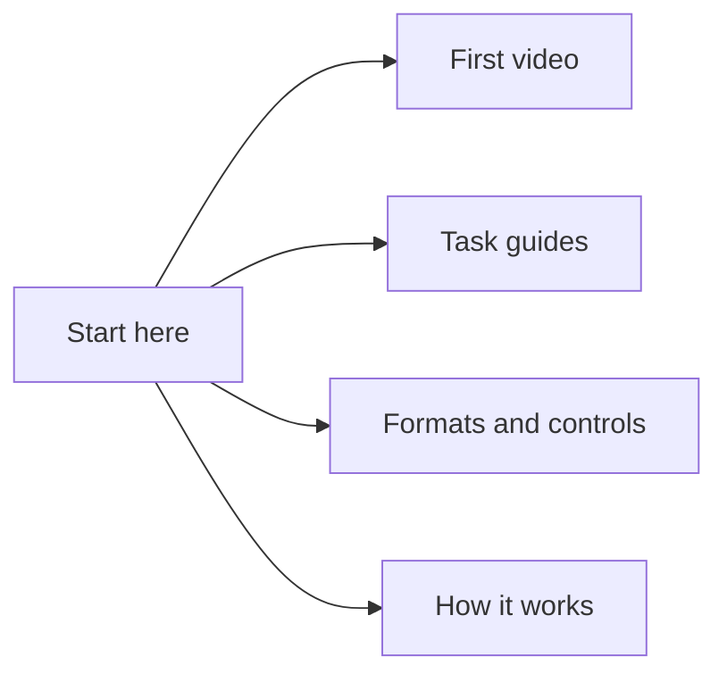

# Drum VRM

**English** · [한국어](README.ko.md)

Turn drum MIDI into a video of a 3D drummer, entirely in your browser. Rust/WASM plans the performance and Three.js renders the rig, drums and camera view.

[Try the public demo](https://postmelee.github.io/drum-vrm/) · [Make your first video](docs/tutorials/first-video.md) · [Feature availability](docs/reference/availability.md)

Upload MIDI, review the preparation results, play or seek, then export video with synthesized drum audio. Your selected MIDI and models are processed locally in the browser. The app does not reproduce the original DAW's sound.

## Find the right guide

- **Learn:** [Create your first video](docs/tutorials/first-video.md).
- **Do:** [Import a character](docs/how-to/import-character.md), [fit the seat and drums](docs/how-to/fit-character.md), [replace drum parts](docs/how-to/replace-drum-parts.md), or [export video](docs/how-to/export-video.md).
- **Look up:** [Supported model files](docs/reference/model-formats.md), [MIDI and output limits](docs/reference/midi-and-export.md), and [drum presets](docs/reference/presets.md).
- **Understand:** [Architecture](docs/explanation/architecture.md) and [performance principles](docs/explanation/performance-principles.md).
- **Explore the technical design:** [Body/kit calibration](specs/architecture/calibration.md), [rig compatibility](specs/architecture/rig-compatibility.md), [performance and expression](specs/architecture/performance-expression.md), and [dependency choices](specs/architecture/dependencies.md).
- **Contribute:** [Run locally](docs/how-to/local-development.md), [design specifications](specs/README.md), and [issues](https://github.com/postmelee/drum-vrm/issues).

[Browse all documentation](docs/README.md)

## Performance research

We study performance expression using **Keiichi Nagata's Yamaha DTX402 Series — Drum Score / Instruction**, alongside grip instruction and animation research. Our motion rules are independently designed and tested. The [source register](docs/reference/sources/README.md) credits authors and separates their instruction, our interpretation and implementation evidence. Citation does not imply endorsement.

## License and credits

Original code is [MIT](LICENSE). Dependencies and external drum models retain their own terms; see [third-party notices](THIRD_PARTY_NOTICES.md) and [asset provenance](public/models/README.md). No external character, sound sample, motion dataset or learned-model weights are bundled. Imported assets remain subject to their creators' conditions.
