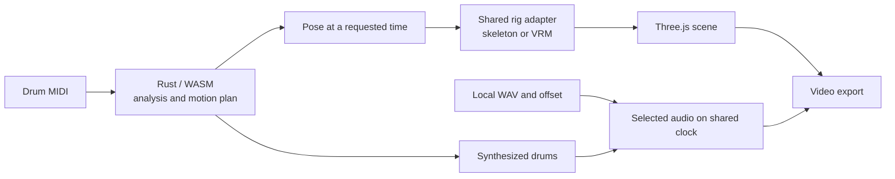

# Drum VRM

**English** · [한국어](README.ko.md)

Turn drum MIDI from a DAW into a video of a 3D drummer, directly in your browser. Rust/WASM plans the performance; Three.js renders the drummer and kit.

**[Try the app](https://postmelee.github.io/drum-vrm/) · [Documentation](docs/README.md) · [Technical design](specs/README.md)**

## Features

- Upload MIDI, select tracks and channels, and review a piano roll with bars, beats and notes.
- Select General MIDI or Logic Drum Kit Designer (GM mode) mapping, retain source events, and inspect count-in, hi-hat control and unassigned-hit diagnostics.
- Play, pause, reset and seek with synthesized drums or a local WAV replacement.
- Use a reference skeleton or a local VRM 1.0 character with the same measured-body motion solver.
- Adjust seat, contact points and palm direction, or explicitly fit the hand-played kit to the measured body. Replace drum bodies while keeping shared stands and pedals.
- Choose Studio, Vintage or Electronic procedural kits, or models by Innerscene, Batoski and smoj.
- Use a white/black workspace, four settings panels, stage/front/top/player views and optional hit feedback.
- Export 1280 × 720 video at 30 fps with the selected audio as MP4 or WebM, depending on browser codecs.
- Inspect individual source notes, omit a mistaken strike or choose its hand without rewriting the MIDI. Review measured contact errors and stick paths.
- Save a local project with interpretation, appearance, calibration, audio offset and view settings; relink original files when reopening.
- Process selected MIDI, WAV and models in the browser without automatically uploading them.

### Which version am I using?

| Version | Availability |
| --- | --- |
| Repository / local build | Includes the MIDI interpretation, phrase planning, body/kit fitting, motion inspection, WAV and local-project features described here. These changes await a separate deployment. |
| [Pages build](https://postmelee.github.io/drum-vrm/) | Deployed baseline [`d8dfab3`](https://github.com/postmelee/drum-vrm/commit/d8dfab38cefc3bffd6edc0b88643d02ff829af73): VRM import, seat/palm/contact calibration and video export with synthesized drums. Check [Pages workflow runs](https://github.com/postmelee/drum-vrm/actions/workflows/pages.yml) for subsequent deployments. |
| [Tagged v0.2.0](https://github.com/postmelee/drum-vrm/releases/tag/v0.2.0) | Historical release: MIDI playback/export, reference skeleton, procedural/Innerscene kits and static drum GLB replacement. [Original verification](docs/verification/studio-0.2.md). |

The guides describe this repository build. Check the deployed commit before assuming a newer local change is public; detailed development checks remain in the linked [verification records](docs/README.md#verification).

## Use the app

1. Open **업로드 · 연주정보** (Upload / Performance) and choose **30초 데모** (30-second demo) or a `.mid`/`.midi` file.
2. Review tracks, channels, mapping profile and diagnostics. Count-in and short open/close hi-hat interpretation are explicit policies, offered when relevant notes exist; the app does not claim to identify the producing DAW. Press **선택한 설정으로 다시 준비** (Prepare selected settings) after changes. **연주 검증 패턴** (Performance check pattern) provides a small authored fixture for visual checks.
3. Press **재생** (Play). Seek on the timeline and use the viewpoint buttons or drag/scroll to adjust the camera. **연주자** (Player) view locks rotation, panning and zoom; closing drum editing restores the previous view.
4. Optionally [load a character](docs/models.md) and [fit the seat, contact points or drum parts](docs/calibration.md).
5. In **업로드 · 연주정보 → 연주 오디오** (Upload / Performance → Performance audio), [load a WAV and adjust its start offset](docs/export.md). Play and seek to review its synchronization.
6. [Save a local project](docs/projects.md) to retain settings and explicit note edits. **내보내기** (Export) remains available for video; the selected audio is included unless **오디오 없이 내보내기** (Export without audio) is selected.

Drum appearance changes do not change the sound, and the app does not reproduce the source DAW's instruments. Export adds 0.5 seconds of preparation and a 0.25-second tail: an exactly 30-second song produces 923 frames, approximately 30.7667 seconds.

## Supported input and limits

| Input | Supported boundary |
| --- | --- |
| MIDI | `.mid` / `.midi`, SMF 0/1 with PPQ timing; 10 MiB; 300 seconds across selected tracks; 512 tracks; 200,000 events; 50,000 selected supported hits. |
| WAV | PCM or float, mono/stereo; up to 100 MiB and 300 seconds. Start offset ±300 seconds. [Formats and trimming](docs/export.md). |
| Character | Self-contained VRM 1.0 `.vrm`, up to 50 MiB. [Bone, image and format limits](docs/models.md#supported-files). |
| Drum appearance | Self-contained static GLB 2.0 `.glb`, up to 25 MiB; embedded resources, no skinned models. [Preparation and fitting](docs/calibration.md#replace-drum-bodies-while-keeping-hardware). |

SMF 2, SMPTE timing and malformed files are rejected with a reason. Unmapped notes are reported and excluded from drum synthesis; supported hits the rig cannot perform retain their original sound, time and target highlight. The planner does not move notes or stretch bones to hide reach problems.

Motion is rule-based. Dense hits, distant targets, body proportions and clothing can still produce awkward poses or intersections. The [model guide](docs/models.md) distinguishes input acceptance from measured compatibility. Generic humanoid GLB mapping, detailed collision/skin calibration, explicit playing styles, expression controls, higher resolutions and 3D motion export remain future work. Save a project to retain appearance and calibration across sessions; source files must be relinked and exact replay requires the same engine build.

## Local development

Use Node.js 24 or newer, Rust 1.94.1 from [rust-toolchain.toml](rust-toolchain.toml) with `wasm32-unknown-unknown`, and wasm-pack 0.15.0. Dependencies are pinned in `package-lock.json` and `Cargo.lock`.

```sh
npm ci
cargo install wasm-pack --version 0.15.0 --locked
npm run build:wasm
npm run dev
```

Open `/drum-vrm/` on the local URL printed by the server. `src/wasm/` is generated; rebuild it after Rust changes with `npm run build:wasm`.

```sh
cargo fmt --check
cargo clippy --locked --all-targets -- -D warnings
cargo test --locked
npm run typecheck
npm test
npm run licenses
npm run build
npm run preview
```

`npm run licenses` generates notices from installed npm dependencies, the Cargo lock graph and original license texts; fetch or build the locked Rust dependencies first. Production output is `dist/`, with Vite base path `/drum-vrm/`.

## Browser and export requirements

The verified target is desktop Chromium on macOS with WebGL, WASM, Web Audio and WebCodecs. Export requires HTTPS or localhost. MP4 (H.264/AAC), WebM (VP9/Opus) and WebM (VP8/Opus) are probed using the actual configuration and a short encode/decode trial. A failed audio combination is not silently accepted as successful silent output.

Codec support depends on browser and OS. PCM and encoded output remain in memory, so longer songs need more memory; the five-minute input limit is not a performance guarantee. Safari, Firefox, mobile and maximum-length performance need separate verification. Hair/clothing dynamics reset to keep seeking and export repeatable.

## How it works



Read the [architecture](specs/architecture/overview.md), [MIDI interpretation contract](specs/architecture/midi-interpretation.md), [body and kit calibration](specs/architecture/calibration.md), [VRM compatibility](specs/architecture/rig-compatibility.md), [performance-expression design](specs/architecture/performance-expression.md), and [dependency rationale](specs/architecture/dependencies.md). [Requirements](specs/requirements.md) describe scope; [issues](https://github.com/postmelee/drum-vrm/issues) track implementation work.

## Research and licenses

Performance research draws on **Keiichi Nagata's [Yamaha DTX402 Series — Drum Score / Instruction](https://data.yamaha.com/files/download/other_assets/7/1224887/DTX_DrumScore_Instruction_eng.pdf)** (© 2018 Yamaha Corporation), other grip instruction and animation research. We design and test our own motion rules from these references. See [performance foundations and source credits](docs/performance-foundations.md) and the [research/reuse register](docs/research/references.md) for authors, source locations and rights boundaries. Technique profiles and a 0–100 visual expression control are planned.

Original project code is [MIT](LICENSE). Third-party materials retain their own terms; citation does not imply endorsement. [Distribution notices](public/licenses.txt) contain versions, sources and license texts, including Mediabunny's MPL-2.0 corresponding-source link. The [bundled drum assets](public/models/README.md) preserve Innerscene's CC0 and Batoski/smoj's CC BY 3.0 provenance, attribution and adaptations. No external avatar, sound samples, motion datasets or ML weights are bundled. Paper licenses are not assumed to cover data or weights.
