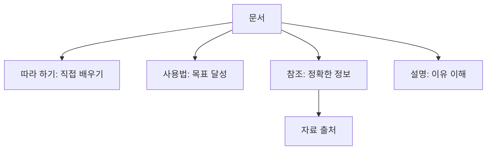

# 문서 안내

[English](README.md) · **한국어**

목적에 맞는 안내를 선택하세요. [기능 제공 범위](reference/availability.ko.md)는 공개 앱과 개발 기능을 구분합니다.

| 하고 싶은 일 | 시작할 문서 |
|---|---|
| 데모로 첫 영상 만들기 | [따라 하기](tutorials/first-video.ko.md) |
| 캐릭터 불러오기·키트 맞추기 | [작업별 사용법](how-to/README.ko.md) |
| 파일 지원·제한·컨트롤 확인 | [참조](reference/README.ko.md) |
| 시간·리그·표현 원리 이해 | [설명](explanation/README.ko.md) |
| 원 연구와 모델 이용 조건 찾기 | [출처](reference/sources/README.ko.md) |
| 로컬에서 프로젝트 실행 | [로컬 개발](how-to/local-development.ko.md) |

기여자는 [설계 명세](../specs/README.md)에서 채택된 요구사항·계약을, [작업 기록](../mydocs/README.md)에서 작업별 계획·검증 근거를 확인할 수 있습니다.

[제품 소개](../README.ko.md)
