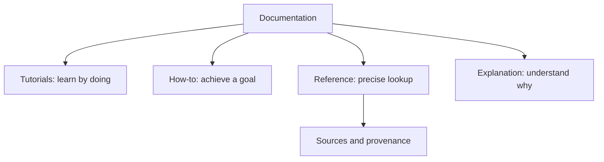

# Documentation

**English** · [한국어](README.ko.md)

Choose the guide for your goal. The [availability reference](reference/availability.md) distinguishes the public app from development features.

| I want to… | Start here |
|---|---|
| Make a first video with the demo | [Tutorial](tutorials/first-video.md) |
| Import a character or fit the kit | [Task guides](how-to/README.md) |
| Check file support, limits or controls | [Reference](reference/README.md) |
| Understand timing, rigging or expression | [Explanations](explanation/README.md) |
| Find original research and model conditions | [Sources](reference/sources/README.md) |
| Run the project locally | [Local development](how-to/local-development.md) |

Contributors can find adopted requirements and contracts in [specifications](../specs/README.md), and task-specific plans and evidence in [work records](../mydocs/README.md).

[Product home](../README.md)
