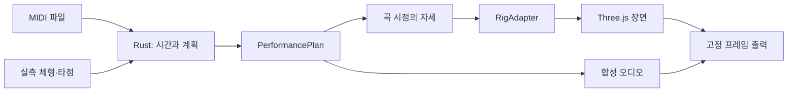

# 연주를 만드는 구조

[English](architecture.md) · **한국어**

Rust는 MIDI 해석과 연주 계획을 담당하고 WASM은 엔진을 브라우저에 연결합니다. Three.js는 리그 어댑터를 통해 체형·키트를 표시하며 엔진이 특정 아바타의 객체 이름을 알 필요가 없게 합니다.

## 하나의 음악 시간축

원본 타격 시각은 고정됩니다. 준비·여운은 음표를 옮기는 대신 출력 구간을 확장합니다. 재생은 오디오 시계를 따르고 고정 프레임 출력은 각 프레임의 정확한 곡 시점을 요청합니다. 뒤로 이동하거나 무작위로 탐색해도 같은 시점에는 같은 주요 자세가 나와야 합니다.

이 계약은 계산된 동작에 관한 것이며 기기 간 영상 파일 바이트나 GPU 픽셀의 완전한 일치를 뜻하지 않습니다. 이전 재생 이력이 자세를 바꾸지 않도록 캐릭터의 부가 스프링 동작을 초기화합니다.

## 체형·타점·외형

체형 프로필은 실측 비율을 설명하고 보정은 좌석과 키트 타점을 배치합니다. 리그 어댑터는 선택한 캐릭터에 의미가 정해진 관절·손 내부 도구를 적용합니다. 이렇게 음악 계획과 모델별 표시를 분리합니다.

드럼 몸체 외형은 접촉 타점과 분리되며 공통 하드웨어 흐름에서는 받침대와도 분리됩니다. 드럼 외형을 키운다고 도달 문제가 자동 해결되지는 않습니다. 좌석·타점 보정은 배치를 명시적으로 바꾸며 체형 비율에 따라 둘 다 조절해야 할 수 있습니다.

배정할 수 없는 타격은 원래 시각·소리와 함께 진단으로 남깁니다. 보기 좋게 만들기 위해 타격을 몰래 늦추지 않습니다.

정확한 계약은 [구조 명세](../../specs/architecture/README.md)의 [엔진](../../specs/architecture/engine-contract.md), [리그](../../specs/architecture/rig-contract.md), [오디오·출력](../../specs/architecture/audio-export-contract.md)에 있습니다. 공개된 구현 범위는 [기능 제공 범위](../reference/availability.ko.md)에서 구분합니다.

상세 [구조 개요](../../specs/architecture/overview.md), [의존성 선택 근거](../../specs/architecture/dependencies.md), [리그 호환성](../../specs/architecture/rig-compatibility.md)을 살펴보세요.

[원리 설명](README.ko.md)
