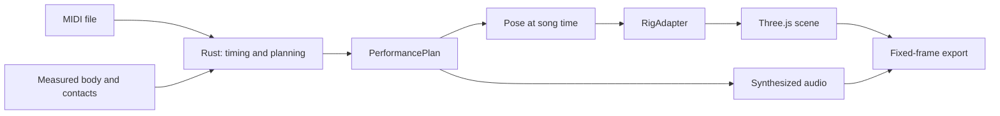

# How the performance is built

**English** · [한국어](architecture.ko.md)

Rust owns MIDI interpretation and motion planning. WASM connects the engine to the browser. Three.js displays a body and kit through a rig adapter, without asking the engine to know a particular avatar's object names.

## One musical clock

Original hit times remain fixed. Preparation and tail extend the output interval rather than moving the notes. Playback follows the audio clock; fixed-frame export asks for each frame's exact song time. The same requested time should produce the same major pose even after backward or random seeking.

That contract concerns evaluated motion, not byte-identical video encoding or identical GPU pixels across devices. Character secondary spring motion is reset so previous playback history does not alter the pose.

## Body, contacts and appearance

The body profile describes measured proportions; calibration places the seat and kit contacts. The rig adapter applies semantic joints and hand-local tools to the selected character. This separates musical planning from model-specific rendering.

A drum body's appearance is separate from its contact target and, in the shared-hardware workflow, its supports. Scaling a visible drum does not automatically solve reach. Seat and contact calibration adjust placement explicitly; arbitrary proportions may need both.

A hit that cannot be assigned remains a diagnostic with its original timing and sound. Better-looking motion is not obtained by silently delaying it.

Exact contracts are in [architecture specifications](../../specs/architecture/README.md): [engine](../../specs/architecture/engine-contract.md), [rig](../../specs/architecture/rig-contract.md), and [audio/export](../../specs/architecture/audio-export-contract.md). [Availability](../reference/availability.md) identifies which implementation is publicly accessible.

Explore the detailed [architecture overview](../../specs/architecture/overview.md), [dependency rationale](../../specs/architecture/dependencies.md) and [rig compatibility](../../specs/architecture/rig-compatibility.md).

[Explanations](README.md)
