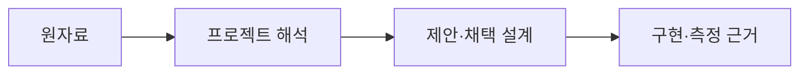

# 자료 출처

[English](README.md) · **한국어**

교육 자료·논문·코드·데이터셋·모델 에셋을 구분합니다. 어느 하나의 라이선스가 다른 배포물까지 자동으로 적용되지는 않습니다. 자료는 독립적으로 설계한 동작 규칙의 근거이며 논문 링크가 코드·가중치·데이터 편입을 뜻하지는 않습니다.

| 주제 | 기록 |
|---|---|
| 자세·그립·페달 교육 | [교육 자료 I01–I03](performance-instruction.ko.md) |
| 드러머 동작·도구·데이터 | [연구 R01–R07](research.ko.md) |
| VRM 확보·샘플 조건 | [캐릭터 모델 출처](models.ko.md) |
| 포함된 드럼 모델 | [프리셋](../presets.ko.md)과 [에셋 출처](../../../public/models/README.ko.md) |
| 설치된 코드 의존성 | [의존성 참조](../dependencies/README.ko.md)와 [배포 고지](../../../THIRD_PARTY_NOTICES.md) |

출처 ID는 유지합니다. 원 조사 기록은 검사한 버전·근거의 한계·당시 결정을 보존합니다. 아래 공개 요약은 부분적인 권리 확인을 확정된 이용 허락으로 바꾸지 않습니다.

[연주 원칙](../../explanation/performance-principles.ko.md) · [설계 명세](../../../specs/README.md) · [참조](../README.ko.md)
