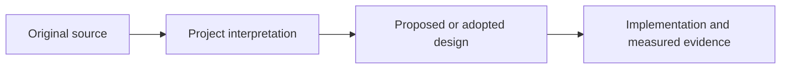

# Sources and provenance

**English** · [한국어](README.ko.md)

These records distinguish instructional material, research papers, code, datasets and model assets. A license for one does not automatically cover the others. Sources inform independently designed motion rules; linking a paper does not mean its code, weights or data are integrated.

| Topic | Record |
|---|---|
| Posture, grip and pedal instruction | [Instruction I01–I03](performance-instruction.md) |
| Drummer motion, tools and data | [Research R01–R07](research.md) |
| VRM acquisition and sample conditions | [Character model sources](models.md) |
| Included drum models | [Preset index](../presets.md) and [asset provenance](../../../public/models/README.md) |
| Installed code dependencies | [Dependency reference](../dependencies/README.md) and [distribution notices](../../../THIRD_PARTY_NOTICES.md) |

Source IDs remain stable. The original research records retain the exact inspected versions, evidence limits and historical decisions. The public summaries below do not silently upgrade a partial rights check into confirmed permission.

[Performance principles](../../explanation/performance-principles.md) · [Design specifications](../../../specs/README.md) · [Reference](../README.md)
