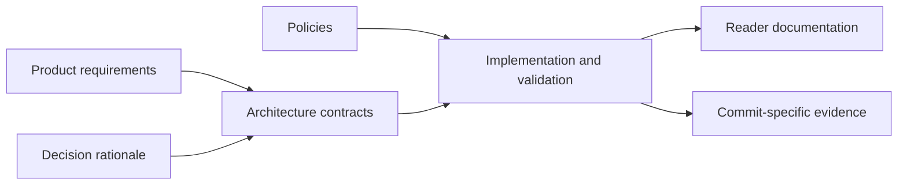

# Adopted specifications

This is the canonical home for adopted product requirements, architecture contracts,
decision records and repository policies. These documents describe the checked-out
source and accepted constraints; they do not announce a public deployment.

| Need | Start here |
| --- | --- |
| Product purpose and invariants | [Product requirements](product/README.md) |
| Component boundaries | [Architecture overview](architecture/overview.md) |
| MIDI, planning and pose interface | [Engine contract](architecture/engine-contract.md) |
| Humanoid, calibration and drum hardware | [Rig contract](architecture/rig-contract.md) |
| Audio time and video output | [Audio/export contract](architecture/audio-export-contract.md) |
| Why a choice was made | [Decision index](decisions/README.md) |
| Documentation, validation, release and reuse rules | [Policies](policies/README.md) |

## Explore the technical design

Repository readers can start with the architectural boundary and continue into the
technical reasoning without following a task tutorial:

- [Body, tool and kit calibration](architecture/calibration.md): measured proportions,
  attachment transforms, atomic updates and shared hardware.
- [Performance expression](architecture/performance-expression.md): source-grounded
  technique rules, the proposed expression budget and immutable musical intent.
- [Dependency/runtime design](architecture/dependencies.md): chosen responsibilities,
  browser constraints, alternatives and adoption gates.
- [Humanoid compatibility](architecture/rig-compatibility.md): normalized/raw bones,
  actual tools, staged evidence and the limits of format compatibility.

These chapters retain substantive design explanation. Their proposed extensions are
explicit; historical experiments and exact source details remain linked evidence.

[Reader documentation](../docs/README.md) explains how to use the product.
[Work records](../mydocs/README.md) contain plans, drafts, research and evidence.
An adopted decision can include future design without establishing that the runtime
implements it. Follow the decision's stated scope and the applicable contract.

Issue and PR state remains on GitHub. Evidence is identified by its measured code,
fixture and environment; it is not copied into these specifications as a running log.
