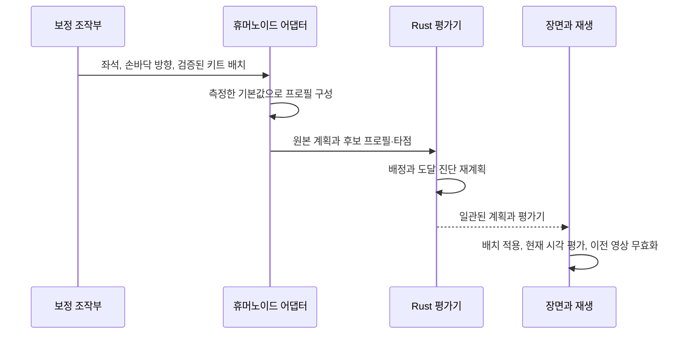

# 체형·도구·키트 보정

[English](calibration.md) · **한국어**

이 문서는 채택한 보정 설계와 한계를 설명합니다. 정확한 입력 범위와 좌표 규약은
[리그 계약](rig-contract.ko.md), 조작 방법은 [사용 안내](../../docs/calibration.ko.md)에 있습니다.
[MIDI 해석 계약](midi-interpretation.ko.md)은 체형별 도달성을 평가하기 전에 어떤
음악적 이벤트가 어떤 실물 부품을 가리키는지 정의합니다.

## 함께 맞아야 하는 요소

표준 휴머노이드는 의미 기반 관절을 제공하지만 드럼 연주 배치를 제공하지는 않습니다.
짧은 팔, 긴 종아리, 두꺼운 신발, 서로 다른 손의 휴지 기준은 각각 접촉 문제의 다른
부분에 영향을 줍니다. 보이는 아바타나 드럼 메시를 균일하게 확대·축소하는 것만으로
모든 문제를 해결할 수는 없습니다.

| 값 | 책임 | 영향 |
| --- | --- | --- |
| 휴지 관절과 분절 길이 | 휴머노이드 어댑터 | 실제로 닿을 수 있는 신체 범위 정의 |
| 앉은 루트 위치 | 신체 보정 | 골반·어깨·기준 손 위치를 함께 이동 |
| 그립 좌표계와 도구 치수 | 도구 보정 | 손과 부착된 스틱·측정된 끝점의 관계 정의 |
| 발바닥·접촉 오프셋 | 발 보정 | 발목 노드와 접촉 소켓의 관계 정의 |
| 키트 접촉 배치 | 연주 계획 | 음악적 동작이 도달해야 할 위치 정의 |
| 외형 크기·재질 | 장면 외형 | 음악적 타점을 옮기지 않고 보이는 본체 변경 |

솔버에는 아바타 이름을 고르는 분기가 없습니다. 모델 어댑터가 측정값과 의미 기반
기능 정보를 제공하고, 같은 수치 처리 경로가 기본 뼈대와 허용된 모든 VRM을 처리합니다.

## 휴지 자세에서 앉은 프로필까지

어댑터는 정규화된 휴지 관절의 월드 위치에서 위·아래 분절을 측정하고 기본 프로필을
저장합니다. 좌석 조절은 직전 결과를 반복 이동하는 대신 이 기본값에서 기준 신체를
옮깁니다. 따라서 조절을 반복해도 부동소수점 이동이 누적되지 않습니다.

자동 맞춤은 양쪽 페달 타점과 측정된 다리 도달 범위로 시작 높이를 추정합니다.
현재 휴리스틱은 전체 다리 길이 중 일부를 여유로 남기고 공통 전방 기준을 사용합니다.
어깨의 편안함, 손목 제한, 피부 간격이나 모든 드럼 타점을 최적화하지는 않습니다.
구현은 [`getAutomaticCalibration`](../../src/rig-humanoid.ts)에 있습니다.

두 발이 페달에 닿더라도 팔·다리 비율이 다르면 타점 배치를 바꿔야 할 수 있습니다.
명시적인 **키트를 체형에 맞춤** 기능은 [fit.rs](../../crates/drum-engine/src/fit.rs)를
통해 손으로 치는 표면에 공통 변환을 탐색합니다.

- 미터 기준 `[0, 1.235, 0.06]` 주위의 위치와 접촉 반지름을 100%부터 60%까지
  2% 간격으로 함께 줄입니다. 킥과 양쪽 페달 접촉은 유지합니다.
- 공통 높이 이동은 ±0.5m 안에서, 앞뒤 이동은 −0.25–+0.10m에서 탐색합니다.
  닫힌·열린 하이햇의 접촉은 함께 이동합니다.
- 완전한 후보 중 가장 큰 키트, 그중 가장 작은 이동을 우선합니다. 완전한 후보가
  없으면 최선의 후보와 아직 닿지 않는 실물 부품 ID를 반환합니다.

`complete`는 지정한 손이 정적 타점에 닿는다는 뜻이며 스네어는 양손을 검사합니다.
이동 시간, 관절의 편안함이나 피부·악기 간격을 보장하지 않습니다. UI는 캐릭터를
불러올 때 암묵적으로 바꾸지 않고 이 기능을 직접 실행할 때 제안을 적용한 뒤 재계획합니다.
완전히 맞춘 배치는 다시 실행해도 바뀌지 않습니다. 자동 충돌 회피 배치와 조건을
통제한 짧은·긴 체형의 VRoid 비교는 별도의 미완료 작업입니다.

## 접촉은 변환의 연결이다

스틱은 실제 원본 손 본에 부착됩니다. 월드 끝점은 개념적으로 손, 그립·소켓, 도구의
변환을 거쳐 계산됩니다.

`worldTip = worldHand × handToGrip × gripToTool × localTip`

솔버는 타점 위치와 의미 있는 도구 방향을 함께 만족해야 합니다. 일정한 월드 스틱
벡터를 빼는 방식은 그립 방향을 손과 분리합니다. 골격을 계산한 뒤 끝점 위치만
그럴듯하게 덮어쓰면 부착 오류를 숨기게 됩니다. 따라서 접촉 검사에서는 실제 렌더링된
끝점을 독립된 관측값으로 사용합니다.

손 마운트는 측정한 손바닥을 대각선으로 가로지릅니다. 손가락 본이 있으면 주위를
감싸도록 굽히고, 없으면 덜 상세한 대체 경로를 사용합니다. 어댑터는 `handFrames`에
측정한 전완·손바닥 축과 원하는 손바닥 방향을 제공합니다. Rust 솔버는 전완과 부착
도구를 합친 연결로 팔꿈치를 각 타점에 맞춘 뒤, 뼈 길이를 유지하며 실제 손목과 도구
방향을 복원합니다. 전완 롤은 기하학적으로 가능한 범위에서 원하는 손바닥 방향을 따릅니다.

고정된 월드 손 방향 대신 타점에 따라 변하는 중립 손목을 사용하고, 보정한 관계에
스트로크 피치를 적용합니다. 관절별 해부학적 제한, 피부 충돌이나 모든 그립을 구현한
것은 아닙니다. 접촉 오차와 손 전방·전완 사이 굽힘은 별개 관측값입니다. 자연스러운
그립을 주장하기 전에 둘과 렌더링된 손가락·메시를 함께 확인해야 합니다.

## 보정 갱신의 일관성

갱신이 성공하면 `pieceId`를 통해 키트 타점과 모든 대응 `hit.target` 필드를 일관되게
바꾸고 체형에 종속된 평가기를 적용합니다. 같은 악기 역할의 크래시 두 개도 독립된
접촉 항목을 유지하므로 하나를 옮겨도 다른 하나는 움직이지 않습니다.
원본 이벤트 ID, tick, 노트, velocity와 시각은 보존합니다.
오디오를 새로 편곡할 필요는 없습니다. 실패하면 이전 보정·배치로 복원하여 신체와
계획 일부만 바뀐 상태를 남기지 않습니다. 보정을 바꾸는 동안 앱은 재생을 멈추고,
충돌하는 준비·가져오기·출력 작업이 끼어들지 않도록 합니다.

닫힌·열린 하이햇은 한 표면을 쓰는 두 의미 음색이므로 타점 이동이 연결됩니다.
하이햇 페달은 별도의 발 접촉입니다. 이 모델에서 킥의 타점은 보이는 베이스 드럼의
앞면이 아닌 페달 접촉점입니다.

## 발과 지지

프로필 평가기는 페달 이벤트가 없는 MIDI에서도 휴지 상태의 두 발을 페달 타점에
놓습니다. 현재 스트로크는 엉덩관절·무릎·발목 연결을 고정하고 작은 준비·누름 곡선을
따라 발을 회전합니다. 닿을 수 없는 휴지 페달은 뼈를 늘리는 대신 명시적으로 진단합니다.

선택적 짧은 열림/닫힘 해석은 짝지은 닫힘을 독립 발 타격으로 추가하는 대신 시간 기반
왼발 피치를 구동합니다. 원본과 제어의 의미는 [MIDI 해석](midi-interpretation.ko.md)에
있으며, 심벌 틈 지오메트리나 측정된 페달 압력은 구현하지 않았습니다.

발목 고정이 뒤꿈치가 지지되고 있다는 증거는 아닙니다. 발바닥 소켓도 정확한 신발
메시 표면은 아닙니다. 완전한 heel-down/up 동작에는 지지 영역과 경우에 따라 발목·무릎
이동이 필요합니다. [연주 표현](performance-expression.ko.md)이 이를 설명합니다.
확장하더라도 기존 이벤트 시각과 반복 가능성 제약을 지켜야 합니다.

## 안정적인 마운트와 교체 가능한 드럼 본체

키트는 보정된 접촉점·마운트와 교체 가능한 쉘·헤드·심벌을 분리합니다.
프리셋과 본체 전용 로컬 GLB 교체는 공통 받침대·페달을 유지하며, 의도적인 배치
변경에서는 대응 하드웨어를 옮길 수 있습니다. 원본별 메시 추출은 외형 어댑터의
책임이며 아바타 솔버를 변경하지 않습니다.

부품 외형 크기 조절은 여전히 장식적 기능으로 타점을 옮기지 않습니다. 명시적인
키트 맞춤은 물리적 위치·반지름을 바꾸며 본체 맞춤과 대응 하드웨어에 반영됩니다.
두 기능 모두 아바타나 뼈를 확대·축소하지 않습니다.

## 과거 근거와 남은 설계

[보정 검증](../../docs/verification/calibration-unreleased.md)과
[손바닥 방향 후속 검증](../../docs/verification/palm-orientation-unreleased.md)에서
당시 실행한 범위와 관측된 손목·피부 한계를 확인할 수 있습니다.
[체형 맞춤·준비 자세 제안](../../docs/research/snare-ready-and-kit-fit.md)은 설계 근거를
보존하며 구현 범위는 이 계약이 정의합니다. 당시의 상세 내용은
[ADR 0005](../../docs/decisions/0005-calibration-pedals-hardware.md)에
남아 있으며, 원래의 범위나 검사 결과를 현재의 보편적 보장으로 다시 쓰지 않습니다.
