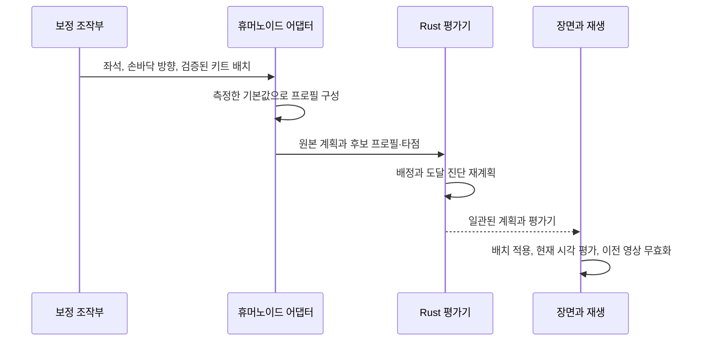

# 체형·도구·키트 보정

[English](calibration.md) · **한국어**

이 문서는 채택한 보정 설계와 한계를 설명합니다. 정확한 입력 범위와 좌표 규약은
[리그 계약](rig-contract.ko.md), 조작 방법은 [사용 안내](../../docs/calibration.ko.md)에 있습니다.
[MIDI 해석 계약](midi-interpretation.ko.md)은 체형별 도달성을 평가하기 전에 어떤
음악적 이벤트가 어떤 실물 부품을 가리키는지 정의합니다.

## 함께 맞아야 하는 요소

표준 휴머노이드는 의미 기반 관절을 제공하지만 드럼 연주 배치를 제공하지는 않습니다.
짧은 팔, 긴 종아리, 두꺼운 신발, 서로 다른 손의 휴지 기준은 각각 접촉 문제의 다른
부분에 영향을 줍니다. 보이는 아바타나 드럼 메시를 균일하게 확대·축소하는 것만으로
모든 문제를 해결할 수는 없습니다.

| 값 | 책임 | 영향 |
| --- | --- | --- |
| 휴지 관절과 분절 길이 | 휴머노이드 어댑터 | 실제로 닿을 수 있는 신체 범위 정의 |
| 앉은 루트 위치 | 신체 보정 | 골반·어깨·기준 손 위치를 함께 이동 |
| 그립 좌표계와 도구 치수 | 도구 보정 | 손과 부착된 스틱·측정된 끝점의 관계 정의 |
| 발바닥·접촉 오프셋 | 발 보정 | 발목 노드와 접촉 소켓의 관계 정의 |
| 키트 접촉 배치 | 연주 계획 | 음악적 동작이 도달해야 할 위치 정의 |
| 외형 형상·재질 | 장면 외형 | 형상 변경은 재측정·재계획, 색상만 변경하면 장식적 효과 |

솔버에는 아바타 이름을 고르는 분기가 없습니다. 모델 어댑터가 측정값과 의미 기반
기능 정보를 제공하고, 같은 수치 처리 경로가 기본 뼈대와 허용된 모든 VRM을 처리합니다.

## 휴지 자세에서 앉은 프로필까지

어댑터는 정규화된 휴지 관절의 월드 위치에서 위·아래 분절을 측정하고 기본 프로필을
저장합니다. 좌석 조절은 직전 결과를 반복 이동하는 대신 이 기본값에서 기준 신체를
옮깁니다. 따라서 조절을 반복해도 부동소수점 이동이 누적되지 않습니다.

자동 맞춤은 양쪽 페달 타점과 측정된 다리 도달 범위로 시작 높이를 추정합니다.
현재 휴리스틱은 전체 다리 길이 중 일부를 여유로 남기고 공통 전방 기준을 사용합니다.
왼쪽 무릎의 굽힘 기준은 확정된 하이햇 페달의 수평 뒤꿈치→발끝 방향을 따릅니다.
킥 쪽 다리 기준은 유지합니다. 후보 측정이 끝나면 좌석과 이전 페달 좌표계를 함께 복원합니다.
어깨의 편안함, 손목 제한, 피부 간격이나 모든 드럼 타점을 최적화하지는 않습니다.
구현은 [`getAutomaticCalibration`](../../src/rig-humanoid.ts)에 있습니다.

## 기준 배치와 설정의 소유권

자동 맞춤은 하나의 일반적인 오른손잡이 5기통 배치를 사용합니다. 스네어는
다리 사이, 두 랙 탐은 앞쪽의 얕은 한 열, 플로어 탐은 오른쪽 옆, 하이햇과
연결된 페달은 왼쪽, 심벌은 접근 가능한 바깥 영역에 둡니다. 이는 제품의
기준 구성이지 모든 드러머에게 적용되는 절대 규칙이 아닙니다. 측정된 타면의
상대 배치는 도달 및 하드웨어 간격과 별도로 검사합니다. 모든 음표를 배정해도
이 배치 관계를 유지했다는 뜻은 아닙니다.

기준 배치는 고정된 위·정면·왼쪽·오른쪽·연주자 시점에서 검토합니다. 높은
심벌은 몸체·하드웨어·스틱 전체의 3차원 접근 검사를 통과하면 위에서 드럼과
겹쳐 보일 수 있습니다. 개별 타점에 닿는다는 이유로 두 랙 탐을 앞뒤 두 열로
바꾸어서는 안 됩니다.

캐릭터나 물리적 악기를 교체하면 새로운 제한된 맞춤을 계산할 수 있습니다.
적용한 뒤에는 해당 캐릭터의 측정된 키트와 좌석이 세션 설정이 됩니다.
MIDI·데모 선택, 음표 편집, 일반적인 준비, 재생, 탐색은 같은 설정을 사용하며
다시 맞추지 않습니다. 원본 준비 트랜잭션은 비동기 작업 전에 키트와 프로필을
복사하고, 다른 설정에 계산 결과를 적용하지 않습니다. 프로젝트를 정확히
복원할 때는 저장된 배치를 유지합니다.

수동 조정은 명시적인 작업으로 남습니다. 제한된 탐색에 실패하면 앞서 사용하던
설정을 유지하고 도달·배치·간격의 원인을 구분해 알립니다. 기준 배치만으로
편안한 자세, 피부·의상 간격 또는 빠른 필인의 전체 경로를 보증하지 않으며,
이는 별도 검사로 남습니다.

## 범위를 제한한 키트 맞춤

이 후보의 그룹 배치·하체 검사 구현은 통합 중이며, 전체 기본 리그·공개 모델
회귀 검증을 아직 통과하지 못했습니다. [검증 기록](../../docs/verification/reference-layout.md)은
선택한 기준 배치와 미완료 자동 맞춤 검증을 구분합니다.

두 발이 페달에 닿더라도 팔·다리 비율이 다르면 타점 배치를 바꿔야 할 수 있습니다.
[fit.rs](../../crates/drum-engine/src/fit.rs)는 측정한 신체에서 스네어 자세를 첫 기준으로
배치를 제안합니다. 손으로 치는 표면을 두 단계로 맞춥니다.

1. 현재 배치의 개별 보정을 먼저 시도한 뒤 셸/배치 비율
   `1.00, 0.92, 0.84, 0.76`을 검사합니다. 위치는 미터 기준
   `[0, 1.235, 0.06]`을 중심으로, 스네어·탐의 접촉 반지름과 측정한 셸 전체 치수도 같은
   비율로 조정합니다. 하이햇·크래시·라이드 지름은 원래 크기를 유지하고 위치만
   배치 보정에 참여합니다. 각 크기에서는 스네어 기준 높이 이동을 ±0.5m로 제한하고
   기준 전방 이동을 −0.25–+0.10m로 제한한 후보, 같은 높이에서 전방 이동 0인
   후보를 검사합니다. 좌우 이동은 0입니다. 처음 성공한 거친 크기와 직전 크기
   사이에서 최대 세 번 2% 간격으로 더 큰 실행 가능 결과를 찾습니다.
2. 스네어와 하이햇을 먼저 배치한 뒤 플로어 탐 우선·랙 탐 우선의 두 순서를
   시도하고 심벌로 이어갑니다. 각 부품은 도달·자세·스틱 전체 접근 조건을 만족하며
   이미 배치한 본체 경계와 겹치지 않아야 합니다. 상대 이동은
   `Δx, Δz ∈ [−0.30, +0.30]m`, `Δy ∈ [−0.25, +0.25]m`이며 0.05m 간격으로
   검사합니다. 범위 안의 정확한 스네어 기준점 이동도 검사합니다. 개별 보정은
   스네어 기준점 주변에는 평균 위팔 길이의 0.1배를 15–30mm로 제한한 추가
   격자를 사용합니다(좌우·상하 ±5칸, 앞뒤 ±6칸). 같은 이동 제한을 지키며
   개별 보정은 반지름을 바꾸지 않습니다.

킥과 킥 페달은 고정합니다. 일반 하이햇은 페달·기둥·심벌이 연결된 하나의 장치로
취급합니다. 초기 후보는 스네어 왼쪽으로 두 반지름 합과 35mm만큼, 연주자 반대쪽으로
50mm만큼 기둥을 배치합니다. 페달 접촉점은 앉은 왼쪽 다리 시작 관절에서 기둥으로
향하는 `pedalForward` 축을 따라 기둥 뒤 120mm에 둡니다. 입력 페달에서 좌우·앞뒤
각각 최대 250mm만 이동합니다. 선호 위치와 원래 축 위치의 조합을 발판 피치
`0, −0.09, −0.18`rad에서 검사하며, 실제 발바닥 오프셋·다리 길이와 무릎 내부 각도
55–155°를 사용합니다. 후보가 실패하면 원래 페달을 유지합니다. 이는 공학적 탐색
선호 조건이며 보편적인 자세 규칙이 아닙니다. 닫힌·열린 하이햇은 같은 물리적 위치를
공유하고 이후 높이만 조정합니다. 스네어 후보를 확정하기 전에 실행 가능한 하이햇
높이와 양쪽 스틱 전체 접근을 포함한 스네어·하이햇 조합을 검사합니다. 스네어만
배치하기 편하다는 이유로 하이햇 기둥의 접근 공간을 막지 않도록 합니다.

두 랙 탐은 하나의 그룹으로 배치합니다. 좌우로 얕은 한 줄을 유지하며 높이·앞뒤
위치와 간격을 제한합니다. 개별 도달만을 위해 앞뒤 두 줄로 분리하지 않습니다.
플로어 탐은 오른쪽 측면에 유지하며 측정한 셸과 받침대가 앉은 허벅지·정강이·
신발을 침범하지 않아야 합니다. 매달림 프리셋은 지지하는 스탠드를 먼저 배치한 뒤
플로어 탐을 연결합니다. 채택된 `standRotation`을 포함한 물리 장착 정보는 결과
키트에 유지합니다.

하체 검사는 발판 피치 `0, −0.09, −0.18`rad에서 실제 본 길이, 회전한 페달 접촉과
[측정한 수치 외형](rig-contract.ko.md#수치형-신체-형상)을 사용합니다.
본체·스탠드·양쪽 발판을 검사하며, 해당 발과 자기 발판의 의도된 접촉만 제외합니다.
정강이·다른 페달·무관한 스탠드에는 이 예외를 적용하지 않습니다. 유한한 골격
정강이는 발목에서 끝나며 둥근 끝부분을 그 아래까지 연장하지 않습니다.
배치 표본 검사이며 연속적인 스킨 충돌 시뮬레이션이 아닙니다.

모든 분기는 배치 후보 최대 80,000개의 예산을 공유합니다. 정확한 손·양손 조합
메모이제이션은 각각 최대 100,000개를 보관합니다. 직접 연결된 하이햇 높이 후보는
분기마다 한 번 필터링하여 불가능한 하이햇 자세를 모든 스네어 후보마다 반복하지 않습니다. 한 부품의 후보를 모두 검사하면
해당 개별 분기를 종료합니다. `searchCandidates`와 `searchLimitReached`는 검사량과
예산 소진을 나타냅니다. 실패는 제한된 탐색에서 완전한 결과를 찾지 못했다는 뜻이며,
물리적으로 불가능하거나 모든 더 큰 크기가 실패한다는 증명이 아닙니다.
선택한 결과가 전역 최적해라는 보장도 없습니다.

개별 보정에서는 스네어는 측정 기준점에, 다른 부품은 후보 위치에 가까운 쪽을
선호하고 이동량에도 더 작은 비용을 부여합니다. 스네어 기준점은 어깨 평균 위치,
위팔·전완 길이와 도구 길이로 정합니다. 배치의 선호 조건이며 정해진 해부학적
자세가 아닙니다.

`handFrames`가 있는 프로필의 `complete`는 지정한 손이 접촉과 두 준비 표본에서
도달·골격 자세 검사를 통과해야 합니다. 표본은 `(수직 상승 m, 도구 피치 rad)` 기준
`(0, 0)`, `(0.055, −0.20)`, `(0.11, −0.42)`입니다. 공통 손목 피치 보정은
`0, ±0.15, ±0.30, ±0.45, ±0.60`rad이며 팔꿈치 후보는 다섯 개입니다.
배치 보정은 몸통 yaw 0에서 세 표본이 통과해야 합니다. 실행 시 선택적인 몸통
회전은 실제 피치가 적용된 접촉을 유지해야 하며, 도달할 수 없는 배치를 회전으로
구제하지 않습니다. 스네어 중앙·림 측, 하이햇 보우·가장자리, 라이드 벨·안쪽·바깥쪽·
가장자리와 크래시 가장자리 접촉은 하나의 표준 주법 목록을 사용합니다.
라이드 바깥쪽이 닿는다고 벨의 도달 실패를 숨길 수 없습니다. 이 정적 검사는
타점 사이의 실행 가능한 전환을 입증하지 않습니다. 각 표본은 도달 가능해야 하며
다음 제한을 만족해야 합니다.

- 위팔 상승각은 수평이 아닌 수직 아래 방향을 0°로 측정합니다.
  `a = clamp((타점Y − 어깨Y) / 위팔길이 + 0.6, 0, 1)`일 때 최대
  `70° + 45° × a`입니다. 높은 악센트는 어깨 높이 경계에서 갑자기 바뀌지 않고
  연속적으로 추가 범위를 허용합니다.
- 팔꿈치 내부 각도는 55–165°입니다.
- 팔꿈치 전방 위치는 어깨 Z − 위팔 길이의 0.35배 이상입니다.
- 손목 전방 위치는 어깨 Z + 전완 길이의 0.15배 이상입니다.
- 팔·도구와 몸통 대리 형상의 간격은 0.002m 이상입니다. 중립 팔꿈치만 검사하지 않고 공통의 제한된 팔꿈치 후보를 탐색합니다.

공통의 소프트 목적 함수는 위팔 상승각 `35° + 55° × a` 이하, 팔꿈치 내부 각도
80–140°, 전완의 아래 방향 기울기 20° 이하를 선호합니다. 라디안 초과량 제곱에
위팔 0.22, 팔꿈치 접힘 0.12·펴짐 0.06, 전완 기울기 0.06의 가중치를 적용하고
손 하나당 0.39로 제한합니다. 조절 가능한 애니메이션 선호값입니다. Yamaha의
힘을 뺀 팔 자세 예시는 목적 함수의 근거이며 이 수치 제한 자체의 출처는 아닙니다.
준비 자세는 같은 아홉 손목 피치 보정과 다섯 팔꿈치 후보를 사용하며, 간격 검사를
통과한 후보 중 목적 함수에 `0.015 × 손목보정²`을 더한 값이 가장 작은 조합을
선택합니다. 양손을 각각 필터링·정렬한 뒤 조합을 검사하여 전체 곱집합 할당이나
아바타별 예외를 만들지 않습니다.
배치·장비 경로·몸통 계획·시간축 팔꿈치 계획이 같은 측정값을 사용합니다. 실행 시
자세 제한을 만족하지 못한 경우 `POSTURE_LIMIT`로 남기며, 편안함 점수를 높이려고
노트를 버리는 대신 원래 접촉 시각을 보존합니다.

스네어 높이는 추가로 양쪽 어깨 각각에서 위팔 길이의 0.4–1.6배 아래여야 합니다.
양손 스네어 준비 자세와 왼손 스네어·오른손 하이햇 그루브 자세도 만족해야 합니다.
검사 스틱 끝은 헤드 위 35mm에 두고, 같은 헤드의 양손 끝점은 반지름에 비례한
제한된 간격으로 좌우 분리합니다. 난수 타점이 아닌 고정 보정 검사 자세입니다.
MIDI가 없을 때 `ready_pose`는 이 검사에 합격한 같은 양손 스네어 해를 사용합니다.
스네어는 각각의 손을, 하이햇·라이드는 오른손을 검사합니다. 탐·크래시 각각은
안전한 손이 하나 이상 있어야 하며 모든 악기를 반대편 손까지 무조건 닿게 하지
않습니다. 서로 다른 크래시 두 개가 있다면 하나의 좌우 배정으로 실제 동시 타격
접촉과 들어 올린 준비 자세가 모두 성립해야 합니다. 두 자세 사이의 경로까지
보증하는 것은 아닙니다. 조합 검사는 접촉 계획과 같은 주법 영역(크래시 가장자리,
라이드 보우)을 사용하며 심벌 장착 중심을 잘못 검사하지 않습니다. 전체 순서 조합
행렬에는 불가능한 반대편 손 조합을 그대로 표시하고, 구간 계획은 실제 손 배정과
전환을 검증해야 합니다. `handFrames`가 없는 구형 프로필은 이러한 자세 조건 없이
정적 도달 검사를 유지합니다.

후보는 [공통 장비·접촉 형상](equipment-contact.ko.md)도 사용합니다. 측정·절차적
본체 상자, 헤드 투영 접근 영역과 생성한 받침대·페달 경계를 포함합니다. `complete`는
체형 도달·자세뿐 아니라 해당 배치와 지정한 손의 스틱 전체 자세 표본도 통과해야 합니다.
나중에 악기를 배치할 때 먼저 배치한 악기의 접근 경로와 필수 양손 조합도 유지합니다.
스틱 몸통이나 팔이 장비에 겹친다면 팁이 닿는 것만으로 충분하지 않습니다. 제한된 근사
형상 탐색이며 모든 프레임, 이동 속도, 해부학적 편안함, 피부, 정확한 메시나 받침대끼리
간격을 인증하지 않습니다.

제안은 셸/배치 비율 `scale`과 공통 `translation`과, `pieceId`·개별 `translation`을 담은
`pieceAdjustments`를 기록합니다. 완전한 후보가 없으면 **원래 배치를 그대로** 반환하고
`scale: 1`, 이동 0, `pieceAdjustments: []`, `complete: false`를 제공합니다.
`layoutViolations`는 배치 관계와 하체 간격 실패를 구분합니다.
`unreachablePieceIds`는 도달·자세 실패를, `clearancePieceIds`는 해결하지 못한 공통 장비
형상을 나타냅니다. 브라우저는 캐릭터 불러오기와 기본 리그 복원 시 완료된 맞춤을 자동 적용하고
지속적으로 사용할 수 있는 되돌리기를 제공합니다. 불완전한 보정은 기존의 사용 가능한
배치와 명시적인 경고를 유지합니다. 반복 불러오기는 자동 결과를 계속 축소하지 않고
마지막 명시적 배치를 기준으로 시작합니다. 저장 프로젝트 복원은 자동 보정을 거치지
않고 기록된 설정을 그대로 복원합니다. 성공한 결과에 다시 맞춤을 실행하면 배치를
유지하고 개별 보정을 반환하지 않습니다. 이 수치 조건은 모든 VRM 체형의 맞춤을
입증하지 않으므로 렌더링한 결과의 비교가 필요합니다.

결과의 `capabilities`에는 순서가 있는 좌우 타점 조합 검사, 형상 출처,
검사한 타점·조합 수와 필수 조합 결과가 포함됩니다. 기본 손 타격 표면 8개는
손·타점 검사 16개와 좌우 조합 64개를 만듭니다. 열린·닫힌 하이햇은 같은 표면이며
발은 제외합니다. 더 큰 사용자 배치는 최대 16개 표면까지 열거합니다.
`available`은 제한된 정적 탐색에서 근사 형상이 겹치지 않는 자세를 찾았다는 뜻이며,
`not-found`는 물리적으로 불가능하다는 증명이 아닙니다. `unmeasured`는 필요한
손 좌표계 계약이 없는 프로필입니다. 이 행렬은 검수를 도우며 시간 순서가 있는
연주의 안전성을 보증하지 않습니다.

## 하나의 형상 간격 계약

보정·동작 계획·검사는 [clearance.rs](../../crates/drum-engine/src/clearance.rs)의
같은 계산을 사용합니다. 어댑터가 [수치 신체 형상](rig-contract.ko.md#수치형-신체-형상)을
제공하고 구형 프로필은 명시적인 골격 추정을 사용합니다. 팔·손은 캡슐, 스틱은
반지름 6mm의 선분이며 손 캡슐은 계산된 도구 회전을 따릅니다. 자기 손과 그립의
연결은 허용하지만 반대쪽 팔·손·스틱은 장애물로 유지합니다.

축 `A(u)`, `B(v)`와 반지름 `rA`, `rB`인 두 캡슐의 간격은
`min(u,v ∈ [0,1]) |A(u) − B(v)| − rA − rB`입니다. 유한 선분의 끝점,
평행 축과 길이 0인 구도 명시적으로 처리합니다.

몸통은 이동하는 어깨 좌표계의 타원 단면 원기둥입니다. 로컬 점 `p`와 반크기
`(rx, ry, rz)`에 대한 보수적인 거리 하한은
`max((sqrt((px/rx)² + (pz/rz)²) − 1) × min(rx,rz), |py| − ry)`입니다.
선분 전체에 황금분할 탐색을 16회 적용하고 남은 구간의 Lipschitz 오차 하한을
반영한 뒤 반지름을 뺍니다. 일부 점만 검사하여 좁은 관통을 놓치는 것을 줄입니다.

위팔은 자기 몸통에 연결되어야 합니다. 어깨 원점이 대리 형상 안에 있고 위팔이
자기 쪽 바깥으로 향하면 연결된 시작 구간만 허용하며 팔꿈치는 몸통 밖이어야 합니다.
측정한 어깨가 몸통 상단 바로 위에 있고 위팔 지름 이내로 인접하며 **어깨 좌표계에서
투영한 원점이 상단 타원 내부인 경우**에도 같은 연결 규칙을 적용합니다. 상단보다
높더라도 그 타원 앞뒤에서 출발하여 몸통을 통과하는 위팔은 제외하지 않습니다.
곧은 위팔은 자기 쪽 바깥으로 단조롭게 향해야 하며 팔꿈치
캡슐이 몸통 밖에 있어야 합니다. 볼록 형상에서는 하나의 근위부 연결 구간과 그 출구로
한정됩니다. 팔의 임의 비율을 잘라내지 않습니다. 피부 안전성을 보증하는 것이 아닌
관절 연결 근사 규칙입니다. 안쪽·몸통을 가로지르는 위팔과 전완·손·스틱은 전체 검사를
유지합니다. 측정된
소매를 버리거나 모델 이름에 따라 분기하는 규칙이 아닙니다.

음수 간격은 대리 형상의 겹침이며 실제 피부 침범 깊이를 측정한 값이 아닙니다.
음수가 아니어도 모든 의상 정점이나 연속적으로 움직이는 삼각형을 보증하지는 않습니다.
정적 조합 가능성, 실제 타격 순간, 중간 이동 경로와 렌더링된 표면은 별도 검증 단계입니다.

## 접촉은 변환의 연결이다

스틱은 실제 원본 손 본에 부착됩니다. 월드 끝점은 개념적으로 손, 그립·소켓, 도구의
변환을 거쳐 계산됩니다.

`worldTip = worldHand × handToGrip × gripToTool × localTip`

솔버는 타점 위치와 의미 있는 도구 방향을 함께 만족해야 합니다. 일정한 월드 스틱
벡터를 빼는 방식은 그립 방향을 손과 분리합니다. 골격을 계산한 뒤 끝점 위치만
그럴듯하게 덮어쓰면 부착 오류를 숨기게 됩니다. 따라서 접촉 검사에서는 실제 렌더링된
끝점을 독립된 관측값으로 사용합니다.

손 마운트는 측정한 손바닥을 대각선으로 가로지릅니다. 손가락 본이 있으면 주위를
감싸도록 굽히고, 없으면 덜 상세한 대체 경로를 사용합니다. 어댑터는 `handFrames`에
측정한 전완·손바닥 축과 원하는 손바닥 방향을 제공합니다. Rust 솔버는 전완과 부착
도구를 합친 연결로 팔꿈치를 각 타점에 맞춘 뒤, 뼈 길이를 유지하며 실제 손목과 도구
방향을 복원합니다. 해부학적 팔꿈치 선호 방향은 어깨 바깥 방향의 0.45배와
단위 아래 방향을 결합합니다. 최단 호 회전으로 몸 전방의 수직 굽힘 평면을 어깨–스틱 끝 방향으로
옮깁니다. 이 방식은 전방 연주 영역에서 고정 기준점을 투영할 때 생기는 특이점을
피합니다. 최단 호 회전으로 합성 연결을 맞추고, 연속적이며 제한된 롤로 원하는
손바닥 방향을 선호하되 정확히 강제하지 않습니다. 프레임마다 반복하는 충돌 최적화는
없으며 위의 맞춤 검사가 계산된 자세를 별도로 확인합니다.

고정된 월드 손 방향 대신 타점에 따라 변하는 중립 손목을 사용하고, 보정한 관계에
스트로크 피치를 적용합니다. 관절별 해부학적 제한, 피부 충돌이나 모든 그립을 구현한
것은 아닙니다. 접촉 오차와 손 전방·전완 사이 굽힘은 별개 관측값입니다. 자연스러운
그립을 주장하기 전에 둘과 렌더링된 손가락·메시를 함께 확인해야 합니다.

## 몸통 협응과 검사

선택적 `torsoPivot`은 정규화된 척추에서 측정하며 좌석과 함께 이동합니다.
[body_motion.rs](../../crates/drum-engine/src/body_motion.rs)는 yaw를 ±0.24 rad로
제한한 12 Hz 곡선을 미리 계산합니다. 각 단계는 직전 계획 yaw의 ±0.06 rad 안에서
후보 13개를 검사합니다. 양손 타점 방향, 제한된 좌우 팔꿈치 후보의 공동 탐색, 공통 근사 형상의 간격과
yaw 변화량을 고려해 비용을 정합니다. 절대 시각으로 부드럽게 보간하므로 프레임 상태의 누적이
아닌 계획된 연속성입니다.
완성된 곡선은 표본 사이 타격을 포함한 모든 배정된 손 타격 시각에서 검사합니다.
몸통 방향 때문에 도달성을 잃으면 인접한 시각의 각도만 중립 쪽으로 줄이고 기존
이웃 각도 차이 0.06 rad 제한을 전파합니다. 최대 16회 보정하면서 다른 구간의 회전을
유지하며, 접촉을 보존할 수 없으면 최종적으로 yaw 0을 사용합니다. 곡선의 연속성과
원본 접촉 시각을 유지합니다.

프로필을 회전하면 어깨, 굽힘 기준점, 가슴과 머리가 피벗 주위로 움직입니다. 이후
원래 월드 도구 타점으로 양팔을 다시 풉니다. 골반, 다리 루트와 페달 지지는 유지합니다.
`torsoPivot`이 없으면 몸은 정면을 유지합니다. 렌더러는 팔다리 본을 풀기 전에 대응하는
척추 회전을 적용합니다. 따라서 장식적인 가슴 회전만으로 어깨 루트 이동을 대신하지
않습니다.

`handFrames`가 있으면
[hand_coordination.rs](../../crates/drum-engine/src/hand_coordination.rs)가 0.1초
격자와 정확한 원본 타격 시각에서 양쪽 팔꿈치 선회를 계획합니다. 각 노드는 양팔
각각 ±0.8 rad 범위를 0.05 rad 간격으로 나눈 33 × 33개 공동 후보를 사용합니다.
동적 계획법으로 전체 시간 경로를 고르므로, 한 시점의 편한 자세에 갇히지 않고
미래 제약을 위해 미리 준비하는 대안을 유지합니다. 간선의 표본 각도 변화율은
최대 2 rad/s이며 C1 smoothstep 보간의 추가 선회 각속도는 최대 3 rad/s입니다.
이는 전체 팔꿈치·손목이 아닌 추가 선회 곡선의 제한입니다.

양팔 결합 충돌 보정이 없는 변에서는 선행 상태 탐색을 팔별로 분리합니다.
동적 계획법의 최적값과 동일 점수에서의 선행 상태 순서를 그대로 유지하며,
양팔 결합 보정이 있는 변에서는 일반 탐색을 사용합니다.

고른 경로를 30 Hz와 정확한 타격 시각에서 회전된 체형·실제 스트로크 타점으로
검사합니다. 겹치는 간선에 측정된 비용을 더해 최대 8회 다시 탐색하고 검사 결과가
가장 나은 경로를 유지합니다. 제한된 비용 최적화이므로 안전한 후보 경로를 찾지
못하면 겹침이 적은 경로를 반환할 수 있습니다. `BODY_PATH_CLEARANCE`는 배정된
손 타격 시각에 남은 근사 형상 겹침을 알립니다. 연속 충돌 인증이 아니며 음표를
조용히 제외하지도 않습니다.

공동 계획기는 중복 제거 후 제어 시각을 최대 6,000개 허용합니다. 노드 비용·부모
테이블을 할당하기 전에 검사하며 이 상한에서 각각 약 52 MB·13 MB를 사용합니다.
이 별도 동작 예산을 넘으면 조정 방법을 안내하는 준비 오류를 반환하고, 검사하지 않은
동작으로 조용히 대체하지 않습니다. MIDI 해석기의 타격 50,000개 제한은 모든 밀집된
악보가 휴머노이드 동작 계획 예산 안에 든다는 보장이 아닙니다.

곡선은 미리 계산하여 재생 순서에 독립적입니다. 원본 시각·타점을 바꾸거나 뼈를
늘리지 않으며 난수 타점도 추가하지 않습니다.

`inspect_pose_at`은 같은 계산식의 몸통, 팔끼리, 스틱끼리,
스틱과 반대쪽 팔·손 간격, 형상 출처와 뼈 길이 오차를 보고합니다. 필드는
[엔진 계약](engine-contract.ko.md)에서 정의합니다. [장비·접촉 계약](equipment-contact.ko.md)은
악기 근사 형상과 스틱 전체 경로 검사도 정의합니다. 이 값은 피부, 의상, 정확한 악기
삼각형이나 연속 경로 전체를 검사하지 않습니다. 수치 접촉
오차 0과 음수가 아닌 대리 형상 간격은 설득력 있게 렌더링된 자세와 별개입니다.

[인체공학·손 배정 조사](../../docs/research/ergonomics-and-sticking.md)는 이 제약의
근거를 제공합니다. 탐색 범위와 비용 가중치의 수치는 공학적 선택이며 Yamaha·PAS·Zildjian의
생체역학 측정값이 아닙니다. 학습한 전신 동작과 확장된 표현 제스처는 별도 확장입니다.

## 보정 갱신의 일관성

갱신이 성공하면 `pieceId`를 통해 키트 타점과 모든 대응 `hit.target` 필드를 일관되게
바꾸고 체형에 종속된 평가기를 적용합니다. 같은 악기 역할의 크래시 두 개도 독립된
접촉 항목을 유지하므로 하나를 옮겨도 다른 하나는 움직이지 않습니다.
원본 이벤트 ID, tick, 노트, velocity와 시각은 보존합니다.
오디오를 새로 편곡할 필요는 없습니다. 실패하면 이전 보정·배치로 복원하여 신체와
계획 일부만 바뀐 상태를 남기지 않습니다. 보정을 바꾸는 동안 앱은 재생을 멈추고,
충돌하는 준비·가져오기·출력 작업이 끼어들지 않도록 합니다.

닫힌·열린 하이햇은 한 표면을 쓰는 두 의미 음색이므로 타점 이동이 연결됩니다.
하이햇 페달은 별도의 발 접촉입니다. 이 모델에서 킥의 타점은 보이는 베이스 드럼의
앞면이 아닌 페달 접촉점입니다.

## 발과 지지

발은 공통 운동학적 페달 접촉을 따릅니다. 발바닥 기준점을 발판 뒤쪽 힌지 주변으로
회전하고, 뼈 길이를 바꾸지 않은 채 움직이는 접촉점으로 다리를 풉니다. 렌더러는
평가한 발 쿼터니언으로 발판 회전을 결정합니다. 킥 비터 접촉은 발바닥 타점과 별도의
표면 이벤트입니다. 수치 힌지·이동 범위·기준점은 [장비와 접촉](equipment-contact.ko.md)이 정의합니다.

원문 열림·닫힘 노트와 명시적인 짧은 열림·닫힘 해석은 하나의 절대 시각 하이햇 상태를
만들며 왼발·위쪽 심벌·스틱 타점이 이를 공유합니다. 원본 의미는
[MIDI 해석](midi-interpretation.ko.md)에 유지합니다. 반복 가능한 운동학을 구현하며,
측정된 페달 압력이나 완전한 heel-up/down 힘 모델은 아닙니다. 신발 표본이 있으면
수직 하단 백분위(외형 여유 3mm 제외)에서 중립 발바닥 높이를 정하고, 표본이 없으면
명시적인 발목–발바닥 25mm 추정을 유지합니다. 발가락 방향 길이와 본 길이는
변경하지 않습니다. 발바닥 소켓은 신발 전체 메시가 아니므로 지지와 피부 간격은
화면에서도 확인해야 합니다.

## 안정적인 마운트와 교체 가능한 드럼 본체

키트는 보정된 접촉점·마운트와 교체 가능한 쉘·헤드·심벌을 분리합니다.
프리셋과 본체 전용 로컬 GLB 교체는 공통 받침대·페달을 유지하며, 의도적인 배치
변경에서는 대응 하드웨어를 옮길 수 있습니다. 원본별 메시 추출은 외형 어댑터의
책임이며 아바타 솔버를 변경하지 않습니다.

모델·외형 크기·회전 변경은 표시된 본체를 다시 측정하고 대응 배치·연주 계획을
준비합니다. 키트 맞춤은 물리적 위치·반지름과 대응 하드웨어를 함께 갱신하며,
주법별 타점 영역은 측정된 연주면을 따릅니다. 색상만 바꾸는 경우는 장식적 효과입니다.
두 기능 모두 아바타나 뼈를 확대·축소하지 않습니다. [공유 형상 계약](equipment-contact.ko.md)을
참고하세요.

## 과거 근거와 남은 설계

[보정 검증](../../docs/verification/calibration-unreleased.md)과
[손바닥 방향 후속 검증](../../docs/verification/palm-orientation-unreleased.md)에서
당시 실행한 범위와 관측된 손목·피부 한계를 확인할 수 있습니다.
[체형 맞춤·준비 자세 제안](../../docs/research/snare-ready-and-kit-fit.md)은 설계 근거를
보존하며 구현 범위는 이 계약이 정의합니다. 당시의 상세 내용은
[ADR 0005](../../docs/decisions/0005-calibration-pedals-hardware.md)에
남아 있으며, 원래의 범위나 검사 결과를 현재의 보편적 보장으로 다시 쓰지 않습니다.
