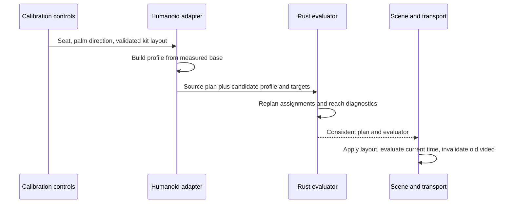

# Body, tool and kit calibration

**English** · [한국어](calibration.ko.md)

This chapter explains the adopted calibration design and its limits. Exact accepted
input ranges and coordinate conventions belong to the [rig contract](rig-contract.md).
The [reader guide](../../docs/calibration.md) covers operating the controls.
The [MIDI interpretation contract](midi-interpretation.md) defines which musical
event addresses which physical piece before body-dependent reach is evaluated.

## What must fit together

A standard humanoid supplies semantic joints, not a drum-playing setup. A short arm,
a long lower leg, a thick shoe and a different hand rest basis affect different parts
of the contact problem. Uniformly scaling the visible avatar or drum mesh does not
solve all of them.

| Quantity | Owner | Effect |
| --- | --- | --- |
| Rest joints and segment lengths | Humanoid adapter | Defines the actual reachable body |
| Seated root position | Body calibration | Translates hips, shoulders and reference hands together |
| Grip frame and tool dimensions | Tool calibration | Relates a hand to its attached stick and measured tip |
| Sole/contact offset | Foot calibration | Relates the ankle node to a contact socket |
| Kit contact layout | Performance plan | Defines where the musical action must arrive |
| Appearance scale/material | Scene appearance | Changes the rendered body without moving the musical target |

The implementation deliberately has no avatar-name selector in the solver. A model
adapter provides measurements and semantic capabilities. The same numeric pipeline
handles the default skeleton and every accepted VRM.

## From rest pose to seated profile

The adapter measures upper/lower segments from normalized rest-joint world positions
and stores a base profile. A seat adjustment translates the reference body from that
base rather than repeatedly translating the previous result. This avoids accumulating
floating-point movement across adjustments.

Automatic fitting estimates a starting height from both pedal targets and measured
leg reach. The current heuristic reserves a fraction of total leg extension and uses
a shared forward reference. It does not optimize shoulder comfort, wrist limits,
skin clearance or all drum targets. Implementation details live in
[`getAutomaticCalibration`](../../src/rig-humanoid.ts).

## Bounded kit fitting

Different arm-to-leg ratios can require target layout changes even when both feet
reach their pedals. [fit.rs](../../crates/drum-engine/src/fit.rs) proposes a layout
from the measured body, with the snare posture as the first reference. It fits
hand-played surfaces in two stages:

1. Search a uniform transform. Scale positions around `[0, 1.235, 0.06]` metres
   and contact radii together, from 100% down to 60% in 2% steps. Lateral shift is
   zero. Shared vertical shift is bounded to ±0.5 m; forward shift ranges from
   −0.25 to +0.10 m in 0.025 m steps. Height candidates include zero, the measured
   snare-reference height difference clamped to ±0.5 m, and mean shoulder height
   minus 1.235 m offset by −0.12 to +0.12 m in 0.03 m steps.
2. Repair local placement in order: snare, hi-hat, floor tom, rack toms, cymbals.
   Each piece must clear already placed nominal bodies while satisfying reach and
   posture; this makes the snare an anchor rather than a target fitted around all
   original obstacles. Relative translation is `Δx, Δz ∈ [−0.30, +0.30] m` and
   `Δy ∈ [−0.25, +0.25] m`, sampled in 0.05 m steps. The exact snare-reference
   displacement is also considered when within those bounds. This stage does not
   change radii. Closed/open hi-hat move together. Kick and both pedal contacts
   remain fixed throughout both stages.

Try the original layout with local repair first. Otherwise prefer the largest scale
with a complete candidate, then minimize the common squared displacement multiplied
by the number of kit entries plus the sum of squared local displacements. A failed
local repair does not stop the search for another uniform candidate or smaller scale.
Within local repair, prefer proximity to the measured snare reference for the snare
and to the candidate position for other pieces, with a smaller displacement cost.
The reference uses mean shoulder position, upper-arm/forearm length and tool length;
it is a soft placement preference, not a prescribed anatomical pose.

For profiles with `handFrames`, `complete` requires designated hands to pass reach
and skeletal posture checks at contact and two preparation samples. The samples are
`(vertical lift in metres, tool pitch in radians)`: `(0, 0)`, `(0.055, −0.20)` and
`(0.11, −0.42)`. Each sample must be reachable, with these bounds:

- At or below shoulder-height targets, elbow height is at most shoulder height plus
  0.10 times upper-arm length. Higher targets are exempt from this height bound.
- Elbow forward position is at least shoulder Z minus 0.35 times upper-arm length.
- Wrist forward position is at least shoulder Z plus 0.15 times forearm length.
- Arm/tool-to-torso proxy clearance is at least 0.002 m. Each sample searches the shared bounded elbow candidates rather than only the neutral elbow.

Snare height must also be 0.4–1.6 upper-arm lengths below each shoulder. The fit
additionally requires a two-hand snare-ready pose and a left-snare/right-hi-hat
groove pose. These probes use tips 35 mm above the heads; two tips on the same
head are separated symmetrically by a bounded fraction of its radius. They are
fixed calibration probes, not random strike offsets. `ready_pose` uses the same
accepted two-snare solution when no MIDI is active. Snare, toms
and crashes check both hands; hi-hat and ride check the right hand. Legacy profiles
without `handFrames` retain static reach checks without these posture guards.

All candidates also check nominal instrument bodies and the vertical hi-hat pull
rod. Horizontal or vertical separation must provide a 5 mm margin; the rod uses a
25 mm clearance radius. These envelopes follow the physical kit radii and standard
body depths, not the exact imported meshes or cosmetic overrides. `complete` requires
both the reach/posture and nominal-body/hi-hat-rod checks to pass. It does not certify
every motion frame, transfer speed, anatomical comfort, skin clearance or all stand
hardware.

The proposal records the uniform `scale` and `translation`, plus `pieceAdjustments`
entries containing `pieceId` and local `translation`. If no complete candidate exists,
return the **original layout unchanged**, `scale: 1`, zero translation,
`pieceAdjustments: []` and `complete: false`. `unreachablePieceIds` identifies reach
or posture failures; `clearancePieceIds` identifies nominal-body/hi-hat-rod overlaps.
The browser automatically applies a complete fit when importing a character or
restoring the built-in rig, and offers persistent undo. Incomplete fitting retains
a usable previous layout and explicit warnings. Repeated imports start from the
last explicit layout baseline rather than repeatedly shrinking an automatic result.
Saved project reopening bypasses fitting and restores the recorded setup exactly.
Fitting a successful result again leaves the layout unchanged and returns no local
adjustments. These numeric guards do not establish universal fit across VRM body
shapes; rendered comparisons remain necessary.

The result includes `capabilities`: a bounded ordered left/right target-pair audit,
geometry source, checked-target/pair counts and the required-pair outcome. The
canonical eight hand-played surfaces produce 16 hand/target checks and 64 ordered
pairs. Open/closed hat share a surface; feet are excluded. At most 16 surfaces are
enumerated for larger custom layouts. `available` means the bounded static search
found a proxy-clear witness; `not-found` is not proof of physical impossibility.
`unmeasured` identifies profiles without the necessary hand-frame contract. This
matrix guides inspection; it does not certify a time-ordered performance.

## One geometric clearance contract

Calibration, motion planning and inspection share
[clearance.rs](../../crates/drum-engine/src/clearance.rs). The adapter supplies the
[numeric body descriptor](rig-contract.md#numeric-body-geometry); older profiles
use an explicit skeleton fallback. Arms and hands are capsules, and sticks are
6 mm-radius segments. Hand capsules follow the solved tool rotation. The own-hand
grip attachment is allowed; the opposite arm, hand and stick remain obstacles.

For capsules with axes `A(u)` and `B(v)` and radii `rA`, `rB`, clearance is
`min(u,v ∈ [0,1]) |A(u) − B(v)| − rA − rB`. Finite segment endpoints,
parallel axes and degenerate spheres are handled explicitly.

The torso uses a capped elliptical cylinder in the moving shoulder frame. For
local point `p` and half extents `(rx, ry, rz)`, a conservative distance bound is
`max((sqrt((px/rx)² + (pz/rz)²) − 1) × min(rx,rz), |py| − ry)`.
The whole segment is minimized with 16 golden-section iterations and a residual
Lipschitz bound before subtracting its radius. This avoids treating isolated
segment samples as proof that a narrow crossing was absent.

An upper arm necessarily connects to its own torso. When the shoulder origin is
inside the proxy and the upper arm moves outward on its own side, only the
connected proximal attachment region is permitted; the elbow must clear the torso.
Inward/cross-body upper arms, forearms, hands and sticks retain full checks. This
geometric rule does not discard measured sleeves or branch on model identity.

Negative clearance is a proxy overlap, not a measured skin penetration depth.
Nonnegative clearance also cannot certify all clothing vertices or continuous
animated triangles. Pair availability, actual impact clearance, intervening paths
and rendered surfaces are separate verification layers.

## Contact is a transform chain

A stick is attached to the actual raw hand. Its world tip is computed through the
hand, grip/socket and tool transforms, conceptually:

`worldTip = worldHand × handToGrip × gripToTool × localTip`

The solver must satisfy both the target point and a meaningful tool orientation.
Subtracting a constant world-space stick vector would detach grip orientation from
the hand. Writing a correct-looking tip position after solving the skeleton would
hide an attachment error. The rendered endpoint is therefore an independent observed
quantity in contact checks.

The hand mount is diagonal across the measured palm. Available finger bones curl
around it; missing fingers use a less detailed fallback. The adapter supplies measured
forearm/palm axes and a desired palm direction in `handFrames`. The Rust solver treats
the forearm and attached tool as a compound link, solves the elbow toward each target,
then recovers the actual wrist and tool orientation while preserving bone lengths.
The anatomical elbow preference combines the outward shoulder axis with a downward
component. A shortest-arc rotation transports that perpendicular bend plane from
body-forward to the shoulder-to-tip direction. This avoids projecting a fixed pole
through a singularity within the front playing workspace. A shortest-arc rotation
aligns the compound link; a continuous, bounded roll prefers the desired palm
direction without forcing it exactly. There is no iterative per-frame clearance
optimization. The fit guards above separately check the resulting posture.

This replaces a fixed world hand orientation with a target-dependent neutral wrist;
stroke pitch is applied around that calibrated relationship. It does not implement
per-joint anatomical limits, skin collisions or every grip style. Contact error and
hand-forward/forearm swing are distinct observations: inspect both, including the
rendered fingers and mesh, before claiming a natural grip.

## Coordinated torso and inspection

Optional `torsoPivot` is measured from the normalized spine and translated with the
seat. [body_motion.rs](../../crates/drum-engine/src/body_motion.rs) precomputes a
12 Hz yaw curve, bounded to ±0.24 radians. Each step examines 13 candidates within
±0.06 radians of the previous planned yaw. Costs balance the direction of both hand targets, a joint bounded search for
left/right elbow candidates, shared proxy clearance and change in yaw. Smooth interpolation is
evaluated by absolute time; this is planned continuity, not accumulated frame state.
The resulting curve is checked at every assigned hand impact, including impacts
between sample knots. If facing loses reach, only adjacent time knots are attenuated toward neutral,
propagating the existing 0.06 rad neighbor bound. A bounded 16-pass repair retains
other phrases; zero yaw is the final fallback if contacts still cannot be retained.
This preserves curve continuity and source contact times.

Rotating the profile moves shoulders, bend references, chest and head around the
pivot. Both arms are then solved again to the original world-space tool targets.
Pelvis, leg roots and pedal support remain stable. Without `torsoPivot`, the body
stays facing forward. The renderer applies the corresponding spine rotation before
solving its limb bones, so a decorative chest turn cannot substitute for moved
shoulder roots.

When `handFrames` are available,
[hand_coordination.rs](../../crates/drum-engine/src/hand_coordination.rs) then plans
both elbow swivels on a 0.1-second grid plus exact source impact timestamps. Each
node contains 33 × 33 joint candidates in 0.05 rad steps, spanning ±0.8 rad per arm.
Dynamic programming selects a whole-timeline path, retaining alternatives that
prepare for future constraints instead of accepting a locally convenient collision.
An edge permits at most 2 rad/s of sampled-angle change; C1 smoothstep interpolation
therefore contributes at most 3 rad/s. These are swivel-track limits, not limits on
the entire moving elbow or wrist.

The selected path is checked at 30 Hz and exact impacts with the turned body and
actual stroke targets. Colliding edges receive their measured cost and the graph
is searched again, up to eight iterations. The best inspected path is retained.
This is bounded cost optimization: it may still return a least-bad path when no
safe candidate sequence is found. `BODY_PATH_CLEARANCE` reports residual proxy
intersections at assigned hand-impact times. It is not a continuous collision
certificate and does not silently omit the notes.

The track is precomputed and independent of playback order. It changes neither
source times nor hit targets, stretches no bones, and adds no random target offsets.

The joint planner accepts at most 6,000 deduplicated control times, checked before
allocating its node-cost and parent tables (about 52 MB + 13 MB at this bound).
Exceeding this separate motion budget returns an actionable preparation error;
it does not fall back silently to an unchecked motion. The MIDI parser's 50,000-hit
limit is not a promise that every dense score fits this humanoid planning budget.

`inspect_pose_at` reports the shared torso, arm-to-arm, stick-to-stick and
stick-to-opposite-arm/hand clearances, geometry source and bone-length error.
The [engine contract](engine-contract.md) defines the fields.
These metrics support reproducible inspection but do not inspect skin, clothing,
all instrument geometry or the entire continuous path. Zero numeric contact error
and nonnegative proxy clearance are separate from a convincing rendered pose.

The [ergonomics and sticking research](../../docs/research/ergonomics-and-sticking.md)
motivates these constraints. Numeric search bounds and cost weights are engineering
choices, not biomechanical measurements from Yamaha, PAS or Zildjian. Learned
whole-body motion and expanded expressive gestures are separate extensions.

## Calibration update transaction

A successful update changes kit contacts and all matching `hit.target` fields
consistently through `pieceId`, then applies the body-dependent evaluator. Two
crashes sharing an instrument role retain independent contact entries; moving one
does not move the other. Original event IDs, ticks,
notes, velocity and times are preserved. Audio does not need a new musical arrangement.
If the update fails, restore the prior calibration/layout rather than leaving a
half-updated body and plan. The application pauses while changing calibration and
keeps conflicting preparation/import/export operations from interleaving.

Closed/open hi-hat are two semantic voices using one surface; their target movement
is coupled. Hi-hat pedal is a separate foot contact. Kick's target in this model is
the pedal contact, not the front of the visible bass drum.

## Feet and support

The profile evaluator places both feet at their pedal contacts at rest, including
MIDI with no pedal events. The implemented stroke keeps the hip/knee/ankle chain
fixed and rotates the foot through a small preparation/press envelope. Impossible
idle pedals receive an explicit diagnostic rather than elongated bones.

The optional short open/close interpretation drives a small time-based left-foot
pitch instead of adding an independent foot strike for the paired close. Source and
control semantics belong to [MIDI interpretation](midi-interpretation.md); cymbal-gap
geometry and measured pedal pressure are not implemented.

A fixed ankle is not proof that the heel is grounded. A sole socket is not an exact
shoe mesh surface. Full heel-down/up mechanics require support regions and potentially
ankle/knee translation, described in [performance expression](performance-expression.md).
Those extensions must preserve the existing event-time and repeatability constraints.

## Stable mounts and replaceable drum bodies

The kit separates a calibrated contact/mount from the replaceable shell, head or
cymbal. Presets and local body-only GLB swaps preserve common stands/pedals; intentional
layout changes may reposition the associated hardware. Source-specific mesh extraction
is an appearance adapter concern and never changes the avatar solver.

The part appearance scale remains cosmetic and does not move its target. The explicit
kit-fit operation instead updates physical positions and radii, reflected by body
fitting and associated hardware. Neither operation scales the avatar or its bones.

## Historical evidence and remaining design

Read the [calibration evidence](../../docs/verification/calibration-unreleased.md)
and [palm follow-up](../../docs/verification/palm-orientation-unreleased.md)
for their original executed scope and observed wrist/skin limits. The
[fit/ready-pose proposal](../../docs/research/snare-ready-and-kit-fit.md)
records the design motivation; this contract defines the implemented subset. Historical details remain in
[ADR 0005](../../docs/decisions/0005-calibration-pedals-hardware.md), without rewriting its
original scope or test results as current universal claims.
