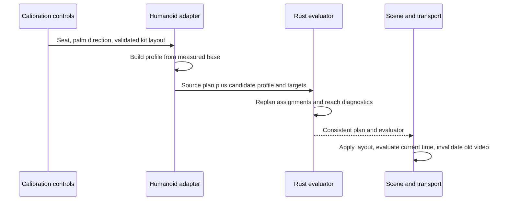

# Body, tool and kit calibration

**English** · [한국어](calibration.ko.md)

This chapter explains the adopted calibration design and its limits. Exact accepted
input ranges and coordinate conventions belong to the [rig contract](rig-contract.md).
The [reader guide](../../docs/calibration.md) covers operating the controls.
The [MIDI interpretation contract](midi-interpretation.md) defines which musical
event addresses which physical piece before body-dependent reach is evaluated.

## What must fit together

A standard humanoid supplies semantic joints, not a drum-playing setup. A short arm,
a long lower leg, a thick shoe and a different hand rest basis affect different parts
of the contact problem. Uniformly scaling the visible avatar or drum mesh does not
solve all of them.

| Quantity | Owner | Effect |
| --- | --- | --- |
| Rest joints and segment lengths | Humanoid adapter | Defines the actual reachable body |
| Seated root position | Body calibration | Translates hips, shoulders and reference hands together |
| Grip frame and tool dimensions | Tool calibration | Relates a hand to its attached stick and measured tip |
| Sole/contact offset | Foot calibration | Relates the ankle node to a contact socket |
| Kit contact layout | Performance plan | Defines where the musical action must arrive |
| Appearance geometry/material | Scene appearance | Geometry changes trigger measurement and replanning; finish alone is cosmetic |

The implementation deliberately has no avatar-name selector in the solver. A model
adapter provides measurements and semantic capabilities. The same numeric pipeline
handles the default skeleton and every accepted VRM or FBX humanoid.

## From rest pose to seated profile

The adapter measures upper/lower segments from normalized rest-joint world positions
and stores a base profile. A seat adjustment translates the reference body from that
base rather than repeatedly translating the previous result. This avoids accumulating
floating-point movement across adjustments.

Automatic fitting estimates a starting height from both pedal targets and measured
leg reach. The current heuristic reserves a fraction of total leg extension and uses
a shared forward reference. The left-knee bend preference follows the accepted
hi-hat pedal's horizontal heel-to-toe direction; the kick-leg preference is
unchanged. Candidate measurement restores the previous pedal frame as well as
the seat. It does not optimize shoulder comfort, wrist limits,
skin clearance or all drum targets. Implementation details live in
[`getAutomaticCalibration`](../../src/rig-humanoid.ts).

## Reference arrangement and setup ownership

The application starts from one conventional right-handed five-piece reference arrangement: snare between
the legs, two rack toms in a shallow forward row, floor tom on the right flank, a linked left hi-hat/pedal,
and reachable outer cymbals. This is the product's reference family, not a universal rule for all drummers.
Its measured surface relationships are checked independently of reach and hardware clearance; assigning
every note cannot substitute for preserving that arrangement.

The source of this arrangement is [`shared/default-kit.json`](../../shared/default-kit.json). The built-in
skeleton starts at the authored 0.79 m seat height and 0.14 m forward position; opening the app installs
that setup without running a layout search. This shortcut applies only on startup; selecting the built-in
rig later follows ordinary fitting. Imported humanoids keep measured bone lengths and obtain their own seat profile.

The reference is reviewed from fixed top, front, left, right and player views.
Elevated cymbals may overlap drums in top projection when three-dimensional body,
hardware and complete-stick approach checks pass. Two rack toms must not become
front/back rows merely because independent targets can be reached there.

Character or physical-equipment replacement may produce a new bounded fit. Once
accepted, that character's measured kit and seat are the session setup. MIDI/demo
selection, note editing, ordinary preparation, playback and seeking consume the
same setup; they do not fit it again. A source-preparation transaction captures
the kit/profile before asynchronous work and cannot install a result against a
different setup. Exact project restoration keeps the saved arrangement.

Manual adjustment remains explicit. A failed bounded search retains the preceding
usable setup and exposes reach, arrangement and clearance reasons separately.
The reference arrangement does not certify relaxed posture, skin/clothing
clearance or the complete route of a fast fill; these remain separate checks.

## Bounded kit fitting

[fit.rs](../../crates/drum-engine/src/fit.rs) gives the current reference layout priority over a new
per-character arrangement. It first searches posture/tool solutions and the bounded seat offsets below
**without moving or resizing any kit piece**. The original seat is tried first, then the remaining offsets
by displacement. Each accepted result passes the same final certificate as a changed layout. A successful
fixed-layout result has `scale: 1`, zero kit translation, no `pieceAdjustments` and only the selected
`seatOffset`.

If this pass finds no complete result, the following bounded layout/shell fallback uses the snare posture as
its first reference. This order avoids moving equipment merely because a greedy local repair was found
before a valid seat. Uniform character scaling is a possible future last resort; it is **not implemented**.
Neither branch stretches bones or modifies MIDI hit times.

The [public-model review](../../docs/verification/public-vrm-fit.md), [integration
record](../../docs/verification/shared-fit-integration.md) and [reference-layout
record](../../docs/verification/reference-layout.md) preserve their original code versions and measured
failures; they do not certify this policy change. The fallback has two stages:

1. Try local repair of the current layout, then shell/layout factors
   `1.00, 0.92, 0.84, 0.76`. Positions scale about
   `[0, 1.235, 0.06]` metres; snare/tom contact radii and their complete measured shell dimensions
   scale together. Hi-hat, crash and ride diameters remain nominal; their positions
   still participate in the layout fit. Each scale tries the snare-reference height shift, bounded to
   ±0.5 m, with the reference forward shift bounded to −0.25–+0.10 m. All coarse
   scales get this translation before zero-forward-shift alternatives. Lateral
   shift is zero. At the first successful
   coarse scale, at most three 2% probes between it and the preceding coarse scale
   seek a larger feasible result.
2. Repair local placement with snare and hi-hat first, then try floor-tom-first and
   rack-tom-first orders before cymbals. Each piece must clear already placed body
   bounds while satisfying reach, posture and complete-tool access. Relative
   translation is `Δx, Δz ∈ [−0.30, +0.30] m` and `Δy ∈ [−0.25, +0.25] m`, sampled
   in 0.05 m steps; the exact bounded snare-reference displacement is also tested.
   Around the snare reference, an additional grid uses 0.1 mean upper-arm length
   per step, clamped to 15–30 mm (±5 steps laterally/vertically, ±6 forward), within
   the same translation bounds. Local repair does not change radii.

The kick and its pedal remain fixed. The direct hi-hat is a coupled pedal/mast/cymbal
assembly: its seed places the mast left of the snare by both radii plus 35 mm and
50 mm farther from the player. The pedal contact is 120 mm behind the mast along
its `pedalForward`, aimed from the seated left-leg root toward that mast. At most 250 mm lateral
or forward/back movement from the input pedal is allowed. Preferred and original
axis combinations are tested at board pitch `0, −0.09, −0.18` rad with the real
sole offset, leg lengths and a 55–155° interior knee range. A failed seed retains
the input pedal. This is an engineering search prior, not a universal posture rule.
Closed/open hi-hat share the resulting physical anchor and subsequently vary only
in height. Before locking a snare candidate, the search requires a feasible
hi-hat height and a clear snare/hi-hat pair, including both complete-tool approaches.
This avoids using the hi-hat mast corridor for a locally convenient snare.

The two rack toms are placed as a group: one shallow left/right row with shared height/depth and bounded
spacing. Individual reach cannot split them into front/back rows. Floor-tom candidates remain on the right
flank; the measured shell and its supports must also clear the structural seated thigh, shin and foot cores
described below. The optional suspended preset places its host stand before the supported floor tom.
Physical mount metadata, including an accepted `standRotation`, is retained in the resulting kit.

Lower-limb checks evaluate board pitches `0, −0.09, −0.18` rad using real bone lengths, yawed pedal contacts
and sole offsets. The hard structural test uses thigh radius `clamp(0.14 × upperLegLength, 0.025, 0.09)`,
shin radius `clamp(0.10 × lowerLegLength, 0.02, 0.07)` and foot radius 0.04 m. It tests drum bodies, stands
and both boards with a 5 mm margin. Only the foot's intended own-board contact is excluded; a shin, another
pedal or an unrelated stand has no such exemption. The finite shin ends at the ankle instead of extending a
rounded cap below it.

[Measured leg/foot envelopes](rig-contract.md#numeric-body-geometry) remain intact for advisory inspection,
including clothing and footwear. Their negative clearance does not reject a layout. Local leg envelopes
follow the measured rest frame transported by the minimum swing to the posed segment; feet follow the actual
yawed/pitched tool frame. Structural cores are an explicit bone-based approximation, not extracted
anatomical skin. Neither test certifies continuous skinned motion.

One repair/certification pipeline uses two deterministic budget allocations. The initial nominal-layout pass
has 12,000 candidates and coarse cached hand/pair queries. Refined nominal-seat retries get 6,000 candidates
each, with the initial pass included in a 30,000 total. The remaining request budget is reserved for
body-anchored shell families: 6,000 per attempt and 24,000 per seat. Child quota exhaustion does not close
later siblings. Unused allowance remains available; all attempts together are still capped at 80,000, not an
exhaustive search.

For profiles with `handFrames`, the fixed-layout pass and fallback use seat Y `0, ±0.06, ±0.12` m and Z `0,
+0.08, −0.08, +0.16, +0.24` m, ordered by squared displacement. Keep pelvis height within 0.3–1.2 m and its
absolute Z within 0.5 m. Without `handFrames`, only the original seat is searched. The fixed kick must pass
the pitch/knee gate before a seat retry; the movable left pedal is checked per generated assembly. Every
final certificate checks both existing pedals with the same real sole offset, reach annulus and 55–155° knee
range.

When a valid snare/hat reference blocks later placement, revisit up to three
distinct validated snare positions per pedal assembly, using the same repair path
and both placement orders. Previously failed positions are excluded; repeated
probes remain charged to the shared budget. At most three assemblies passing
the hat precheck receive these deeper attempts. No physical criterion is relaxed.

Each candidate translates world roots, hand references, torso center and pivot together. Bone lengths,
neutral contact rotations, local `legBoxes`/`footBoxes` and `legRestFrames` remain unchanged. Each pedal
branch refreshes foot targets and the left knee direction from its `pedalForward`, matching adapter
calibration. Thus yaw is composed once with the neutral foot rotation and board pitch, while measured local
boxes are not translated a second time.

All passes share a maximum of 80,000 layout candidates; exact hand and pair memoization each retain at most
100,000 entries. Each direct-hat assembly's height witnesses are filtered once per placement-order attempt
before snare lookahead, avoiding repeated impossible hat tests for every snare candidate. Exhausting one
piece's candidates ends that local branch. `searchCandidates` and `searchLimitReached` disclose work and
budget exhaustion. Failure means this bounded search found no complete result; it does not prove physical
impossibility or that every larger scale is infeasible. The chosen result is not a global optimum.

Within local repair, prefer proximity to the measured snare reference for the snare
and to the candidate position for other pieces, with a smaller displacement cost.
The reference uses mean shoulder position, upper-arm/forearm length and tool length;
it is a soft placement preference, not a prescribed anatomical pose.

For profiles with `handFrames`, `complete` requires designated hands to pass reach
and skeletal posture checks at contact and two preparation samples. The samples are
`(vertical lift in metres, tool pitch in radians)`: `(0, 0)`, `(0.055, −0.20)` and
`(0.11, −0.42)`. Common wrist-pitch offsets are `0, ±0.15, ±0.30, ±0.45, ±0.60`
rad. Initial cached queries keep the five original elbow candidates. Seat retries
and shared contact queries can refine the same −0.8–+0.8 rad interval in 0.05 rad
steps when coarse witnesses fail; anatomical limits and the 2 mm physical-tool
margin remain hard constraints. Final certification uses the shared refined queries for every result.
Fitting requires these probes at neutral torso yaw;
optional runtime facing must preserve the actual pitched contacts rather than rescue
an otherwise unreachable layout. Snare center/rim-side regions, hat bow/edge, ride
bell/inner/outer/edge and crash-edge contacts use one canonical articulation catalog.
A valid outer ride contact cannot hide an unreachable bell. These static checks do
not prove a feasible transition between targets.
Each sample must be reachable, with these bounds:

- Upper-arm elevation is measured from vertically down (0°), not from horizontal.
  With `a = clamp((targetY − shoulderY) / upperArmLength + 0.6, 0, 1)`, its maximum
  is `70° + 45° × a`; high accents have a continuous allowance rather than a
  shoulder-height discontinuity.
- The interior elbow angle is 55–165°.
- Measured hand-to-forearm swing is at most 0.60 rad (about 34.4°).
- Elbow forward position is at least shoulder Z minus 0.35 times upper-arm length.
- Wrist forward position is at least shoulder Z plus 0.15 times forearm length.
- Each sample searches the shared bounded elbow candidates rather than only the neutral elbow. Whole-stick/equipment and whole-stick/stick clearance must be at least 0.002 m outside the intended contact rules. Measured body, arms, hands and clothing contribute advisory costs instead of rejecting a candidate.

A shared soft objective additionally prefers elevation below `35° + 55° × a`,
interior elbow angles 80–140°, and a forearm no more than 20° downward. Squared
radian excesses have weights 0.22, 0.12 (folded), 0.06 (extended) and 0.06
(downward), capped at 0.39 per arm. These are adjustable animation priors;
Yamaha's relaxed-arm examples inform the objective, not its numeric limits.
Ready-pair selection minimizes this objective, `0.015 × wristOffset²` and bounded
body-overlap penalties among candidates satisfying anatomical and physical-tool
constraints. For advisory clearance `c`, the penalty is
`0.04 × d / (0.025 + d)`, where `d = max(0, 0.002 − c)` metres. It is below 0.04
even for very large costume envelopes, so visual avoidance cannot outweigh a
physical tool constraint. Per-hand body clearance and the pair's arm/cross clearance
are scored separately. The same nine bounded wrist offsets and coarse-first elbow
search are used, with bounded refinement only when no coarse pair exists.
Each hand is filtered and sorted before checking pairs; no Cartesian allocation
or avatar-specific exception is needed. Kit probes,
equipment routing, torso planning and temporal elbow planning use the same
measurements. A hard-limit failure in the runtime search remains visible as
`POSTURE_LIMIT`; contact times are preserved, rather than discarding a note to
improve a comfort score.

Snare height must also be 0.4–1.6 upper-arm lengths below each shoulder. The fit additionally requires a
two-hand snare-ready pose and a left-snare/right-hi-hat groove pose. These probes use tips 35 mm above the
heads; two tips on the same head are separated symmetrically by a bounded fraction of its radius. They are fixed
calibration probes, not random strike offsets. `ready_pose` uses the same accepted two-snare solution when no
MIDI is active. Snare requires each hand; hi-hat and ride require the right hand. Each tom and crash requires at
least one anatomically valid, tool-clear hand, rather than forcing the far-side hand to reach every surface.
When two distinct crashes exist, one left/right assignment must admit simultaneous actual impact contacts and
the raised ready pair. This does not certify the intervening path. Pair probes use the same articulation regions
as contact planning (crash edge, ride bow), not a cymbal's mounting center. Before a bounded fallback search
locks either of its first two semantic crashes, the shoulder frame determines its spatial side and requires a
same-side hand witness at impact and 35 mm above the target. This prevents a greedy placement from consuming the
opposite hand's crash role; it neither fixes score hand assignment nor strengthens the unchanged-kit
certificate. The full ordered capability matrix still exposes unavailable opposite-hand combinations, and the
phrase planner must validate actual assignments and transitions. Legacy profiles without `handFrames` retain
static reach checks without these posture guards.

Candidates also use the [common equipment/contact geometry](equipment-contact.md): measured or procedural
body boxes, projected head access and generated support/pedal envelopes. Every returned proposal, including
an unchanged input, undergoes the same final certification: arrangement, structural lower-limb clearance,
rigid equipment clearance, designated-hand anatomical/whole-tool checks and required tool-pair checks
determine `complete`. Adding a later instrument must preserve previously placed instruments' contact
approaches and required pair witnesses. A reachable tip alone is insufficient when the rest of its stick
intersects equipment or the other stick. Arm/equipment, arm/arm and body/tool envelope overlap remain
advisory. This is a bounded proxy search, not certification of every frame, transfer speed, anatomical
comfort, skin, exact meshes or support-to-support clearance.

The proposal records the shell/layout `scale` and common `translation`, plus `pieceAdjustments` entries
containing `pieceId` and local `translation`. `seatOffset` is the winning body translation, applied
atomically with that kit before replanning. Up to 32 `searchFailures` entries aggregate `{stage, pieceId,
branches}` for `hihat-witness`, `placement` and `feet` failures. These describe rejected search branches;
the failed-piece lists and `layoutViolations` describe the returned layout. If no complete candidate exists,
return the **original layout unchanged**, `scale: 1`, zero translation, `pieceAdjustments: []`, zero
`seatOffset` and `complete: false`. `unreachablePieceIds` identifies reach or posture failures;
`clearancePieceIds` identifies unresolved common equipment geometry. `layoutViolations` separates
arrangement and structural lower-limb failures. Optional `advisoryLayoutViolations` lists measured leg/foot
envelope warnings on that returned setup, excluding those already reported as hard failures. It never gates
`complete`; absence in an older response means unreported, not clear. The browser shows these in Analysis,
not as fit-failure toasts. The browser automatically applies a complete fit when
importing a character or restoring the built-in rig, and offers persistent undo. Incomplete fitting retains
a usable previous layout and explicit warnings. Repeated imports start from the last explicit layout
baseline rather than repeatedly shrinking an automatic result. Saved project reopening bypasses fitting and
restores the recorded setup exactly. Fitting a successful result again leaves the layout unchanged and
returns no local adjustments. These numeric guards do not establish universal fit across VRM or FBX body
shapes; rendered comparisons remain necessary.

The result includes `capabilities`: a bounded ordered left/right target-pair audit, geometry source,
checked-target/pair counts and the required-pair outcome. The canonical eight hand-played surfaces produce
16 hand/target checks and 64 ordered pairs. Open/closed hat share a surface; feet are excluded. At most 16
surfaces are enumerated for larger custom layouts. `available` means the bounded static search found a
witness satisfying the sampled anatomical and physical-tool constraints; measured-body warnings can coexist
with `available`. `not-found` is not proof of physical impossibility. `unmeasured` identifies profiles
without the necessary hand-frame contract. This matrix guides inspection; it does not certify a time-ordered
performance.

## One geometric clearance contract

Calibration, motion planning and inspection share
[clearance.rs](../../crates/drum-engine/src/clearance.rs). The adapter supplies the
[numeric body descriptor](rig-contract.md#numeric-body-geometry); older profiles
use an explicit skeleton fallback. The calculation distinguishes two uses:

| Geometry | Effect on a candidate |
| --- | --- |
| Complete physical stick against equipment or the other stick | Hard rejection; ordinarily 2 mm, with explicit count-in contact/approach rules |
| Structural leg/foot cores against equipment | Hard rejection; 5 mm margin |
| Measured torso, arms, hands, legs, shoes and clothing, including stick/body overlap | Advisory ranking and diagnostics; no reach veto |

The raw inspection metrics remain available. Arms and hands use capsules, and the historical stick metric
uses 6 mm-radius wrist-to-tip segments. Hard stick-pair checks instead use both complete butt-to-tip
profiles and the shared rendered taper. Hand capsules follow the solved tool rotation; own-hand grip attachment is
permitted. Advisory pair checks still include the opposite arm, hand and tool. See the [equipment
contract](equipment-contact.md) for whole-tool geometry and intended contact boundaries.

For capsules with axes `A(u)` and `B(v)` and radii `rA`, `rB`, clearance is
`min(u,v ∈ [0,1]) |A(u) − B(v)| − rA − rB`. Finite segment endpoints,
parallel axes and degenerate spheres are handled explicitly.

The torso uses a capped elliptical cylinder in the moving shoulder frame. For
local point `p` and half extents `(rx, ry, rz)`, a conservative distance bound is
`max((sqrt((px/rx)² + (pz/rz)²) − 1) × min(rx,rz), |py| − ry)`.
The whole segment is minimized with 16 golden-section iterations and a residual
Lipschitz bound before subtracting its radius. This avoids treating isolated
segment samples as proof that a narrow crossing was absent.

The advisory body metric accounts for an upper arm connecting to its own torso. When the shoulder origin is
inside the proxy and the upper arm moves outward on its own side, only the connected proximal attachment
region is permitted; the elbow must clear the torso. The same attachment rule applies when a measured
shoulder is just above the torso cap, within one upper-arm diameter, **and its projection lies inside the
cap's elliptical footprint in the shoulder frame**. A root above but behind/in front of that footprint
cannot exempt an arm traversing the torso. The upper arm must move monotonically outward on its own side and
its elbow capsule must be clear: convexity then bounds one proximal attachment interval and its exit. No
arbitrary fraction of the arm is removed. This remains an attachment-proxy approximation, not a skin
certificate. Inward/cross-body upper arms, forearms, hands and sticks retain full checks. This geometric
rule does not discard measured sleeves or branch on model identity.

Negative measured-body clearance is an advisory proxy overlap, not a measured
skin penetration depth or a failed physical-tool certificate. Nonnegative clearance
also cannot certify all clothing vertices or continuous
animated triangles. Pair availability, actual impact clearance, intervening paths
and rendered surfaces are separate verification layers.

## Contact is a transform chain

A stick is attached to the actual raw hand. Its world tip is computed through the
hand, grip/socket and tool transforms, conceptually:

`worldTip = worldHand × handToGrip × gripToTool × localTip`

The solver must satisfy both the target point and a meaningful tool orientation.
Subtracting a constant world-space stick vector would detach grip orientation from
the hand. Writing a correct-looking tip position after solving the skeleton would
hide an attachment error. The rendered endpoint is therefore an independent observed
quantity in contact checks.

The diagonal palm mount and finger curl retain measured adapter geometry; `handFrames` supply forearm/palm axes and desired palm.
The shaft aims from shoulder to target in XZ, with 0.25 rad downward inclination plus pitch. Optional `palmReference: shaftHeading` rotates desired palm from +Z by horizontal yaw.
Natural uses inward followed by 0–90° pronation, side-signed in `palmRollRange`; explicit up/inward/down allow ±0.15 rad around their world preference.
Ranges contain zero, lie within ±π and span at most π. These are grip policies, not anatomical limits.
Static fitting/contact candidates perform four analytic refinements and a final wrist/arm solve, returning after five solves only if reachable and shared `anatomical_violation == 0`; no new threshold is introduced.
Otherwise the proposal and both interval endpoints receive complete wrist/arm evaluation, ranked by reach, the shared anatomical deficit,
then squared wrist deviation plus comfort cost, then absolute roll. The deficit includes wrist, arm elevation, elbow angle and forward-position constraints.
Twelve fixed golden-section refinement steps over the same interval retain the best evaluated pose: 21 wrist/arm solves in this fallback, without a global-optimum guarantee.
Selected numeric rolls are stored alongside elbow angles in the existing `SwivelSample` control knots; legacy hands store `None`.
The exact elbow-circle point closest to the measured forearm supplies the bend plane before planned swivel; axial degeneracy retains the transported pole.
The independent 0.60 rad wrist gate and all joint limits remain unchanged. Each trial recovers the wrist from complete grip/tool offsets and solves fixed-length bones.
Edge checks and runtime use the same smoothstep-interpolated angles and rolls, then one fixed-roll wrist/arm solve; they do not rerun the pointwise optimizer or add a grid/frame history. Equipment acceptance remains separate.
Without a roll range, the original four unconstrained refinements remain; the elbow pole combines 0.45 times outward shoulder axis with down, transported by shortest arc from body-forward to shoulder-to-wrist.

The cheap `may_reach_contact` triangle envelope only prunes impossible distances;
passing it does not replace an actual posture/tool witness at the chosen pitch and swivel.
These approach and roll rules are animation priors, not all grip styles or a global optimum.
Inspect rendered fingers, wrist swing and the whole moving shaft separately from endpoint error; this is not continuous collision certification.

## Coordinated torso and inspection

Optional `torsoPivot` is measured from the normalized spine and translated with the
seat. [body_motion.rs](../../crates/drum-engine/src/body_motion.rs) precomputes a
12 Hz yaw curve, bounded to ±0.24 radians. Each step examines 13 candidates within
±0.06 radians of the previous planned yaw. Costs balance the direction of both hand targets, a joint bounded search for
left/right elbow candidates, shared proxy clearance and change in yaw. Smooth interpolation is
evaluated by absolute time; this is planned continuity, not accumulated frame state.
The resulting curve is checked at every assigned hand impact, including impacts
between sample knots. If facing loses reach, only adjacent time knots are attenuated toward neutral,
propagating the existing 0.06 rad neighbor bound. A bounded 16-pass repair retains
other phrases; zero yaw is the final fallback if contacts still cannot be retained.
This preserves curve continuity and source contact times.

Rotating the profile moves shoulders, bend references, chest and head around the
pivot. Both arms are then solved again to the original world-space tool targets.
Pelvis, leg roots and pedal support remain stable. Without `torsoPivot`, the body
stays facing forward. The renderer applies the corresponding spine rotation before
solving its limb bones, so a decorative chest turn cannot substitute for moved
shoulder roots.

When `handFrames` are available,
[hand_coordination.rs](../../crates/drum-engine/src/hand_coordination.rs) then plans
both elbow swivels on a 0.1-second grid plus exact source impact timestamps. Each
node contains 33 × 33 joint candidates in 0.05 rad steps, spanning ±0.8 rad per arm.
Dynamic programming selects a whole-timeline path, retaining alternatives that
prepare for future constraints instead of accepting a locally convenient collision.
An edge permits at most 2 rad/s of sampled-angle change; C1 smoothstep interpolation
therefore contributes at most 3 rad/s. These are swivel-track limits, not limits on
the entire moving elbow or wrist. Roll changes receive the existing `0.01 × (Δangle)²` variation cost, not a new hard rate bound.

When an edge has no coupled collision refinement, the bounded predecessor search
is factored into one search per arm. It retains the same dynamic-programming optimum
and stable predecessor order; refined coupled edges use the general search.

Joint pitch/lift repair precedes elbow coordination; [equipment contact](equipment-contact.md) owns its budgets.
The selected angle/roll path is checked at 30 Hz and exact impacts with the turned body and actual stroke targets.
Physical stick/equipment and stick/stick intersections receive feasibility penalties; measured body overlap
receives bounded advisory cost. Unreachable contacts add `1e12`; each anatomical failure adds `1e9 + 1e6 × min(deficit, 100)` using the shared squared deficit. This ranks failed fallbacks without making them valid.
The graph is searched again up to eight times, retaining the best inspected path. A successful static fit or complete hit assignment is not temporal acceptance. `BODY_PATH_CLEARANCE`
reports advisory overlap; `TOOL_EQUIPMENT_PATH_CLEARANCE` and `TOOL_PAIR_PATH_CLEARANCE` identify residual
physical-tool problems. No source note or contact time is silently removed to suppress these diagnostics.

The track is precomputed and independent of playback order. It changes neither
source times nor hit targets, stretches no bones, and adds no random target offsets.

The joint planner accepts at most 6,000 deduplicated control times, checked before
allocating its node-cost and parent tables (about 52 MB + 13 MB at this bound).
Exceeding this separate motion budget returns an actionable preparation error;
it does not fall back silently to an unchecked motion. The MIDI parser's 50,000-hit
limit is not a promise that every dense score fits this humanoid planning budget.

`inspect_pose_at` reports the shared torso, arm-to-arm, stick-to-stick and
stick-to-opposite-arm/hand clearances, geometry source and bone-length error.
Separate whole-stick/equipment and whole-stick/pair metrics preserve the distinction
from advisory body overlap. The [engine contract](engine-contract.md) defines the fields.
The [equipment/contact contract](equipment-contact.md) additionally defines
instrument-envelope and complete-tool path inspection. These metrics do not inspect
skin, clothing, exact instrument triangles or the entire continuous path. Zero numeric contact error
and nonnegative proxy clearance are separate from a convincing rendered pose.

The [ergonomics and sticking research](../../docs/research/ergonomics-and-sticking.md)
motivates these constraints. Numeric search bounds and cost weights are engineering
choices, not biomechanical measurements from Yamaha, PAS or Zildjian. Learned
whole-body motion and expanded expressive gestures are separate extensions.

## Calibration update transaction

A successful update changes kit contacts and all matching `hit.target` fields
consistently through `pieceId`, then applies the body-dependent evaluator. Two
crashes sharing an instrument role retain independent contact entries; moving one
does not move the other. Original event IDs, ticks,
notes, velocity and times are preserved. Audio does not need a new musical arrangement.
If the update fails, restore the prior calibration/layout rather than leaving a
half-updated body and plan. The application pauses while changing calibration and
keeps conflicting preparation/import/export operations from interleaving.

Closed/open hi-hat are two semantic voices using one surface; their target movement
is coupled. Hi-hat pedal is a separate foot contact. Kick's target in this model is
the pedal contact, not the front of the visible bass drum.

## Feet and support

Feet stay supported by a shared kinematic footboard contact. The sole marker
rotates about the board's rear hinge, and the leg is solved to that moving contact
without changing bone lengths. The renderer reads the evaluated foot quaternion
for its board rotation. Kick beater contact is a separate surface event, not the
sole target. [Equipment and contact](equipment-contact.md) owns the numerical
hinge, travel and marker definitions.

Literal open/close notes and explicit short-open/close interpretation feed one
absolute-time hi-hat state used by the left foot, upper cymbal and stick target.
Source meaning remains in [MIDI interpretation](midi-interpretation.md).
This implements repeatable kinematics, not measured pedal pressure or a complete
heel-up/down force model. Measured footwear supplies the neutral sole height from its lower vertical percentile
(without the 3 mm envelope inflation); a model without footwear samples keeps the
explicit 25 mm ankle-to-sole fallback. Toe reach and bone lengths are unchanged.
A sole socket is not the full shoe mesh; support and skin clearance still require
visible inspection.

## Stable mounts and replaceable drum bodies

The kit separates a calibrated contact/mount from the replaceable shell, head or
cymbal. Presets and local body-only GLB swaps preserve common stands/pedals; intentional
layout changes may reposition the associated hardware. Source-specific mesh extraction
is an appearance adapter concern and never changes the avatar solver.

Model, appearance-scale and rotation changes measure the displayed body again and
prepare a matching layout/plan before continuing. Kit fitting updates physical
positions, radii and associated hardware; articulation regions follow the measured
playing surface. Finish alone remains cosmetic. Neither operation scales the avatar
or its bones. See the [shared geometry contract](equipment-contact.md).

## Historical evidence and remaining design

Read the [calibration evidence](../../docs/verification/calibration-unreleased.md)
and [palm follow-up](../../docs/verification/palm-orientation-unreleased.md)
for their original executed scope and observed wrist/skin limits. The
[fit/ready-pose proposal](../../docs/research/snare-ready-and-kit-fit.md)
records the design motivation; this contract defines the implemented subset. Historical details remain in
[ADR 0005](../../docs/decisions/0005-calibration-pedals-hardware.md), without rewriting its
original scope or test results as current universal claims.
