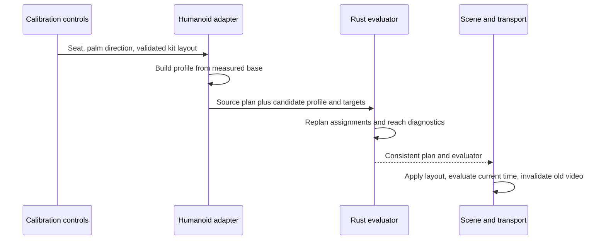

# Body, tool and kit calibration

**English** · [한국어](calibration.ko.md)

This chapter explains the adopted calibration design and its limits. Exact accepted
input ranges and coordinate conventions belong to the [rig contract](rig-contract.md).
The [reader guide](../../docs/calibration.md) covers operating the controls.
The [MIDI interpretation contract](midi-interpretation.md) defines which musical
event addresses which physical piece before body-dependent reach is evaluated.

## What must fit together

A standard humanoid supplies semantic joints, not a drum-playing setup. A short arm,
a long lower leg, a thick shoe and a different hand rest basis affect different parts
of the contact problem. Uniformly scaling the visible avatar or drum mesh does not
solve all of them.

| Quantity | Owner | Effect |
| --- | --- | --- |
| Rest joints and segment lengths | Humanoid adapter | Defines the actual reachable body |
| Seated root position | Body calibration | Translates hips, shoulders and reference hands together |
| Grip frame and tool dimensions | Tool calibration | Relates a hand to its attached stick and measured tip |
| Sole/contact offset | Foot calibration | Relates the ankle node to a contact socket |
| Kit contact layout | Performance plan | Defines where the musical action must arrive |
| Appearance scale/material | Scene appearance | Changes the rendered body without moving the musical target |

The implementation deliberately has no avatar-name selector in the solver. A model
adapter provides measurements and semantic capabilities. The same numeric pipeline
handles the default skeleton and every accepted VRM.

## From rest pose to seated profile

The adapter measures upper/lower segments from normalized rest-joint world positions
and stores a base profile. A seat adjustment translates the reference body from that
base rather than repeatedly translating the previous result. This avoids accumulating
floating-point movement across adjustments.

Automatic fitting estimates a starting height from both pedal targets and measured
leg reach. The current heuristic reserves a fraction of total leg extension and uses
a shared forward reference. It does not optimize shoulder comfort, wrist limits,
skin clearance or all drum targets. Implementation details live in
[`getAutomaticCalibration`](../../src/rig-humanoid.ts).

## Bounded kit fitting

Different arm-to-leg ratios can require target layout changes even when both feet
reach their pedals. An explicit **Fit kit to body** operation uses
[fit.rs](../../crates/drum-engine/src/fit.rs) to fit hand-played surfaces in two stages:

1. Search a uniform transform. Scale positions around `[0, 1.235, 0.06]` metres
   and contact radii together, from 100% down to 60% in 2% steps. Lateral shift is
   zero. Shared vertical shift is bounded to ±0.5 m; forward shift ranges from
   −0.25 to +0.10 m in 0.025 m steps. Height candidates are zero plus the mean
   shoulder height minus 1.235 m, offset by −0.12 to +0.12 m in 0.03 m steps.
2. For each reachable candidate, repair only surfaces that fail the posture checks
   below. Local translation relative to that candidate is `Δx = 0`,
   `Δy ∈ [−0.25, 0] m`, `Δz ∈ [0, +0.30] m`, sampled in 0.025 m steps.
   Choose the smallest squared local displacement that passes; this step does not
   change radii. Closed/open hi-hat move together in both stages. Kick and both
   pedal contacts remain unchanged.

Try the original layout with local repair first. Otherwise prefer the largest scale
with a complete candidate, then minimize the common squared displacement multiplied
by the number of kit entries plus the sum of squared local displacements. A failed
local repair does not stop the search for another uniform candidate or smaller scale.

For profiles with `handFrames`, `complete` requires designated hands to pass reach
and skeletal posture checks at contact and two preparation samples. The samples are
`(vertical lift in metres, tool pitch in radians)`: `(0, 0)`, `(0.055, −0.20)` and
`(0.11, −0.42)`. Each sample must be reachable, with these bounds:

- At or below shoulder-height targets, elbow height is at most shoulder height plus
  0.10 times upper-arm length. Higher targets are exempt from this height bound.
- Elbow forward position is at least shoulder Z minus 0.35 times upper-arm length.
- Wrist forward position is at least shoulder Z plus 0.15 times forearm length.

Snare checks both hands; other surfaces use their designated preferred hand.
Legacy profiles without `handFrames` retain static reach checks only. These sampled
guards do not certify every frame, transfer speed, anatomical joint comfort or
skin/instrument clearance.

The proposal records the uniform `scale` and `translation`, plus `pieceAdjustments`
entries containing `pieceId` and local `translation`. If no complete candidate exists,
return the **original layout unchanged**, `scale: 1`, zero translation,
`pieceAdjustments: []`, `complete: false` and failing `unreachablePieceIds`; those IDs
can indicate posture failure as well as reach failure. The UI does not apply an
incomplete proposal and asks for manual seat/target adjustment. It applies a complete
proposal and replans only on the explicit action, never silently on character import.
Fitting a successful result again leaves the layout unchanged and returns no local
adjustments. Automatic collision-free fitting and controlled short/tall VRoid
comparisons remain separate unfinished work.

## Contact is a transform chain

A stick is attached to the actual raw hand. Its world tip is computed through the
hand, grip/socket and tool transforms, conceptually:

`worldTip = worldHand × handToGrip × gripToTool × localTip`

The solver must satisfy both the target point and a meaningful tool orientation.
Subtracting a constant world-space stick vector would detach grip orientation from
the hand. Writing a correct-looking tip position after solving the skeleton would
hide an attachment error. The rendered endpoint is therefore an independent observed
quantity in contact checks.

The hand mount is diagonal across the measured palm. Available finger bones curl
around it; missing fingers use a less detailed fallback. The adapter supplies measured
forearm/palm axes and a desired palm direction in `handFrames`. The Rust solver treats
the forearm and attached tool as a compound link, solves the elbow toward each target,
then recovers the actual wrist and tool orientation while preserving bone lengths.
Its common bend preference points down with modest outward/forward clearance, rather
than deriving an elbow pole from the wrist rest target. This reduces upward/backward
folding near the body; the fit guards above still check the resulting posture.
Forearm roll follows the desired palm direction where geometry permits.

This replaces a fixed world hand orientation with a target-dependent neutral wrist;
stroke pitch is applied around that calibrated relationship. It does not implement
per-joint anatomical limits, skin collisions or every grip style. Contact error and
hand-forward/forearm swing are distinct observations: inspect both, including the
rendered fingers and mesh, before claiming a natural grip.

## Calibration update transaction

A successful update changes kit contacts and all matching `hit.target` fields
consistently through `pieceId`, then applies the body-dependent evaluator. Two
crashes sharing an instrument role retain independent contact entries; moving one
does not move the other. Original event IDs, ticks,
notes, velocity and times are preserved. Audio does not need a new musical arrangement.
If the update fails, restore the prior calibration/layout rather than leaving a
half-updated body and plan. The application pauses while changing calibration and
keeps conflicting preparation/import/export operations from interleaving.

Closed/open hi-hat are two semantic voices using one surface; their target movement
is coupled. Hi-hat pedal is a separate foot contact. Kick's target in this model is
the pedal contact, not the front of the visible bass drum.

## Feet and support

The profile evaluator places both feet at their pedal contacts at rest, including
MIDI with no pedal events. The implemented stroke keeps the hip/knee/ankle chain
fixed and rotates the foot through a small preparation/press envelope. Impossible
idle pedals receive an explicit diagnostic rather than elongated bones.

The optional short open/close interpretation drives a small time-based left-foot
pitch instead of adding an independent foot strike for the paired close. Source and
control semantics belong to [MIDI interpretation](midi-interpretation.md); cymbal-gap
geometry and measured pedal pressure are not implemented.

A fixed ankle is not proof that the heel is grounded. A sole socket is not an exact
shoe mesh surface. Full heel-down/up mechanics require support regions and potentially
ankle/knee translation, described in [performance expression](performance-expression.md).
Those extensions must preserve the existing event-time and repeatability constraints.

## Stable mounts and replaceable drum bodies

The kit separates a calibrated contact/mount from the replaceable shell, head or
cymbal. Presets and local body-only GLB swaps preserve common stands/pedals; intentional
layout changes may reposition the associated hardware. Source-specific mesh extraction
is an appearance adapter concern and never changes the avatar solver.

The part appearance scale remains cosmetic and does not move its target. The explicit
kit-fit operation instead updates physical positions and radii, reflected by body
fitting and associated hardware. Neither operation scales the avatar or its bones.

## Historical evidence and remaining design

Read the [calibration evidence](../../docs/verification/calibration-unreleased.md)
and [palm follow-up](../../docs/verification/palm-orientation-unreleased.md)
for their original executed scope and observed wrist/skin limits. The
[fit/ready-pose proposal](../../docs/research/snare-ready-and-kit-fit.md)
records the design motivation; this contract defines the implemented subset. Historical details remain in
[ADR 0005](../../docs/decisions/0005-calibration-pedals-hardware.md), without rewriting its
original scope or test results as current universal claims.
