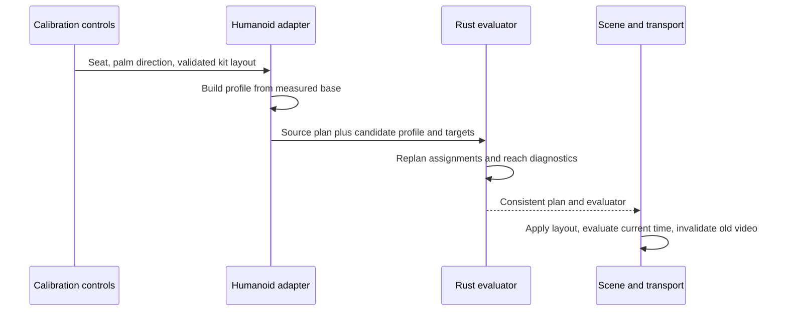

# Body, tool and kit calibration

**English** · [한국어](calibration.ko.md)

This chapter explains the adopted calibration design and its limits. Exact accepted
input ranges and coordinate conventions belong to the [rig contract](rig-contract.md).
The [reader guide](../../docs/calibration.md) covers operating the controls.

## What must fit together

A standard humanoid supplies semantic joints, not a drum-playing setup. A short arm,
a long lower leg, a thick shoe and a different hand rest basis affect different parts
of the contact problem. Uniformly scaling the visible avatar or drum mesh does not
solve all of them.

| Quantity | Owner | Effect |
| --- | --- | --- |
| Rest joints and segment lengths | Humanoid adapter | Defines the actual reachable body |
| Seated root position | Body calibration | Translates hips, shoulders and reference hands together |
| Grip frame and tool dimensions | Tool calibration | Relates a hand to its attached stick and measured tip |
| Sole/contact offset | Foot calibration | Relates the ankle node to a contact socket |
| Kit contact layout | Performance plan | Defines where the musical action must arrive |
| Appearance scale/material | Scene appearance | Changes the rendered body without moving the musical target |

The implementation deliberately has no avatar-name selector in the solver. A model
adapter provides measurements and semantic capabilities. The same numeric pipeline
handles the default skeleton and every accepted VRM.

## From rest pose to seated profile

The adapter measures upper/lower segments from normalized rest-joint world positions
and stores a base profile. A seat adjustment translates the reference body from that
base rather than repeatedly translating the previous result. This avoids accumulating
floating-point movement across adjustments.

Automatic fitting estimates a starting height from both pedal targets and measured
leg reach. The current heuristic reserves a fraction of total leg extension and uses
a shared forward reference. It does not optimize shoulder comfort, wrist limits,
skin clearance or all drum targets. Implementation details live in
[`getAutomaticCalibration`](../../src/rig-humanoid.ts).

The general fitting principle is adopted: measure the body, position the seat and
contacts, then re-evaluate reach. Automatic collision-free fitting and controlled
short/tall VRoid comparisons are separate unfinished work. Different arm-to-leg
ratios can require target layout changes even when both feet reach their pedals.

## Contact is a transform chain

A stick is attached to the actual raw hand. Its world tip is computed through the
hand, grip/socket and tool transforms, conceptually:

`worldTip = worldHand × handToGrip × gripToTool × localTip`

The solver must satisfy both the target point and a meaningful tool orientation.
Subtracting a constant world-space stick vector would detach grip orientation from
the hand. Writing a correct-looking tip position after solving the skeleton would
hide an attachment error. The rendered endpoint is therefore an independent observed
quantity in contact checks.

The current hand mount is diagonal across the measured palm. Available finger bones
curl around it; missing fingers use a less detailed fallback. Palm orientation is a
calibration choice carried partly by the forearm. This corrects a reference-frame
problem but does not provide target-dependent anatomical wrist constraints.

## Calibration update transaction

A successful update changes kit contacts and all matching `hit.target` fields
consistently, then applies the body-dependent evaluator. Original event IDs, ticks,
notes, velocity and times are preserved. Audio does not need a new musical arrangement.
If the update fails, restore the prior calibration/layout rather than leaving a
half-updated body and plan. The application pauses while changing calibration and
keeps conflicting preparation/import/export operations from interleaving.

Closed/open hi-hat are two semantic voices using one surface; their target movement
is coupled. Hi-hat pedal is a separate foot contact. Kick's target in this model is
the pedal contact, not the front of the visible bass drum.

## Feet and support

The profile evaluator places both feet at their pedal contacts at rest, including
MIDI with no pedal events. The implemented stroke keeps the hip/knee/ankle chain
fixed and rotates the foot through a small preparation/press envelope. Impossible
idle pedals receive an explicit diagnostic rather than elongated bones.

A fixed ankle is not proof that the heel is grounded. A sole socket is not an exact
shoe mesh surface. Full heel-down/up mechanics require support regions and potentially
ankle/knee translation, described in [performance expression](performance-expression.md).
Those extensions must preserve the existing event-time and repeatability constraints.

## Stable mounts and replaceable drum bodies

The kit separates a calibrated contact/mount from the replaceable shell, head or
cymbal. Presets and local body-only GLB swaps preserve common stands/pedals; intentional
layout changes may reposition the associated hardware. Source-specific mesh extraction
is an appearance adapter concern and never changes the avatar solver.

Visual scale is currently an appearance control. Making a shell smaller does not
bring its musical contact within reach. A future compact-kit fitting operation would
need to change physical dimensions, layout, tool offsets and checks deliberately;
it must not masquerade as a cosmetic scale change.

## Evidence and next design boundary

Read the [calibration evidence](../../docs/verification/calibration-unreleased.md)
and [palm follow-up](../../docs/verification/palm-orientation-unreleased.md)
for the executed scope, including remaining wrist/skin limits. The
[fit/ready-pose proposal](../../docs/research/snare-ready-and-kit-fit.md)
separates the next design from implemented behavior. Historical details remain in
[ADR 0005](../../docs/decisions/0005-calibration-pedals-hardware.md), without rewriting its
original scope or test results as current universal claims.
