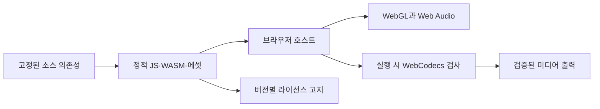

# 의존성과 실행 환경 설계

[English](dependencies.md) · **한국어**

이 문서는 기술 구성을 나눈 이유를 설명합니다. 정확한 버전, 무결성 값과 간접 의존성은
[package-lock.json](../../package-lock.json), [Cargo.lock](../../Cargo.lock),
[rust-toolchain.toml](../../rust-toolchain.toml),
[생성된 의존성 목록](../../docs/research/dependency-lock.md)이 관리합니다.
이 설명을 수동으로 관리하는 두 번째 lockfile로 만들지 않습니다.

## 계층별 책임

| 구성 요소 | 채택한 역할 | 해결하지 않는 경계 |
| --- | --- | --- |
| Rust + midly | 엄격한 SMF 해석, 정규화, 배정과 결정적 포즈 평가 | 자연스러운 연주 의도 추론이나 MIDI 편집 UI |
| serde / serde_json | 버전이 있는 JSON 계획·프로필 경계 | 문서가 존재한다고 스키마 검증이 이루어지는 것은 아님 |
| wasm-bindgen / wasm-pack | 브라우저 연결과 재현 가능한 WASM 빌드 | 스레딩, 호스트 코덱 지원이나 렌더러 동작 |
| Three.js | 장면 그래프, WebGL, 변환, 재질과 가져온 지오메트리 | 음악적 이벤트 시각이나 자동 해부학적 리타게팅 |
| three-vrm | VRM 로딩과 정규화·원본 휴머노이드 규약 | 체형별 키트 도달성, 스틱 그립, 접촉 보존이나 모델 권리 |
| Mediabunny + WebCodecs | 타임스탬프가 있는 프레임·오디오 인코딩과 컨테이너 출력 | 모든 OS·브라우저에서 보장되는 코덱 |
| Lucide | 일관된 SVG 조작 아이콘 | 앱의 상호작용·상태 설계 |
| TypeScript / Vite / Vitest | 브라우저 타입, 정적 빌드와 테스트 | 실행 기능이나 배포 증거 |

의존성 선언의 기준은 [package.json](../../package.json)과
[엔진 manifest](../../crates/drum-engine/Cargo.toml)입니다. 현재 Rust는 작은 벡터·쿼터니언
연산을 엔진 안에서 수행하며, 과거 후보였던 `glam`은 직접 채택된 의존성이 아닙니다.
VRM을 표준으로 택했다고 해서 upstream 저장소의 모든 샘플 아바타를 제품에 포함하는
것도 아닙니다.

## 엔진을 분리하는 이유

Rust는 원본 이벤트 시각, 배정, 궤적과 진단을 담당합니다. 수치 `RigProfile`을
전달하면 Three.js 메시·본 이름이 엔진으로 들어가지 않고 네이티브 회귀 검사를
실행할 수 있습니다. 브라우저는 모델별 지오메트리를 측정하고 계산 결과를 적용합니다.
이 경계는 향후 CLI나 다른 렌더러를 만들 여지를 남기지만 그런 제품이 이미 있다는
뜻은 아닙니다.

midly 선언은 기본 기능을 끄고 `std`와 `strict`를 켭니다. 따라서 단일 스레드
브라우저 빌드에 병렬 해석 기능이 암묵적으로 요구되지 않습니다. 워커 분리는 준비 중
응답성을 제공하며 스레드 WASM이나 공유 메모리를 배포 요건으로 만들지 않습니다.

## 정적 호스팅과 실행 시 기능

빌드는 `/drum-vrm/` 아래에서 제공되며 파일 처리용 백엔드가 필요하지 않습니다.
사용자가 선택한 파일은 로컬 바이트로 전달되며 앱 서버로 업로드되지 않습니다.
WASM, 워커와 에셋은 같은 프로젝트 기준 경로에서 찾을 수 있어야 합니다.

SIMD·스레딩을 추구한다는 이유만으로 교차 출처 격리나 검증되지 않은 호스팅 헤더
우회 방법을 요건으로 추가하지 않습니다. 구체적인 병목을 먼저 측정하고 환경·취소
처리에 미칠 영향을 검토합니다. 브라우저 API 유무와 코덱 지원은 서로 다른 검사입니다.
[오디오·출력 계약](audio-export-contract.ko.md)은 실제 인코딩·디코딩 검사를 요구합니다.

## 소스와 배포 의무

자체 코드의 MIT 라이선스는 각 의존성과 에셋의 라이선스와 독립적입니다.
MPL이 적용되는 Mediabunny 소스에는 배포 빌드에 해당하는 소스 제공·고지 처리가
필요합니다. Mozilla의 [MPL FAQ](https://www.mozilla.org/en-US/MPL/2.0/FAQ/)는 의무가
파일 단위로 적용됨을 설명하고 소스 배포와 실행물 배포를 구분합니다.
고정된 버전을 기준으로 실제 포함된 패키지 고지와 소스 링크를 생성합니다.
upstream 브랜치 URL만으로는 패키지의 정체성을 고정할 수 없습니다.

[제3자 자료 정책](../../docs/research/license-policy.md)은 채택 시 기록할 항목과 고지
관리를 정의합니다. 빌드 전용 도구, 배포 코드와 모델 파일은 별도 목록 범주입니다.
원본 모델 라이선스와 필요한 저작자 표시는 에셋 옆에 유지합니다. 라이브러리의 MIT
라이선스가 임의의 아바타·텍스처·사운드 팩 사용을 허가하지는 않습니다.

## 대안과 채택 조건

| 경로 | 현재 판단 | 채택 전에 필요한 근거 |
| --- | --- | --- |
| CCDIKSolver | 주 Rust two-bone 솔버가 아님 | 접촉, 휴지 기준, 수렴과 평가 순서 독립성 |
| GLTFExporter / VRMA | 향후 모션 출력 작업 | 명시적 베이킹, 확장 보존, 리타게팅 후 접촉 복원과 권리 |
| ffmpeg.wasm / 추가 인코더 | 포함하지 않음 | 정확한 코어 빌드, 의존성 권리, 메모리, 취소와 실측 이득 |
| ONNX 또는 학습·검색 모션 | 통합하지 않음 | 재현 가능한 모델·데이터·가중치, 권리, 기준선 실패와 비교 가능한 평가 |
| WAV 입력과 동기화 | 추가 의존성 없이 브라우저 Web Audio로 구현 | [지원 형식·오프셋·시간·출력 계약](audio-export-contract.ko.md); 대상 브라우저별 검증 필요 |

이는 프로젝트의 선택이며 대안 자체가 본질적으로 부적합하다는 뜻은 아닙니다.
[원래 의존성 조사](../../docs/research/dependencies.md)에 1차 출처, 후보 선택 이유와
미검증 가정을 보존합니다. 새로운 채택 결정은 해당 구현 계약을 갱신하고,
이전 조사는 검토했던 대안의 근거로 유지합니다.

## 갱신 검토

의존성을 바꿀 때마다 실행·API 변경, 간접 패키지, 라이선스·소스 링크와 영향을 받는
브라우저 동작을 검토합니다. Lockfile과 생성 고지를 일치시키고 변경 경계에 맞는
검증을 수행한 뒤 검사한 리비전을 기록합니다. 설치나 빌드 성공만으로 모델 호환성,
올바른 미디어 시각이나 공개 배포를 입증할 수는 없습니다.
