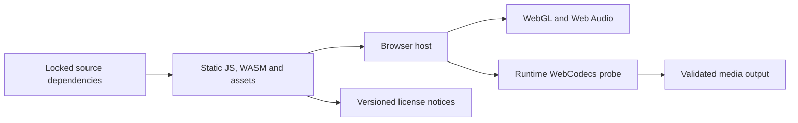

# Dependency and runtime design

**English** · [한국어](dependencies.ko.md)

This chapter explains why the stack is divided as it is. Exact versions, integrity
values and transitive packages belong to [package-lock.json](../../package-lock.json),
[Cargo.lock](../../Cargo.lock), [rust-toolchain.toml](../../rust-toolchain.toml) and the
[generated dependency inventory](../../docs/research/dependency-lock.md).
Avoid turning this explanation into a second manually maintained lockfile.

## Responsibility by layer

| Component | Adopted role | Boundary it does not solve |
| --- | --- | --- |
| Rust + midly | Strict SMF parsing, normalization, assignment and deterministic pose evaluation | Natural performance inference or MIDI editing UI |
| serde / serde_json | Versioned JSON plan/profile boundary | A document's presence is not schema validation |
| wasm-bindgen / wasm-pack | Browser binding and reproducible WASM build | Threading, host codec support or renderer behavior |
| Three.js | Scene graph, WebGL, transforms, materials and imported geometry | Musical event timing or automatic anatomical retargeting |
| three-vrm | VRM loading and normalized/raw humanoid conventions | Body-to-kit reach, stick grip, contact preservation or model rights |
| Mediabunny + WebCodecs | Timestamped frame/audio encoding and container output | A guaranteed codec on every OS/browser |
| Lucide | Consistent SVG controls | Application interaction/state design |
| TypeScript / Vite / Vitest | Browser types, static build and tests | Runtime feature or deployment evidence |

The authoritative dependency declarations are [package.json](../../package.json) and
[the engine manifest](../../crates/drum-engine/Cargo.toml). Rust currently performs its
small vector/quaternion operations within the engine; the historical `glam` candidate
is not a direct adopted dependency. Likewise, standardization on VRM does not mean
all example avatars in an upstream repository are part of this product.

## Why the engine stays separate

Rust owns source-event timing, assignment, trajectories and diagnostics. Passing a
numeric `RigProfile` keeps Three.js mesh/bone names out of the engine and makes native
regression checks possible. The browser measures model-specific geometry and applies
the solved result. This boundary also leaves future CLI or alternate-renderer work
possible without claiming those products already exist.

The midly declaration disables default features and enables `std` plus `strict`.
This avoids implicitly requiring its parallel parsing feature in the single-threaded
browser build. Worker separation provides responsive preparation without making
threaded WASM or shared memory a deployment requirement.

## Static hosting and runtime capabilities

The build is served under `/drum-vrm/` and does not require a file-processing backend.
User file selection supplies local bytes; it is not an upload to an application server.
WASM, workers and assets must resolve under the same project base path.

Do not add a requirement for cross-origin isolation or an unverified hosting-header
workaround merely to pursue SIMD/threading. First measure a concrete bottleneck and
review the environment and cancellation implications. Browser API availability and
codec support are different checks; the [audio/export contract](audio-export-contract.md)
requires an actual encode/decode probe.

## Source and distribution obligations

The own-code MIT license is independent of each dependency and asset. Mediabunny's
MPL-covered source needs the applicable source-availability and notice handling in
our distributed build. Mozilla's [MPL FAQ](https://www.mozilla.org/en-US/MPL/2.0/FAQ/)
explains that the obligations are file-scoped and distinguishes source from executable
distribution. The exact included package notices and source links are generated for
the locked version; an upstream branch URL alone is not a package identity.

The [third-party policy](../../docs/research/license-policy.md) defines adoption fields and notice
maintenance. Build-only tools, shipped code and model files are separate inventory
categories. Original model licenses and required attribution remain beside those assets.
A library's MIT license does not authorize arbitrary avatars, textures or sound packs.

## Alternatives and adoption gates

| Path | Current disposition | Evidence needed before adoption |
| --- | --- | --- |
| CCDIKSolver | Not the main Rust two-bone solver | Contact, rest basis, convergence and order-independent evaluation |
| GLTFExporter / VRMA | Future motion-output work | Explicit baking, extension retention, recontact after retargeting and rights |
| ffmpeg.wasm / extra encoders | Not bundled | Exact core build, dependency rights, memory, cancellation and measured benefit |
| ONNX or learned/retrieved motion | Not integrated | Reproducible model/data/weights, rights, baseline failures and comparable evaluation |
| WAV input and synchronization | Separate future feature | Offset/time contract, decoded audio behavior and combined export checks |

These are project dispositions, not claims that an alternative is inherently unsuitable.
The [original dependency investigation](../../docs/research/dependencies.md)
preserves primary links, original candidate reasoning and unverified assumptions.
New adoption decisions update the corresponding implementation contract and retain
the earlier investigation as evidence of the alternatives considered.

## Upgrade review

Review executable/API changes, transitive packages, license/source links and affected
browser behavior with each dependency change. Keep the lockfile and generated notices
consistent, run boundary-appropriate validation and record the tested revision.
A successful package install or build does not demonstrate model compatibility,
correct media timing or a released public artifact.
