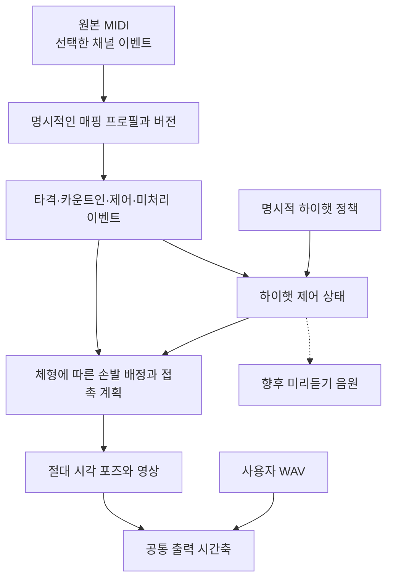

# MIDI 해석

[English](midi-interpretation.md) · **한국어**

이 계약은 원본 MIDI, 악기 매핑, 연주 의도와 상태를 바꾸는 제어의 경계를 정의합니다.
[엔진 계약](engine-contract.ko.md)은 입력 제한·시간 변환·손발 배정·WASM/포즈 API를,
[보정](calibration.ko.md)은 신체와 접촉 맞춤을,
[연주 표현](performance-expression.ko.md)은 주법과 선택적 동작을 담당합니다.

## 해석하기 전에 근거를 보존한다

MIDI 파일은 메시지를 기록하며 물리적 연주 방법을 하나로 정하지는 않습니다.
노트 번호에는 악기 매핑이 필요하고, 짧은 간격만으로 주법을 확정할 수 없으며,
velocity가 관절 각도를 지정하지도 않습니다. 해석과 그 근거를 분리합니다.

실선은 구현된 경계를 나타냅니다. 점선의 음원 경로는 확장이며 기존 합성 드럼은
부분 개방 하이햇 샘플을 재현하지 않습니다.

| 계층 | 책임 | 조용히 바꾸면 안 되는 것 |
| --- | --- | --- |
| 원본 | 트랙·이벤트 식별자, 채널 메시지, tick, 한 번 반올림한 시각 | 메시지 값과 원본 시각 |
| 매핑 | 악기 역할, 주법, 실물 부품 | 원본 노트 번호와 이벤트 식별자 |
| 의도 | 명시적 해석 또는 별도로 표시한 제안 | 근거를 확정된 사실로 취급하는 것 |
| 제어 | 하이햇 개방량, 심벌 뮤트 등의 상태 | 상태 변화를 추가 타격으로 취급하는 것 |
| 동작 | 실행 가능한 손발 배정, 준비, 접촉, 회복 | 잘못된 자세를 숨기기 위한 음악 시각 변경 |

[model.rs](../../crates/drum-engine/src/model.rs),
[midi.rs](../../crates/drum-engine/src/midi.rs),
[interpretation.rs](../../crates/drum-engine/src/interpretation.rs)의 Rust 구현이 직렬화 동작의 기준입니다.
브라우저 타입은 이 경계를 반영하며 장면 객체 이름이나 아바타 식별자는 매핑을 정의하지 않습니다.

## 원본 이벤트의 범위와 식별자

`PerformancePlan` 스키마 2는 선택한 트랙과 채널 필터에 해당하는 `sourceEvents`를
보존합니다. 각 이벤트에는 `track:eventIndex` 형식의 `id`와 `track`, `eventIndex`,
`tick`, `timeUs`, `channel`, 종류를 구분한 `message`가 있습니다.

보존하는 채널 메시지 종류는 `noteOn`, `noteOff`, `controller`, `programChange`,
`pitchBend`, `polyAftertouch`, `channelAftertouch`입니다. 피치 벤드는 부호 없는
14비트 값을 사용합니다. velocity가 0인 note-on도 근거에는 note-on으로 남지만
타격을 만들지는 않습니다. 템포와 박자는 별도의 시간 맵에 있습니다.

무손실 SMF 편집기나 보관 형식은 아닙니다. 선택하지 않은 이벤트, 임의의 메타 이벤트
페이로드와 SysEx 페이로드는 `sourceEvents`에 복사하지 않습니다. 다시 가져올 수
있도록 원본 로컬 파일을 보관합니다. 메시지를 보존한다고 그 음악적 효과까지
구현되어 있다는 뜻은 아닙니다.

`interpretations`는 `sourceEventId`로 각 보존 이벤트를 참조하고 `strike`, `countIn`,
`control`, `omitted`, `unmapped`, `preserved`로 분류합니다. 타격에는 `hitId`와 악기·실물 부품·주법이
연결됩니다. `preserved`는 현재 소비하지 않는 note-off와 CC처럼 동작·제어 효과를
적용하지 않고 보존한다는 뜻입니다. 미지원 양의 note-on은 `unmapped`로 남고 진단을 제공합니다.
명시적 하이햇 정책은 닫힘을 두 번째 타격 대신 `control`로 해석하고
`relatedSourceEventId`로 열림 이벤트를 참조할 수 있습니다.
`omitted`는 원본 메시지와 존재하는 매핑 메타데이터를 유지하면서 명시적으로 연주에서
제외했음을 기록하며, 타격이나 제어를 만들지 않습니다.

보정은 타격의 타점과 손발을 바꿀 수 있지만 원본 이벤트는 바꾸지 않습니다.
다른 매핑을 선택하면 타격 배열의 인덱스가 달라질 수 있습니다. 같은 파일의 서로
다른 해석 결과를 연결할 때는 원본 이벤트 식별자를 사용합니다.

## 매핑 프로필과 실물 부품

`Selection.mappingProfile`로 `gm` 또는 `logicDkdGm`을 명시적으로 선택하며,
생략하면 `gm`입니다. 계획에는 `mappingProfile`, `mappingVersion`(현재 `"1"`)과
카운트인 선택을 기록합니다.
파일명, 트랙 이름, 아바타나 익숙한 노트 하나로 프로필을 추정하지 않습니다.

`logicDkdGm`은 구현된 Drum Kit Designer GM 모드의 부분 집합을 지원합니다.
모든 Logic 악기, 브러시 동작, GM + ModWheel 또는 V-Drum 모드를 지원한다는 뜻은
아닙니다. 모르는 매핑은 진단으로 남깁니다. 같은 MIDI 키의 옥타브 표시는 DAW마다
다를 수 있으므로 정수 노트 번호를 기준으로 합니다.

| MIDI 노트 | `gm` | `logicDkdGm` |
| --- | --- | --- |
| 32 / 34 | 미매핑 | 스네어 `rimshotEdge` / `edge` |
| 33 | 미매핑 | 하이햇 `footClose` |
| 38 / 40 | 스네어 `center` / `electric` | 스네어 `center` / `rimshot` |
| 42 / 44 / 46 | 하이햇 `closed` / `footClose` / `open` | 같은 의미 |
| 49 / 57 | 좌우 크래시 부품 | 좌우 크래시 부품 |
| 52 | 크래시 `china` | 라이드 `edge` |
| 75 | 명시적 선택 시에만 카운트인, 아니면 미매핑 | 같은 의미 |

이 표는 프로필 차이를 설명하며 지원 노트 전체 목록은 아닙니다. 모든 허용 노트의
기준은 매핑 구현입니다. Logic의 풋 스플래시와 크래시 정지 키는 대응 동작·제어를
지원할 때까지 미매핑으로 남습니다.

`Instrument`는 음악적 역할이고 `KitPiece.id`는 실제 접촉 항목을 식별합니다.
각 부품에도 `instrument`가 있습니다. 타격은 `instrument`, `pieceId`, `articulation`을
함께 기록합니다. 예를 들어 `crash`와 `crashRight`는 `crash` 역할을 공유하는 별도
부품이며 독립적으로 이동·선택·배정할 수 있습니다. 외형 프리셋에서 심벌 본체를
재사용해도 두 접촉점을 합치지는 않습니다.

호환성을 위한 `hihat`·`openHat` ID는 여전히 한 표면의 연결된 위치를 가리키며,
`pedalHat`은 별도 발 접촉점을 가리킵니다. 두 하이햇 심벌이 독립적으로 존재한다는
뜻은 아닙니다. 이벤트를 림샷으로 식별하는 것과 접촉 영역별 림샷 역학을 구현하는
것도 구분합니다.

`Selection.countInNote75`의 기본값은 false입니다. 지원하는 두 프로필 중 어느 쪽에서든 켜면 노트 75를
카운트인 지시로 명시적으로 해석합니다. 원본 이벤트는 보존하지만 드럼 타격, 손발
배정이나 합성 타격음을 추가하지 않습니다. 다른 파일에서는 같은 노트가 실제 타악기
연주일 수 있으므로 이 선택은 보이고 되돌릴 수 있어야 합니다. 자동 카운트인 감지는
아닙니다. [명시적 카운트인 제스처](equipment-contact.ko.md#명시적-스틱-카운트인)는
양손의 여유와 신체·장비 제약이 허용하면 실제 두 팁을 맞닿게 합니다. 이 별도 표현
트랙은 드럼 `Hit`를 만들거나 원본 cue를 바꾸지 않으며 실패하면 진단을 남깁니다.

## 명시적 연주 편집

`Selection`과 스키마 2 계획은 되돌릴 수 있는 원본 이벤트 기반 지시 두 가지를 보존합니다.

| 필드 | 의미 |
| --- | --- |
| `omittedSourceEventIds` | 이 연주에서 제외한 양의 note-on 원본 ID 배열, 기본값 `[]` |
| `handOverrides` | 유지한 손 타격의 원본 ID를 왼손 `0` 또는 오른손 `1`에 연결하는 객체, 기본값 `{}` |

ID는 타격 배열 인덱스, 곡 파일명이나 아바타가 아닌 기존 `track:eventIndex`를 사용하며,
선택한 트랙·채널에 존재해야 합니다. 제외 지시는 중복 ID, 양의 velocity가 아닌 이벤트와
note-on 이외 이벤트를 거부합니다. 손 지정은 매핑되어 있고 제외하지 않은 손 타격만
가리킬 수 있습니다. 발 이벤트, 지시와 미매핑 노트에는 손을 지정할 수 없습니다.
지정을 제거하면 해당 이벤트는 자동 배정으로 돌아갑니다. 원본 메시지, tick, velocity,
곡 길이와 원본 MIDI는 그대로 유지합니다.

제외 처리는 하이햇 제어 파생보다 먼저 적용합니다. 제외한 열림·닫힘은 쌍을 만들거나
준비 시간을 제한하지 않습니다. 남은 연주 이벤트로 제어를 다시 계산한 뒤 보존된 원본
참조를 검증합니다. 손 지정은 도달·점유·이동 검사를 거쳐 계획기에서 허용할 손을 제한합니다.
지정 손으로 불가능하면 타격을 미배정 상태와 진단으로 유지하며 다른 손으로 바꾸거나
시각을 옮기지 않습니다. 명시적 제외는 해결하지 못한 필수 타격과 구별합니다.
기존 합성 미리듣기는 편집된 타격을 따르지만 사용자 WAV는 어느 지시로도 편집하지 않습니다.

계획을 불러올 때 ID를 다시 검증하고 해석·제어의 일관성을 다시 계산합니다. 해석·타격을
맞추지 않고 제외 목록만 바꾼 계획은 거부합니다. 기존 스키마 2 계획은 빈 지시를 기본값으로
사용합니다. 스키마 1에는 보존된 원본 근거가 없으므로 빈 값이 아닌 지시를 넣을 수 없습니다.
이벤트 검사에서 제외와 자동·왼손·오른손을 선택하며,
[프로젝트 형식](project-format.ko.md)은 선택한 지시를 계획과 함께 보존합니다.

## 명시적 하이햇 의도와 제어 상태

오픈 하이햇 뒤의 풋 클로즈는 짧은 오픈 소리, 독립된 발 타격음 또는 부분 개방 음색을
만들기 위한 편집일 수 있습니다. 해당하는 연속 제어나 명시적인 사용자 지시가 없다면
짧은 간격만으로 개방량을 하나로 확정할 수 없습니다.

`Selection.hihatPolicy`와 대응 계획 필드는 `literal`(기본값) 또는 `shortOpenClose`를
선택합니다. 후자는 지원하는 두 매핑에서 명시적으로 선택하는 정책이며 자동 의도 감지가
아닙니다. 같은 채널에서 매핑된 양의 풋 클로즈를 가장 가까운 앞선 미연결 오픈 하이햇과
연결하며, 선택한 여러 트랙에 걸쳐 있어도 됩니다. 매핑된 닫힌 하이햇이 오면 대기 중인
오픈을 취소하고, 다른 오픈이 오면 교체합니다. 간격은 0보다 크고 80 ms와 해당 위치의
4분음표 길이의 1/4 이하를 모두 만족해야 합니다. 서로 충돌하는 제어 구간은
진단과 함께 독립적인 발 타격으로 유지합니다. 선택한 채널은 하나의 물리적 하이햇을
공유하므로 다른 선택 채널의 닫힘과 충돌하는 경우에도 같은 원칙을 적용합니다.

각 쌍의 `controls`에는 `kind: hihatClose`, 닫힘의 `sourceEventId`, 열림의
`openSourceEventId`, `releaseStartTimeUs`, `openTimeUs`, 닫힘의 `timeUs`, `openness`를 기록합니다.
닫힘은 타격에서 제어 해석으로 바뀌지만 원본 두 메시지, velocity와 시각은 유지합니다.
연결되지 않은 이벤트는 원래 의미로 남습니다. `hihatOpenness`는 단위 없는 0.05–1.0
설정이며 기본값은 0.2입니다. 실측 심벌 간격이나 원본 악기의 소리를 입증하는 값은
아닙니다. 계획을 불러올 때 저장된 제어를 원본 이벤트·선택 정책과 대조하여 검증합니다.

절대 시각 평가에서는 손 타격 전 최대 100 ms 동안 부드럽게 열고 원본 닫힘 시각에는
0이 됩니다. 부호 있는 `releaseStartTimeUs`는 열림 시각에서 100 ms를 뺀 값과
선택한 모든 채널의 가장 최근 매핑된 닫힌 하이햇·풋 클로즈 시각 중 늦은 값입니다.
독립 타격으로 남은 닫힘도 포함하되 제외한 이벤트는 사용하지 않습니다. 노트 33은
해당 역할을 부여한 매핑에서만 닫힘을 제한합니다. 시작 시각은 곡 시작 전 준비를 위해
음수가 될 수 있습니다. 준비 시간이
남지 않는 닫힘 또는 열린 구간 안의 닫힘이 있으면 연결하지 않습니다. 불러오기에서
원본 이벤트로 준비 경계를 다시 계산하므로 수정된 곡선이 원본 닫힘을 덮어쓸 수 없습니다.
발목은 페달 배치의 위치를
유지하고 발이 작은 해제 회전을 따릅니다. 뒤꿈치·발바닥 지지나 실제 페달 연결을
측정한 기능은 아닙니다. 제어 구간은 닫힌 양 끝점까지 담당하며, 뒤따르는 독립 발
타격의 준비는 앞선 제어 닫힘보다 먼저 시작하지 않습니다. 같은 곡선을 재생·탐색·출력에서 상태 누적 없이
평가합니다. 보존된 CC는 아직 개방량을 구동하지 않으며 `literal`에서는 자동 연결하지 않습니다.
현재 시각 상태는 발목을 구동하며 심벌 메시 사이의 간격은 바꾸지 않습니다.

이 정책은 선택한 연주 편집에 적용합니다. 명시적 제외는 이미 제어 파생보다 먼저
적용하며, 향후 이벤트별 개방량·구간별 덮어쓰기와 연속 제어는 다음 우선순위를 따라야 합니다.

1. 선택한 원본 이벤트나 구간에 대한 명시적 사용자 지시를 적용합니다.
2. 제어 값은 그 의미를 정의한 프로필을 통해서만 해석합니다.
3. 맥락 추론은 규칙·버전·원본 참조가 있는 제안으로 표시하며 앞선 두 근거를 조용히
   덮어쓰지 않습니다.

손 타격, 들리는 발 타격음, 개방량·압력과 소리 차단은 서로 다른 개념입니다.
합성음은 다음 닫힌 하이햇·페달 타격 또는 파생된 닫힘 제어에서 오픈 하이햇 소리를
끊되 시작 시각은 바꾸지 않습니다. 샘플러의 부분 개방 음색을 재현하는 기능은 아닙니다.
이 작업은 별도의
페달 정책 문서를 만드는 대신 [연주 표현](performance-expression.ko.md)의 T06을 확장합니다.

## Velocity와 손 배정: 확장 경계

주어진 시간에 맞추기 위해 동작 크기를 줄이더라도 원본 velocity는 보존합니다.
Velocity, 주변 이벤트와 명시적 주법으로 스트로크를 정할 수 있지만 velocity 하나가
힘, push-pull 주법이나 감정을 확정하지는 않습니다.

구간 단위 손 배정은 동시 연주 요구를 지키면서 실행 가능한 손 순서, 악센트와 회복을
비교해야 합니다. 다른 손이 사용 중일 수 있으므로 모든 반복 노트를 교대로 치는 것은
보편적인 해법이 아닙니다. [연주 표현](performance-expression.ko.md)의 T07·T09에
연결합니다. 자연스러운 손목 자세와 체형별 도달 범위는 [보정](calibration.ko.md)의 책임입니다.

오디오 구현은 같은 해석을 샘플 레이어, 개방량과 소리 차단에 사용할 수 있지만
아바타의 손을 결정하지는 않습니다. 사용자 WAV 대체는
[오디오·출력 시간 계약](audio-export-contract.ko.md)을 따르며 VST 호스트나
Logic 음원 엔진 재현을 요구하지 않습니다.

## 가져오기 안내

조작부는 [조사](../../docs/research/ergonomics-and-sticking.md)에 따라 악기 매핑과
연주 의도를 구분합니다. Standard MIDI File은
제작 프로그램 식별자를 보장하지 않고, 한 DAW에서도 다른 악기 매핑으로 내보낼 수
있습니다. 브라우저는 노트 기반 매핑 근거를 보여주며 Logic 파일이라고 단정하거나
프로필을 자동 선택하지 않습니다.

**드럼 음원 매핑 / 연주 해석** 아래에 준비한 선택의 카운트인 후보와 적용 가능한
하이햇 제어 선택을 보여줍니다. 짧은 열림·닫힘 처리는 DAW 식별 대신 매핑된 역할을
사용합니다. 짧은 쌍이 자동으로 부분 열림이 되는 것도, 노트 75가 항상 카운트인인 것도
아닙니다. 컨트롤러 해석에도 의미를 정의한 프로필이 필요합니다. 확인한 정책과 원본
이벤트 편집은 [프로젝트 형식](project-format.ko.md)에 저장합니다. 이 조작부가 다른 악기
매핑이나 컨트롤러 지원을 뜻하지는 않습니다.

## 포함된 데모의 선택 설정

[src/demo-catalog.ts](../../src/demo-catalog.ts)가 선택 가능한 데모와 명시적인
`Selection` 값을 관리합니다. 데모를 선택하면 업로드한 악보와 같은 가져오기·계획
인터페이스로 해당 값을 적용하며, 이름에 따라 별도의 동작 알고리즘을 고르지 않습니다.
생성형 예시는 지정된 매핑과 채널을 사용합니다. 공개 MIDI 에셋은 기록된 바이트 길이와
SHA-256을 가져오기 전에 확인하며 출처·허락 정보는 해당 에셋의 출처 기록에 유지합니다.

[곡 전체 데모](../../public/demos/transparent-girl-1-provenance.json)는
`logicDkdGm`, `countInNote75: true`, `hihatPolicy: "shortOpenClose"`,
`hihatOpenness: 0.2`, `omittedSourceEventIds: ["23:237"]`를 선택합니다. 원본의 해당
스네어를 보존하면서 마지막 좌우 크래시·킥 연주에서만 제외하며, 분석에서 확인하고
이벤트 편집으로 되돌릴 수 있습니다. 검토된 선택 데이터이며 DAW나 연주 의도 추론이
아닙니다. 원본 바이트·타임스탬프·velocity는 유지합니다. 사용법은
[데모 안내](../../docs/calibration.ko.md#데모-악보-사용하기)를 참고하세요.

## 호환성과 검증

스키마 1 계획은 원래 담고 있던 정보만 제공합니다. 이관할 때 남아 있는 타격에 새
부품·주법 필드를 추정하여 채울 수는 있지만, 이전에 버린 원본 이벤트를 복원할 수는
없습니다. 완전한 원본 이벤트 근거나 다른 매핑이 필요하면 MIDI를 다시 가져옵니다.
기존 자료에서 추정한 데이터를 원본 파일을 새로 해석한 결과처럼 표시하지 않습니다.

수용 기준은 이벤트 집계와 연주 품질을 구분합니다.

- 선택한 모든 채널 이벤트에 안정적인 식별자와 해석이 있습니다. 미지원 양의 노트는
  지원되지만 미배정된 타격과 별도로 집계합니다.
- 카운트인 지시, 명시적 제외와 상태 변화를 누락된 물리적 타격으로 집계하지 않습니다.
- 원본의 두 동시 크래시는 두 이벤트와 두 의도한 표면으로 유지합니다.
- 재계획해도 원본 시각·값·식별자를 보존하고 반복·무작위 순서 평가에서 주요 포즈를 유지합니다.
- 복원한 손발 배정은 끝점 도달성뿐 아니라 악기별 손발 역할, 같은 손발의 최소
  타격 간격, 이동 속도 제한과 명시적인 손 지정도 지켜야 합니다.
- 실제 도구·발 접촉, 손목 자세, 도달성과 간격을 각각 측정합니다. 정확한 타점이나
  미배정 0개만으로 자연스러운 연주를 입증하지 않습니다.

공개 회귀 테스트에는 독립적으로 만든 짧은 fixture를 사용합니다. 별도로 공개하는
데모 에셋에는 배포 허락의 기록이 필요하며, 그 허락이 다른 업로드의 공개를 뜻하지는
않습니다. 비공개 곡 전체의 검사는 집계 결과와 모델·설정 식별자를 검증 기록에 남길 수
있으며 그 밖의 업로드 MIDI·WAV·VRM은 로컬에 유지합니다. 작업 상태와 측정 커밋은 이
계약 대신 이슈와 검증 기록에서 관리합니다.

## 외부 참고자료

- [MIDI Association: Standard MIDI Files](https://midi.org/standard-midi-files)와
  [Apple: Standard MIDI files](https://support.apple.com/en-il/guide/logicpro/lgcpdf6a3851/mac)는
  교환 데이터와 메타데이터를 설명하며 내보낸 프로그램의 식별을 보장하지 않습니다.
- [Apple: Drum Kit Designer 매핑](https://support.apple.com/en-ae/guide/logicpro/lgsia2ae90f1/mac)은
  매핑 모드를 구분합니다. GM + ModWheel은 하이햇 키의 의미를 바꾸고 모듈레이션으로
  개방량을 조절하며, 브러시 스네어의 손 배정 동작은 브러시 소리에 한정됩니다.
- [Apple: MIDI 내보내기 준비](https://support.apple.com/en-gb/guide/logicpro/lgcp77376cad/10.7/mac/11.0)는
  내보내기 전에 리전·퀀타이즈 설정을 적용하고 프로젝트 구조를 변환하는 절차를
  설명합니다. 내보낸 메시지가 모든 DAW 화면 설정을 재현하지는 않습니다.
- [SFZ: 심벌 음소거](https://sfzformat.com/tutorials/cymbal_muting/)는 소리 관점에서
  타격 샘플과 음소거 관계를 구분하는 예입니다. 향후 오디오 구현의 배경이며 이 계약에
  코드나 샘플 콘텐츠를 포함한다는 뜻은 아닙니다.

이 자료들은 독립 구현의 참고 근거입니다. 링크와 출처 표시만으로 스크린샷, 오디오,
샘플이나 애플리케이션 에셋의 재배포 권한을 얻는 것은 아닙니다.
