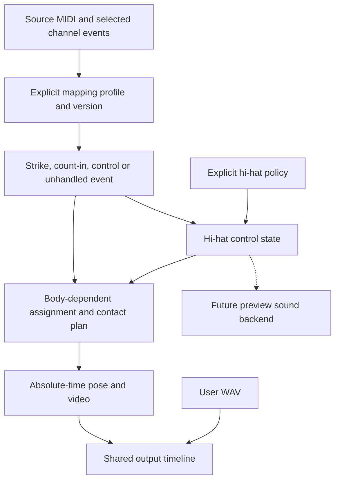

# MIDI interpretation

**English** · [한국어](midi-interpretation.ko.md)

This contract owns the boundary between source MIDI, instrument mapping, performer
intent and state-changing controls. The [engine contract](engine-contract.md) owns
input limits, time conversion, assignment and the WASM/pose API;
[calibration](calibration.md) owns body and contact fitting; and
[performance expression](performance-expression.md) owns technique and optional motion.

## Preserve evidence before interpreting it

A MIDI file records messages, not a unique physical performance. A note number needs
an instrument mapping; a short interval does not prove a technique; velocity does not
specify a joint angle. Keep those interpretations separate from their evidence.

Solid paths describe the implemented boundaries. The dashed sound-backend path is
an extension; the existing synthesized drums do not reproduce partial-open samples.

| Layer | Owns | Must not silently change |
| --- | --- | --- |
| Source | Track/event identity, channel message, tick and once-rounded time | Message values or original timing |
| Mapping | Instrument role, articulation and physical piece | Source note number or event identity |
| Intent | An explicit interpretation or a separately identified suggestion | Evidence into an asserted fact |
| Control | State such as hi-hat aperture or cymbal mute | A state change into an extra impact |
| Motion | Feasible limb assignment, preparation, contact and recovery | Musical timing to conceal a failed pose |

The Rust implementation in [model.rs](../../crates/drum-engine/src/model.rs),
[midi.rs](../../crates/drum-engine/src/midi.rs) and
[interpretation.rs](../../crates/drum-engine/src/interpretation.rs) owns serialized behavior. Browser types
mirror that boundary; scene object names and avatar identities do not define mapping.

## Source event scope and identity

`PerformancePlan` schema 2 retains `sourceEvents` for the selected tracks and channel
filter. Each event has an `id` formed from `track:eventIndex`, plus `track`,
`eventIndex`, `tick`, `timeUs`, `channel` and a tagged `message`.

The retained channel message kinds are `noteOn`, `noteOff`, `controller`,
`programChange`, `pitchBend`, `polyAftertouch` and `channelAftertouch`. Pitch bend
uses its unsigned 14-bit value. A velocity-zero note-on remains a note-on in this
evidence; it does not produce a strike. Tempo and meter have their separate time maps.

This is not a lossless SMF editor or archive: unselected events, arbitrary meta-event
payloads and SysEx payloads are not copied into `sourceEvents`. Keep the original
local file for re-import. Retaining a message also does not mean its musical effect
is implemented.

`interpretations` references each retained event by `sourceEventId` and classifies
it as `strike`, `countIn`, `control`, `omitted`, `unmapped` or `preserved`. A strike links to a `hitId` and
its instrument, physical piece and articulation. `preserved` means retained without
an applied motion/control effect, including currently unconsumed note-offs and CCs.
An unsupported positive note-on remains visible as `unmapped`, with a diagnostic.
An explicit hi-hat policy can interpret a close as `control`, referencing the open
event with `relatedSourceEventId` instead of creating a second hit.
`omitted` records an explicit arrangement omission while retaining the source message
and available mapping metadata; it creates neither a hit nor a control.

Calibration can change a hit's target and limb, but not the source event. Hit-array
indices may change after selecting a different mapping; use source event identity
when relating results across interpretations of the same file.

## Mapping profiles and physical pieces

`Selection.mappingProfile` explicitly chooses `gm` or `logicDkdGm`; omission means
`gm`. The plan records `mappingProfile`, `mappingVersion` (currently `"1"`) and the
count-in choice. Do not infer a profile
from the filename, a track name, an avatar or the presence of one familiar note.

`logicDkdGm` covers the implemented Drum Kit Designer GM-mode subset. It is not
support for every Logic instrument, brush behavior, GM + ModWheel or V-Drum mode.
Unknown mappings remain diagnostic. Integer note numbers are authoritative because
DAWs can display different octave names for the same MIDI key.

| MIDI note | `gm` | `logicDkdGm` |
| --- | --- | --- |
| 32 / 34 | Unmapped | Snare `rimshotEdge` / `edge` |
| 33 | Unmapped | Hi-hat `footClose` |
| 38 / 40 | Snare `center` / `electric` | Snare `center` / `rimshot` |
| 42 / 44 / 46 | Hi-hat `closed` / `footClose` / `open` | Same meanings |
| 49 / 57 | Left/right crash pieces | Left/right crash pieces |
| 52 | Crash `china` | Ride `edge` |
| 75 | Count-in only with the explicit option; otherwise unmapped | Same meanings |

This table highlights profile differences, not the complete supported-note table.
The mapping implementation owns all accepted notes. Logic foot splash and crash-stop
keys remain unmapped until their respective motion/control behavior is supported.

`Instrument` is a musical role; `KitPiece.id` identifies a physical contact entry.
Each piece also has an `instrument`. A hit records both `instrument` and `pieceId`,
plus its `articulation`. For example, `crash` and `crashRight` are separate pieces
sharing the `crash` role. They can be moved, selected and assigned independently.
An appearance preset can reuse a cymbal body without merging the two contacts.

The compatibility IDs `hihat` and `openHat` still address coupled positions on one
surface; `pedalHat` addresses its separate foot contact. These aliases are not two
independent hi-hat cymbals. Contact-region-specific rimshot mechanics are separate
from identifying an event as a rimshot.

`Selection.countInNote75` is false by default. In either supported profile, enabling it
explicitly interprets note 75 as a count-in cue. The source event is retained, but
no drum hit, limb assignment or synthesized strike is added. A different file can
use that note as played percussion, so this choice must remain visible and reversible.
It is not automatic count-in detection or a stick-click animation.

## Explicit arrangement edits

`Selection` and schema 2 plans retain two reversible, source-addressed directives:

| Field | Meaning |
| --- | --- |
| `omittedSourceEventIds` | Array of positive note-on source IDs excluded from this arrangement; default `[]` |
| `handOverrides` | Object mapping a retained hand-strike source ID to left `0` or right `1`; default `{}` |

IDs use the existing `track:eventIndex` identity, not a hit-array index, song filename
or avatar. They must exist in the selected tracks/channel. Omission rejects duplicate
IDs and nonpositive or non-note-on events. A hand override must identify a mapped,
non-omitted hand strike; foot events, cues and unmapped notes cannot receive a hand.
Removing an override returns that event to automatic assignment. Source messages,
ticks, velocity, duration and the original MIDI remain unchanged.

Omission precedes hi-hat control derivation: omitted opens/closes do not create pairs
or constrain preparation. Recompute controls from remaining arranged events, then
validate their retained source references. A hand override narrows the planner's
allowed hand after reach, occupancy and transfer checks. If that hand is infeasible,
retain the hit as unassigned with a diagnostic; do not substitute the other hand or
retime the event. An explicit omission is distinct from an unresolved required hit.
The existing synthesized preview follows the arranged hits; a supplied WAV is not
edited by either directive.

Loading a plan revalidates IDs and rederives interpretation/control consistency.
Changing only the omission list without its corresponding interpretations/hits is
rejected. Older schema 2 plans default to empty directives; schema 1 cannot contain
nonempty directives because it lacks retained source evidence. The event inspector
exposes omission and automatic/left/right selection; the
[project format](project-format.md) preserves the selected directives alongside the plan.

## Explicit hi-hat intent and control state

An open-hi-hat note followed by a foot-close note can represent a short open sound,
a separate foot chick or an author's workaround for a partially open timbre. Without
an applicable continuous controller or an explicit user instruction, a short gap
does not uniquely identify aperture.

`Selection.hihatPolicy` and the corresponding plan field choose `literal` (default)
or `shortOpenClose`. The latter is an explicit choice in either supported mapping,
not automatic intent detection. It pairs mapped positive foot-close events with the
nearest preceding unpaired open-hi-hat on the same channel, including across selected
tracks. A mapped closed hi-hat cancels the pending open; another open replaces it.
The gap must be positive and at
most both 80 ms and one quarter of the local quarter-note duration. Conflicting
overlapping control intervals or closures on another selected channel remain literal
foot strikes with a diagnostic: the selected channels share one physical hi-hat.

For each pair, `controls` records `kind: hihatClose`, the close `sourceEventId`, the
`openSourceEventId`, `releaseStartTimeUs`, `openTimeUs`, close `timeUs` and `openness`. The close changes
from a hit to a control interpretation; both raw messages, velocities and timestamps
remain intact. Unpaired events keep their literal meaning. `hihatOpenness` is a
dimensionless 0.05–1.0 setting, default 0.2; it is not a measured cymbal gap or proof
of the source instrument's sound. Stored controls are validated against source events
and the selected policy when loading a plan.

Absolute-time evaluation smoothly opens during at most 100 ms before the hand
strike, then reaches zero at the original close time. The signed `releaseStartTimeUs`
is the later of open time minus 100 ms and the latest preceding mapped closed-hi-hat
or foot-close event on any selected channel, including literal strikes and excluding
omitted events. Note 33 constrains closure only in a mapping that gives it that role.
The start can be negative for preparation
before song time zero. A closure with no remaining preparation time or during an open
interval prevents pairing. Loading rederives the release boundary from source events;
an edited curve cannot override an original closure. The ankle remains at its pedal
setup and the foot rotates through a small
release. This is not measured heel/sole support or a physical pedal linkage. The
control interval owns its closed endpoints as well; preparation for a later literal
foot strike starts no earlier than the preceding control close.
The same curve is evaluated for playback, seek and export without accumulating state.
Retained CCs do not yet drive openness, and there is no automatic pairing in `literal`.
The current visual state drives the ankle; it does not separate the cymbal meshes.

The policy applies to the selected arrangement. Explicit omissions already precede
derivation; future per-event aperture/region overrides and continuous controllers
should use this precedence:

1. Apply an explicit user cue for the selected source events or region.
2. Interpret controller values only through a profile that defines their meaning.
3. Offer contextual inference as a labeled suggestion with its rule/version and
   source references; do not silently overwrite either of the above.

Hand strikes, audible foot chicks, aperture/pressure and sound choking remain
different concepts. Synthesis truncates an open-hi-hat voice at the next closed-hat,
pedal strike or derived close control without changing its onset; it does not
recreate a sampler's partial-open timbre. This work extends T06 in
[performance expression](performance-expression.md),
not a second pedal-policy document.

## Velocity and sticking: extension boundary

Preserve the source velocity even when motion amplitude is reduced to fit available
time. Velocity, surrounding events and an explicit technique can inform a stroke;
velocity alone does not establish force, push-pull technique or emotion.

Phrase-level sticking should compare feasible hand sequences, accents and recovery
while respecting simultaneous demands. Alternating every repeated note is not a
universal solution: the other hand may be occupied. Connect that work to T07 and T09
in [performance expression](performance-expression.md). Natural wrist posture and
body-dependent reach remain [calibration](calibration.md) responsibilities.

An audio backend may use the same interpretation for sample layers, aperture and
choke behavior. It does not determine the avatar's hands. User WAV replacement follows
the [audio/export time contract](audio-export-contract.md) and does not require a
VST host or a recreation of Logic's sound engine.

## Import guidance

The controls separate instrument mapping from performance intent, following the
[research](../../docs/research/ergonomics-and-sticking.md).
Standard MIDI Files do not guarantee a producer identifier, and one DAW can export
different instrument maps. The browser shows note-based mapping evidence, without
asserting that a file came from Logic or automatically selecting a profile.

Under **Drum sound mapping / Interpretation**, count-in candidates and applicable
hi-hat control choices are shown from the prepared selection. Short-open-close
handling uses mapped roles rather than a DAW identity. A short pair is not
automatically a partial opening, nor is note 75 always count-in. Controller
interpretation still requires a defining profile. Confirmed policy and source-event
edits persist with the [project format](project-format.md). These controls do not
imply support for additional instrument maps or controllers.

## Bundled demo selections

[src/demo-catalog.ts](../../src/demo-catalog.ts) owns the selectable demos and their
explicit `Selection` values. Choosing a demo applies those values through the same
import and planning interfaces as an uploaded score; its name never selects a
special motion algorithm. Generated examples use their declared mapping and channel.
A published MIDI asset is checked against its recorded byte length and SHA-256
before import; source and permission metadata remain in its provenance record.

The [full-song demo](../../public/demos/transparent-girl-1-provenance.json) selects
`logicDkdGm`, `countInNote75: true`, `hihatPolicy: "shortOpenClose"`,
`hihatOpenness: 0.2`, and `omittedSourceEventIds: ["23:237"]`. That source snare is
retained but omitted from the final dual-crash/kick arrangement, visible in Analysis
and reversible through the event editor. These are reviewed selection data, not DAW
or playing-intent inference. Original bytes, timestamps and velocity are unchanged.
See the [demo guide](../../docs/calibration.md#try-a-demo-score) for using the examples.

## Compatibility and verification

Schema 1 plans can only supply the information they already contain. Migration can
infer the new piece/articulation fields for retained hits; it cannot reconstruct
previously discarded source events. Re-import the MIDI when complete source-event
evidence or a different mapping is needed. Do not label inferred legacy data as a
fresh parse of the original file.

Acceptance separates event accounting from performance quality:

- Every selected channel event has a stable identity and interpretation; unsupported
  positive notes are counted separately from supported but unassigned strikes.
- Count-in cues, explicit omissions and state changes are not counted as missing physical impacts.
- Two original simultaneous crashes remain two events and two intended surfaces.
- Replanning preserves original times, values and identities; repeated or shuffled
  evaluation preserves the major pose.
- Restored limb assignments must respect instrument roles, the same-limb minimum
  interval, transfer-speed limits and explicit hand overrides, not just endpoint reach.
- Actual tool/foot contact, wrist posture, reach and clearance are measured separately.
  An accurate target or zero unassigned hits alone does not establish natural playing.

Use independently authored small fixtures for public regression tests. Additional
published demo assets require recorded permission for their distribution; that
permission does not make unrelated uploads public. Private full-song checks can
retain aggregate results and model/setup identifiers in verification records; other
uploaded MIDI, WAV and VRM files remain local. Task status and measured commits belong
in issues and evidence reports rather than this contract.

## External references

- [MIDI Association: Standard MIDI Files](https://midi.org/standard-midi-files) and
  [Apple: Standard MIDI files](https://support.apple.com/en-il/guide/logicpro/lgcpdf6a3851/mac)
  describe interchange data and metadata; neither guarantees exporter identification.
- [Apple: Drum Kit Designer mappings](https://support.apple.com/en-ae/guide/logicpro/lgsia2ae90f1/mac)
  distinguishes mapping modes. GM + ModWheel changes hi-hat key meanings and uses
  modulation for openness; its brush-snare hand behavior is specific to brush sounds.
- [Apple: MIDI export preparation](https://support.apple.com/en-gb/guide/logicpro/lgcp77376cad/10.7/mac/11.0)
  explains applying region/quantization settings and converting project structures
  before export. The exported messages do not reproduce every DAW UI setting.
- [SFZ: Cymbal muting](https://sfzformat.com/tutorials/cymbal_muting/) illustrates a
  sound-side distinction between strike samples and muting relationships. It is
  background for a future backend, not code or sample content bundled by this contract.

These sources inform an independent implementation. Links and attribution do not
grant redistribution rights to their screenshots, audio, samples or application assets.
