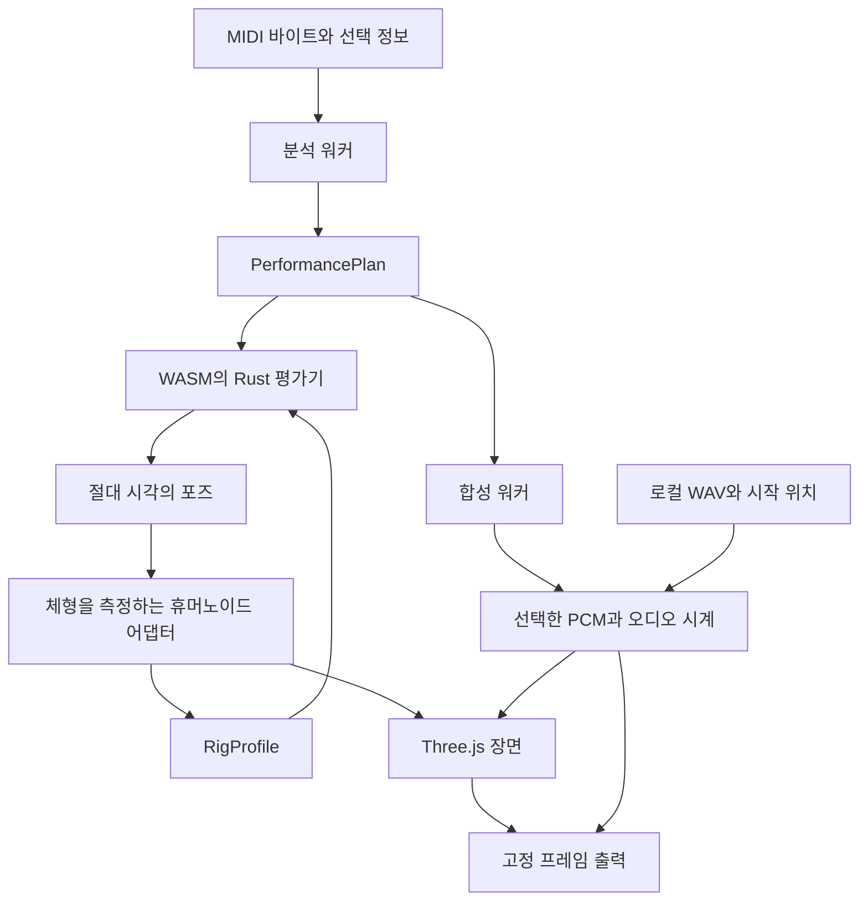

# 아키텍처 개요

[English](overview.md) · **한국어**

## 구성 요소의 경계

Rust 엔진은 Three.js 객체나 원본 모델의 메시 이름에 의존하지 않습니다.
버전이 있는 연주 계획은 [MIDI 해석 계약](midi-interpretation.ko.md)에 따라
원본 근거·매핑·의도·제어를 분리합니다.
브라우저 어댑터는 신체의 의미 기반 관절을 측정하여 수치 프로필을 제공하고,
계산된 포즈를 자신의 장면 그래프에 적용합니다.

| 영역 | 구현 진입점 | 책임 |
| --- | --- | --- |
| 해석·계획 | [Rust 엔진](../../crates/drum-engine/src/lib.rs) | SMF 검사, 정규화된 이벤트, 배정, 결정적 평가 |
| 브라우저 엔진 | [engine.ts](../../src/engine.ts), [워커](../../src/engine.worker.ts) | UI 스레드 밖에서 준비하고 검증된 계획·프로필로 평가기를 다시 구성 |
| 휴머노이드 | [rig-humanoid.ts](../../src/rig-humanoid.ts), [rig-vrm.ts](../../src/rig-vrm.ts) | 공통 의미 기반 본, 정규화·원본 본 변환, 부착된 도구 측정 |
| 배치·외형 | [kit-calibration.ts](../../src/kit-calibration.ts), [하드웨어](../../src/kit-hardware.ts), [라이브러리](../../src/model-library.ts) | 접촉 배치와 교체 가능한 드럼 본체 분리 |
| 렌더링·UI | [scene.ts](../../src/scene.ts), [main.ts](../../src/main.ts), [timeline.ts](../../src/timeline.ts) | 장면, 조작부, 템포·박자 기반 미리보기 |
| 소리·재생 | [synthesis.ts](../../src/synthesis.ts), [wav.ts](../../src/wav.ts), [audio.ts](../../src/audio.ts) | 합성 또는 시간 맞춘 WAV PCM, 공통 재생·출력 시계 |
| 인코딩 | [export.ts](../../src/export.ts) | 실제 코덱 검사, 고정 프레임 시각, 다중화, 취소·정리 |

## 상태 변경

체형이나 보정된 타점을 변경하면 원본 이벤트를 유지하면서 체형에 종속된 계획과
평가기를 다시 구성해야 합니다. 좌석·타점 변경 중 신체와 계획 중 일부만 적용된
상태를 남기면 안 됩니다. 장면이나 계획이 바뀌면 이전에 만든 영상 다운로드를
무효화합니다.

외형 교체는 원본 타격 시각, 타점 위치나 합성음을 바꾸지 않습니다.
의도적인 배치 보정은 키트 타점과 대응하는 이벤트 타점을 함께 변경합니다.
자세한 경계는 [리그 계약](rig-contract.ko.md)에 정의되어 있습니다.

## 호환 경로

`Performance.from_json_with_profile()`과 `evaluate_rig_at()`은 방향을 포함하는 현재 경로입니다.
기존 `from_json()`·`evaluate_at()`의 기본 리그 경로는 호환성과 비교를 위해 유지합니다.
두 경로의 버퍼 길이는 다릅니다. [엔진 계약](engine-contract.ko.md)을 참고하세요.

## 실행 환경

웹 빌드는 교차 출처 격리를 요구하지 않는 단일 스레드 WASM과 워커를 사용합니다.
Vite의 기준 경로는 `/drum-vrm/`이며, 생성된 WASM은 `src/wasm/`, 배포용 출력은
`dist/`에 있습니다. 이는 소스·빌드의 구성이지 특정 커밋이 공개되었다는 증거가 아닙니다.

[오디오·출력 계약](audio-export-contract.ko.md)이 공통 시간축을 정의합니다.
MVP 당시의 아키텍처와 측정 결과는 [원래 아키텍처 기록](https://github.com/postmelee/drum-vrm/blob/66951cd69015e43cfe132a6ba61545b175a25412/docs/architecture.md)에 보존되어 있습니다.
