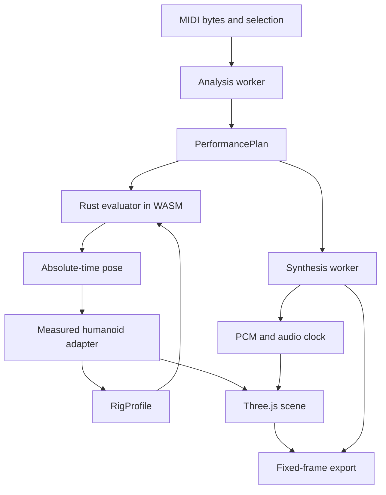

# Architecture overview

## Boundaries

The Rust engine is independent of Three.js objects and source model mesh names.
Its versioned performance plan represents musical intent and diagnostics.
The browser adapter measures a body's semantic joints, supplies a numeric profile,
and applies the evaluated pose to its own scene graph.

| Area | Implementation entry | Responsibility |
| --- | --- | --- |
| Parsing/planning | [Rust engine](../../crates/drum-engine/src/lib.rs) | SMF inspection, normalized events, assignment, deterministic evaluation |
| Browser engine | [engine.ts](../../src/engine.ts), [worker](../../src/engine.worker.ts) | Prepare off the UI thread; rebuild the evaluator from validated plan/profile data |
| Humanoid | [rig-humanoid.ts](../../src/rig-humanoid.ts), [rig-vrm.ts](../../src/rig-vrm.ts) | Shared semantic bones, normalized/raw conversion and attached tool measurements |
| Layout/appearance | [kit-calibration.ts](../../src/kit-calibration.ts), [hardware](../../src/kit-hardware.ts), [library](../../src/model-library.ts) | Keep contact layout separate from replaceable drum bodies |
| Rendering/UI | [scene.ts](../../src/scene.ts), [main.ts](../../src/main.ts), [timeline.ts](../../src/timeline.ts) | Scene, controls and tempo/meter-based preview |
| Sound/transport | [synthesis.ts](../../src/synthesis.ts), [audio.ts](../../src/audio.ts) | Deterministic PCM and playback clock |
| Encoding | [export.ts](../../src/export.ts) | Actual codec probe, fixed frame times, mux, cancellation and cleanup |

## State changes

Changing the body or calibrated contacts requires rebuilding the body-dependent
plan/evaluator while retaining original source events. Seat and target changes must
not leave a partially applied body/plan pair. Invalidate stale rendered downloads
when their underlying scene or plan is changed.

Appearance replacement does not change original hit timing, target positions or
synthesized sound. Intentional layout calibration changes kit contacts and the
corresponding event targets together. The [rig contract](rig-contract.md) defines
that boundary.

## Compatibility paths

`Performance.from_json_with_profile()` and `evaluate_rig_at()` are the current
orientation-capable path. The older `from_json()`/`evaluate_at()` primitive path is
retained for compatibility and comparisons. Their buffer lengths differ; see the
[engine contract](engine-contract.md).

## Runtime environment

The web build uses single-threaded WASM and workers without requiring cross-origin
isolation. Vite's base is `/drum-vrm/`; generated WASM lives in `src/wasm/`, and the
production output is `dist/`. These are source/build responsibilities, not evidence
that a particular commit has been published.

[Audio/export](audio-export-contract.md) defines the shared time axis. Historical
MVP architecture and measurements remain in the [baseline archive](../../mydocs/report/history/baseline-66951cd/architecture.md).
