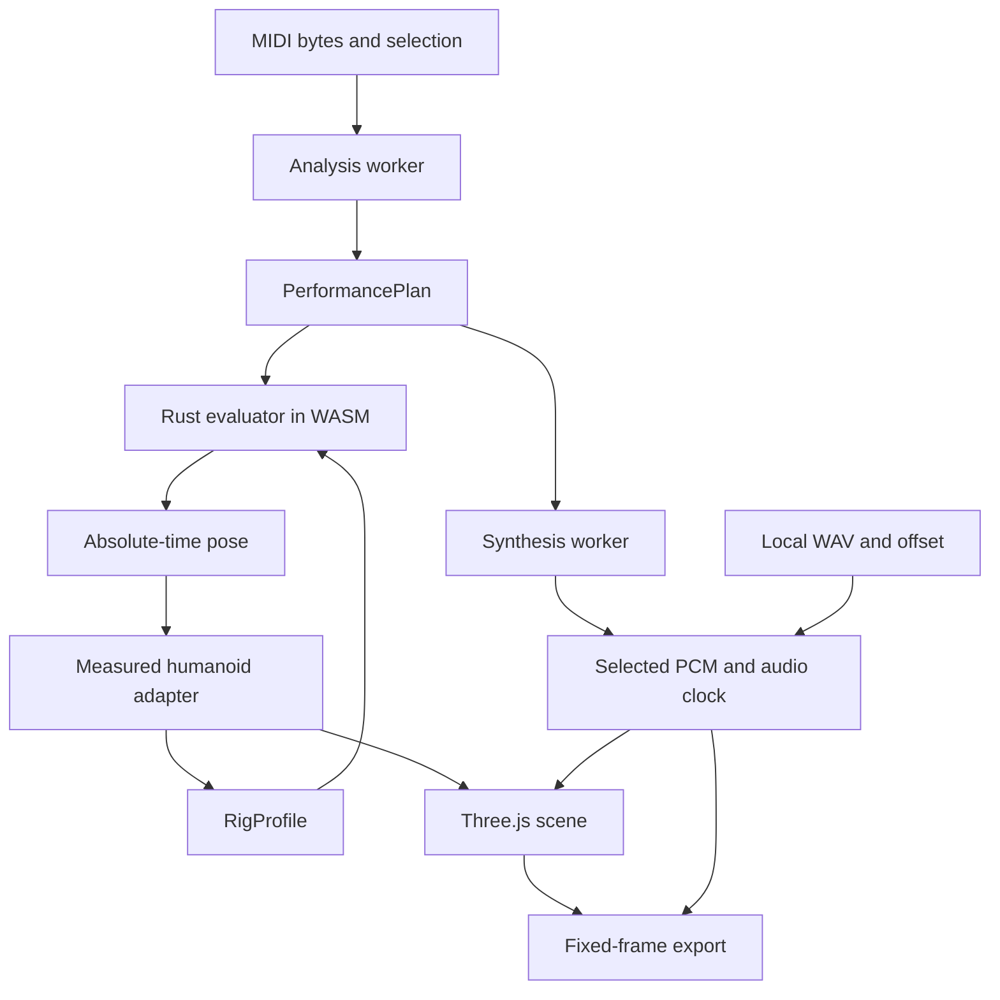

# Architecture overview

**English** · [한국어](overview.ko.md)

## Boundaries

The Rust engine is independent of Three.js objects and source model mesh names.
Its versioned performance plan separates source evidence, mapping, intent and controls
under the [MIDI interpretation contract](midi-interpretation.md).
The browser adapter measures a body's semantic joints, supplies a numeric profile,
and applies the evaluated pose to its own scene graph.

| Area | Implementation entry | Responsibility |
| --- | --- | --- |
| Parsing/planning | [Rust engine](../../crates/drum-engine/src/lib.rs) | SMF inspection, normalized events, assignment, deterministic evaluation |
| Browser engine | [engine.ts](../../src/engine.ts), [worker](../../src/engine.worker.ts) | Prepare off the UI thread; rebuild the evaluator from validated plan/profile data |
| Humanoid | [rig-humanoid.ts](../../src/rig-humanoid.ts), [rig-vrm.ts](../../src/rig-vrm.ts) | Shared semantic bones, normalized/raw conversion and attached tool measurements |
| Layout/appearance | [kit-calibration.ts](../../src/kit-calibration.ts), [hardware](../../src/kit-hardware.ts), [library](../../src/model-library.ts) | Keep contact layout separate from replaceable drum bodies |
| Rendering/UI | [scene.ts](../../src/scene.ts), [main.ts](../../src/main.ts), [timeline.ts](../../src/timeline.ts) | Scene, controls and tempo/meter-based preview |
| Interface language | [i18n.ts](../../src/i18n.ts) | English/Korean labels and explicit language selection; separate from performance data |
| Sound/transport | [synthesis.ts](../../src/synthesis.ts), [wav.ts](../../src/wav.ts), [audio.ts](../../src/audio.ts) | Synthesized or aligned WAV PCM and shared playback/export clock |
| Encoding | [export.ts](../../src/export.ts) | Actual codec probe, fixed frame times, mux, cancellation and cleanup |

## State changes

Changing the body or calibrated contacts requires rebuilding the body-dependent
plan/evaluator while retaining original source events. Seat and target changes must
not leave a partially applied body/plan pair. Invalidate stale rendered downloads
when their underlying scene or plan is changed.

Appearance replacement does not change original hit timing, target positions or
synthesized sound. Intentional layout calibration changes kit contacts and the
corresponding event targets together. The [rig contract](rig-contract.md) defines
that boundary.

## Interface language

The interface defaults to English and stores the selected language as the optional
`drum-language` browser preference. `?lang=en` and `?lang=ko` take precedence over
that preference. The toolbar switch updates the interface and the URL without reloading
the app, reimporting files, replanning motion or changing the playback position.
Language affects interface text and accessibility labels; it does not translate
user-supplied file names, track names or model metadata. MIDI source events,
performance timing, numeric settings and asset provenance stay unchanged.

## Compatibility paths

`Performance.from_json_with_profile()` and `evaluate_rig_at()` are the current
orientation-capable path. The older `from_json()`/`evaluate_at()` primitive path is
retained for compatibility and comparisons. Their buffer lengths differ; see the
[engine contract](engine-contract.md).

## Interface information hierarchy

Panels and import dialogs separate editable controls, concise live state, and
on-demand explanation. `ui-help.ts` supplies the same keyboard-accessible native
`details/summary` help component to static templates and dynamic dialogs. Help
must not contain required controls or blocking errors. One short description may
sit beside a control; technical limits and common operating guidance belong in
help. Model metadata/terms remain accessible in their own disclosure.

Completion messages use the existing dismissible notification; pending/error
states remain beside their action. Diagnostics show a localized code-based
summary, with the full original diagnostic, source context and seek action in
expandable details. Unknown codes keep their full explanation. This hierarchy
applies to every model and source, without model-specific visibility rules.

## Runtime environment

The web build uses single-threaded WASM and workers without requiring cross-origin
isolation. Vite's base is `/drum-vrm/`; generated WASM lives in `src/wasm/`, and the
production output is `dist/`. These are source/build responsibilities, not evidence
that a particular commit has been published.

[Audio/export](audio-export-contract.md) defines the shared time axis. Historical
MVP architecture and measurements remain in the [original architecture record](https://github.com/postmelee/drum-vrm/blob/66951cd69015e43cfe132a6ba61545b175a25412/docs/architecture.md).
