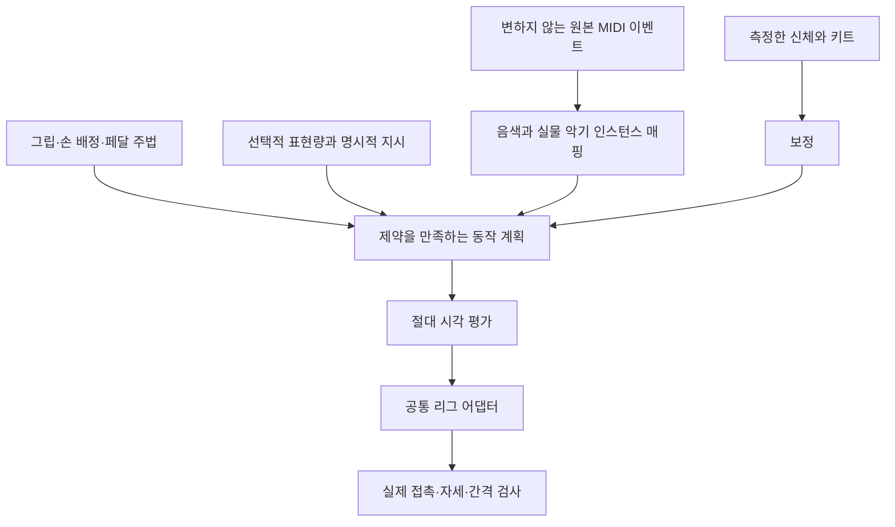

# 주법과 제약을 지키는 연주 표현

[English](performance-expression.md) · **한국어**

채택한 기반 설계는 음악적 의도, 물리적 맞춤, 연주 주법과 선택적 시각 표현을
분리합니다. 이 문서는 그 설계 이유를 설명하며 표현 슬라이더나 완전한 주법 프로필이
구현되었다는 뜻은 아닙니다. 기존 [ADR 0006](../../docs/decisions/0006-technique-and-expression-foundation.md)에
제안 범위, T01–T09 식별자와 수용 판단의 근거가 보존되어 있습니다.
[MIDI 해석 계약](midi-interpretation.ko.md)은 원본 근거, 매핑과 명시적 의도·추론한
제어의 구분을 정의합니다.

## 근거와 해석

Keiichi Nagata의 Yamaha DTX402 Series 교육 자료(I01)는 배치·그립·스트로크·페달
사용의 교육 사례를 제공합니다. Riley Warren의 그립 안내(I02)와 Dr. Dave Gerhart의
스네어 교육(I03)을 함께 참고합니다. 정확한 저자, 원문 위치와 권리는
[교육 자료 출처 대장](../../docs/performance-foundations.ko.md)에서 관리합니다.

교육 사례는 독립적인 공학 규칙의 출발점이며 관절 제한, 모션 캡처 정답이나 이 프로젝트의
표현 알고리즘을 제공하지 않습니다. 입문 예시를 보편적 규칙으로 바꾸지 말고 맥락에
따른 대안을 보존합니다. 이 설계는 원문의 사진·악보·녹음·모션 데이터를 제품 에셋으로
포함하지 않습니다.

## 계층별 의미와 책임

| 계층 | 의미 | 구현 경계 |
| --- | --- | --- |
| 음악 | 원본 이벤트 식별자, 노트, velocity, 시각 | 엔진이 보존 |
| 매핑 | 음악적 역할·주법과 의도한 실물 부품 | 명시적 프로필과 실물 부품 식별자가 존재하며 완전한 주법 역학은 미완성 |
| 맞춤 | 측정 신체, 좌석, 타점 배치, 그립·발바닥 좌표계 | 공통 프로필·세션 보정·명시적 정적 키트 맞춤 존재 |
| 주법 | 손가락·손목·팔다리·지지 부위가 스트로크를 수행하는 방식 | 타점별 손목·준비 자세·velocity 기반 스트로크·프레이즈 배정·발목 근사는 존재하며 완전한 스타일은 미완성 |
| 표현 | 실행 가능한 추가 준비·회복 동작과 몸통·시선 강조 | 0–100 조절은 제안이며 현재 실행 기능이 아님 |

더 강해 보이는 몸짓이 원본 velocity나 오디오를 바꾸지는 않습니다. 손바닥을 위로
두는 선택만으로 비대칭 손·손가락 역할을 요구하는 전통 그립이 되지는 않습니다.
오른손 하이햇 선호도 충돌 없는 교차 연주를 보장하지 않습니다.

## 추적 가능한 규칙 묶음

T 식별자는 ADR 0006의 의미를 유지합니다. 아래 표현은 설계 개념이며 배포된 JSON
스키마가 아닙니다.

| 규칙 | 설계 책임 | 확인할 관측 결과 |
| --- | --- | --- |
| T01 배치 | 측정 비율에 따른 신체·좌석·키트 보정 | 팔다리를 늘리지 않고 확보한 도달 범위와 간격 |
| T02 그립 | 손 로컬 좌표계, 지렛점·도구 관계와 선택적 손가락 | 실제 부착과 손목·전완 관계 |
| T03 준비·스트로크 | 악기별 준비·예비 동작·접촉·반동·이동 | 반복 스네어가 공통 몸통 휴지 위치로 우회하지 않음 |
| T04 Heel-down | 뒤꿈치 지지와 페달을 따르는 발목 중심 동작 | 단순 발목 고정이 아닌 타당한 뒤꿈치·앞발 지지 |
| T05 Heel-up | 앞발 지지, 허용된 뒤꿈치 상승과 관절 협응 | 발목·무릎이 이동할 수 있어도 유지되는 지지 |
| T06 해제 | 독립적인 페달 유지·반동과 하이햇 압력·열림 | 뒤꿈치 모드나 note-off만으로 해제를 추정하지 않음 |
| T07 손 배정 | 교차·오픈·좌우 반전 선호와 명시적 덮어쓰기 | 동시 타격의 공통 간격 검사와 불가능 진단 |
| T08 접촉 방식 | 스틱 끝·몸통 접촉 영역과 표면 점·법선 | 도구의 적절한 부분이 의도한 표면에 접촉 |
| T09 프레이즈 맥락 | 결정적 시점 힌트와 명시적 악센트 지시 | 강조해도 이벤트 식별자와 시각 보존 |

현재 구현 범위는 공통 정적 맞춤과 타점별 중립 손목(T01–T02), 악기별 준비 자세와
velocity에 따른 들어 올림·피치(T03), 명시적인 짧은 열림/닫힘 하이햇 제어(T06),
빠른 스네어 반복에서 남는 손을 번갈아 쓸 수 있는 제한된 프레이즈 beam(T07/T09)을
포함합니다. 정확한 동작은 [엔진](engine-contract.ko.md), [보정](calibration.ko.md),
[MIDI 해석](midi-interpretation.ko.md) 계약에서 정의합니다.

이 근사는 측정된 뒤꿈치·발바닥 지지, 생체역학적 push-pull, 충돌 없는 팔 교차,
주법별 림·스틱 몸통 접촉이나 수동 손 배정 스타일을 보장하지 않습니다. Velocity는
동작 크기의 입력이며 특정 주법의 증거가 아닙니다. 별도의
[오디오 경로](audio-export-contract.ko.md)는 몸짓 의미를 바꾸지 않고 합성 드럼이나
시간을 맞춘 사용자 WAV를 사용할 수 있습니다.

## 0–100의 의미

제안한 조절값은 시각적 움직임의 허용량입니다. `e = clamp(amount / 100, 0, 1)`로
정규화합니다. 0이어도 필요한 준비·접촉·지지·반동은 유지합니다. 1에서는 이벤트의
시각·도달성·간격 제약이 허용하는 만큼만 선택적 몸짓을 키웁니다.
보정된 감정·음량·힘 척도가 아닙니다.

Velocity와 프레이즈 맥락으로 기본 동작과 추가 악센트를 제안할 수는 있지만, 낮은
velocity나 마디 첫 박만으로 연주 의도를 하나로 확정할 수는 없습니다. 명시적 지시는
휴리스틱과 구분해야 합니다. 큰 동작에는 인접 타격 사이에 준비·회복할 시간이 필요합니다.
제약에 걸리면 선택적 동작부터 줄이고, 기본 타격 자체가 불가능하면 원본 이벤트를
유지한 채 진단합니다.

계산된 관절 각도에 배율을 곱하거나 두 포즈를 섞은 뒤 접촉이 유지된다고 가정하면
안 됩니다. 몸통·어깨 동작은 팔다리 시작점을 바꾸므로 솔버에 다시 반영해야 합니다.
변화를 넣을 때는 seed와 값을 기록하여 탐색·출력이 프레임 이력에 의존하지 않게 합니다.
카메라 동작과 드럼 타격 반응은 독립된 조절로 유지합니다.

기존 준비·종료 구간도 첫 타격 준비와 마지막 회복 동작의 제약입니다. 표현은 이 구간에
맞추거나 크기를 줄여야 합니다. 구간을 바꾸려면 오디오와 영상 전반의
[시간·출력 계약](audio-export-contract.ko.md)을 명시적으로 갱신해야 합니다.

## 양쪽 크래시 예시

키트의 실물 부품 `crash`와 `crashRight`는 음악적 역할 `crash`를 공유합니다.
원본에 있던 두 동시 크래시 이벤트는 별도 표면을 유지하고, 보정된 신체와 타격 시각이
허용하면 두 손에 배정할 수 있습니다. 부품 식별자를 분리하는 것만으로 편안한 도달이나
충돌 없는 동작을 보장하지는 않습니다. 매핑 상세는 [MIDI 해석](midi-interpretation.ko.md)에 있습니다.

표현량이 크다는 이유만으로 단일 이벤트를 두 타격으로 늘리지는 않습니다.
편곡 편집기를 추가한다면 원본을 덮어쓰지 않고 추가 이벤트를 명시적으로 기록해야 합니다.

## 연구의 영향과 평가

프로젝트는 계획, 준비·접촉·회복, IK 아이디어를 독립적으로 구현합니다.
DRUMS·Disney의 가중치, 검색된 모션, 학습 데이터나 저자 코드를 통합하지 않았습니다.
접촉·시간 검사는 해당 논문의 전체 지표를 재현하거나 동등한 자연스러움을 입증하지 않습니다.
[연구 대장](../../docs/research/references.md)과
[과거 감사](../../docs/research/rig-and-studio-audit.md)에 이 구분을 보존합니다.

개발은 올바른 매핑·인스턴스, 체형 맞춤과 자연스러운 절제된 스트로크의 기반을 마련한 뒤
선택적 표현으로 확장해야 합니다. 표현 조절이 구현되면 직접 만든 fixture를 체형별로
0/50/100과 중간 설정에서 비교하고 실제 도구·지지 접촉, 시간, 자세, 간격, 연속성과 줄어든 몸짓을
측정합니다. 원본 첫·마지막 이벤트, 순서를 섞은 탐색과 실제 출력 프레임 경계도 검사합니다.
수치 기준에는 명시적인 근거를 남기며 임의로 정한 한계를 교육 자료의 규칙으로 돌리지 않습니다.
