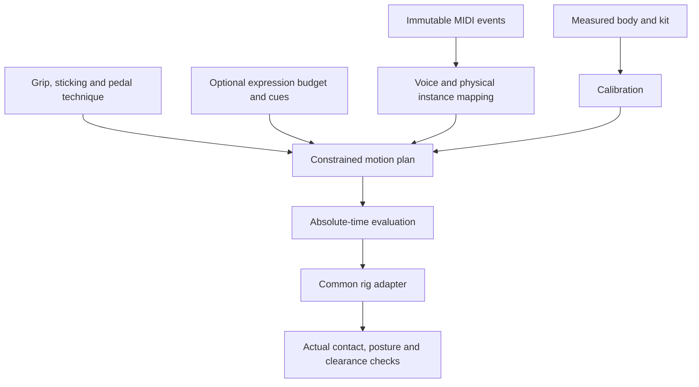

# Technique and constrained performance expression

The adopted foundation separates musical intent, physical fit, playing technique and
optional visual expression. This chapter maintains that design rationale; it does
not announce an expression slider or complete technique profiles. The original
[ADR 0006](../decisions/0006-technique-and-expression-foundation.md) preserves the
proposal's scope, T01–T09 identifiers and acceptance reasoning.

## Evidence and interpretation

Keiichi Nagata's Yamaha DTX402 Series instruction (I01) provides educational examples
of setup, grip, strokes and pedal use. Riley Warren's grip guide (I02) and Dr. Dave
Gerhart's snare instruction (I03) broaden that context. Exact authors, locators and
rights are maintained in the [instruction source register](../../docs/reference/sources/performance-instruction.md).

Teaching examples motivate independent engineering rules; they do not provide joint
limits, motion-capture ground truth or the project's expression algorithm. Preserve
contextual alternatives rather than turning a beginner example into a universal law.
No source photos, scores, recordings or motion data are product assets by this design.

## Layers and owned meaning

| Layer | Meaning | Implementation boundary |
| --- | --- | --- |
| Music | Source event identity, note, velocity and time | Preserved by the engine |
| Mapping | Musical role/articulation and intended physical piece | Fixed semantic roles exist; distinct physical-instance mapping is future work |
| Fit | Measured body, seat, target layout, grip and sole frames | Common profile and session calibration exist |
| Technique | How fingers, wrists, limbs and supports perform a stroke | Basic grip/ankle approximation exists; explicit style profiles are incomplete |
| Expression | Additional feasible preparation, recovery, body/gaze emphasis | Proposed 0–100 control, not a current runtime feature |

A louder-looking gesture does not change source velocity or audio. A palm-up option
does not establish traditional grip, which also requires asymmetric hand/finger roles.
Right-hand-hi-hat preference does not establish collision-safe crossed-arm playing.

## Traceable rule families

The T identifiers retain their identity from ADR 0006. The proposed representations
below are design concepts, not a shipped JSON schema.

| Rule | Design responsibility | Required observation |
| --- | --- | --- |
| T01 Setup | Body/seat/kit calibration from measured proportions | Reach and clearance without stretched limbs |
| T02 Grip | Hand-local frame, fulcrum/tool relationship and optional fingers | Real attachment plus wrist/forearm relation |
| T03 Ready/stroke | Instrument-specific ready, preparation, contact, rebound and transfer | Repeated snare does not detour through a generic torso rest |
| T04 Heel-down | Heel support and ankle-led motion following the pedal | Plausible heel/forefoot support, not merely a fixed ankle |
| T05 Heel-up | Forefoot support with allowed heel lift and coordinated joints | Support maintained while ankle/knee may translate |
| T06 Release | Independent pedal hold/rebound and hi-hat pressure/aperture | Do not infer release solely from heel mode or note-off |
| T07 Sticking | Crossed/open/mirrored preferences and explicit overrides | Shared simultaneous-hit clearance and infeasibility diagnostics |
| T08 Contact mode | Tip or shaft region with a surface point/normal | The appropriate part of the tool contacts the intended surface |
| T09 Phrase context | Deterministic timing hints and explicit accent cues | Emphasis preserves event identity and time |

Only the basic fit, generic grip, ankle-only pedal and contact/determinism foundations
are implemented. Full support mechanics, contact-region selection and explicit style
policies must be developed and measured before being presented as completed technique.

## Meaning of 0–100

The proposed control is a visual movement budget: `e = clamp(amount / 100, 0, 1)`.
At zero, required preparation, contact, support and rebound remain. At one, optional
gestures may become larger only when the event's timing, reach and clearance permit.
It is not a calibrated emotion, loudness or force scale.

Velocity and phrase context can propose a baseline and optional accents, but neither
low velocity nor a bar's first beat uniquely identifies playing intent. Explicit cues
should be distinguishable from heuristics. Larger motion needs time to prepare and
recover before adjacent strikes. Optional motion is reduced first when constrained;
an impossible baseline is reported with the original musical event retained.

Do not multiply solved joint angles or blend two poses and assume contact survives.
Torso/shoulder movement changes limb roots and therefore must feed back into solving.
Seed and record any variation so seeking and export do not depend on frame history.
Camera motion and drum hit feedback remain independent controls.

The existing pre-roll and tail also constrain first-hit preparation and final recovery.
Expression must fit those windows or reduce amplitude; changing them requires an
explicit [time/export contract](audio-export-contract.md) update across audio and video.

## Two-crash example

The current kit has one `crash` role. Two distinct cymbals require role/articulation
to be separated from physical-instance identity, with corresponding selection,
calibration and diagnostic migration. Two original simultaneous crash events can
then be assigned to two feasible hands/surfaces. A single event does not become two
impacts merely because expression is high. Any arrangement editor must record such
an added event explicitly without overwriting the source.

## Research influence and evaluation

The project independently uses planning, preparation/contact/recovery and IK ideas.
It has not integrated DRUMS/Disney weights, retrieved motion, training data or author
code. Contact/time tests are not reproductions of those papers' complete metrics or
proof of equivalent naturalness. The [research register](../../docs/reference/sources/research.md)
and [historical audit](../../mydocs/tech/research/2026-10-24/rig-and-studio-audit.md)
retain the distinctions.

Development should establish fitting, then natural restrained strokes, then explicit
techniques/instances, before optional expression. Compare authored fixtures at 0/50/100
and intermediate settings across bodies; measure actual tool/support contact, time,
posture, clearance, continuity and any reduced gesture. Test original first/last events,
shuffled seeks and actual exported-frame boundaries. Keep numerical thresholds
explicitly justified rather than attributing invented limits to an instructional source.
