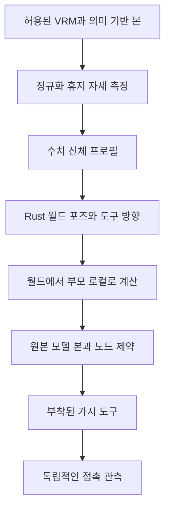

# 휴머노이드 호환성과 검증 근거

[English](rig-compatibility.md) · **한국어**

유효한 VRM 파일인지와 설득력 있는 드럼 연주가 가능한지는 서로 다른 문제입니다.
이 문서는 후자를 위한 표준 경계, 어댑터 설계와 필요한 근거를 설명합니다.
정확한 가져오기 제한과 좌표 변환은 [리그 계약](rig-contract.ko.md)에 있으며,
여기서 별도의 수치 API를 정의하지 않습니다.

## 표준이 제공하는 것

VRM 0.0과 1.0은 계층 요건에 따라 휴머노이드의 의미 이름을 glTF 노드에 매핑합니다.
필수 골반·척추·머리와 주요 팔·다리 연결은 공통 기준을 제공합니다. 선택 항목인
손가락·발가락·어깨·몸통 관절은 없을 수 있으므로, 유효한 신체라도 정교한 스틱
그립에 필요한 손가락 정보가 없을 수 있습니다.
[공식 휴머노이드 명세](https://github.com/vrm-c/vrm-specification/blob/master/specification/VRMC_vrm-1.0/humanoid.md)는
스케일 성분도 양수로 요구합니다. 앱이 더 엄격하게 검사하는 골격 스케일 조건은
리그 계약에 기록되어 있습니다.

디버그 머리 구체는 시각화일 뿐이며 호환성, 머리 해부학이나 스킨 가중치를 정의하지
않습니다. `.glb` 확장자만으로도 의미 기반 휴머노이드 매핑이나 호환되는 바인딩·휴지
자세가 제공되지는 않습니다. 기본 참고 뼈대는 의미 기반 Bone 노드를 사용하며,
모든 모델에 통용되는 스킨 캐릭터 에셋은 아닙니다.

## 정규화 본과 원본 본

모델마다 원본 로컬 휴지 회전이 다를 수 있습니다. three-vrm의 정규화 리그는 공통
포즈 규약을 제공하고 결과를 원본 본으로 전달합니다.
[휴머노이드 API](https://pixiv.github.io/three-vrm/docs/classes/three-vrm.VRMHumanoid.html)는
휴지 기준 상대 포즈 접근과 절대 휴지 변환을 구분합니다. `normalizedRestPose`를
`setNormalizedPose`에 그대로 전달하는 것은 서로 바꿔 쓸 수 있는 사용법이 아닙니다.

정규화는 규약을 맞추며 팔을 늘리거나 스틱 끝의 드럼 접촉을 자동으로 유지하지
않습니다. 측정한 신체에 다시 맞추고 도달성을 재계획해야 합니다. 현재 73개 값의
출력은 월드 점과 도구 쿼터니언으로 구성되며 표준 VRM 애니메이션 파일이나 모든
정규화 로컬 본 회전의 배열이 아닙니다. 어댑터가 로컬 계산과 원본 휴지 기준 변환을
명시적으로 수행합니다.

해부학적 좌우도 명시적으로 처리해야 합니다. 유지 중인 엔진 기준과 원래 VRM
기준은 해부학적 왼쪽의 X 부호가 반대입니다. 위치·회전·접촉·팔다리 역할을 일관되게
변환해야 하며, 골격에 음수 스케일을 적용하는 방식은 어댑터의 변환 전략이 아닙니다.
회귀 검사에는 오른발 킥과 왼발 하이햇 사례를 포함합니다.

## 도구 부착과 그립 기능

스틱은 보정된 소켓을 통해 실제 손의 자식으로 유지합니다. 측정한 메시 끝점과 원본
본 변환은 타점 변수 하나를 다시 읽는 검사로는 찾을 수 없는 오류를 드러냅니다.
손가락이 있으면 공통 굽힘을 적용하고, 선택 본이 없을 때의 대체 동작은 기능 표시에서
드러내야 합니다. 장갑 두께나 특이한 손가락·피부 비율 때문에 수치상 올바른 부착도
어색하게 보일 수 있습니다.

공통 손바닥 기준 보정은 이전 T-pose 축 불일치를 개선했지만 타점별 손목 제한을
해결하지는 않습니다. 전통 그립에는 비대칭 손가락·손 동작이 필요하므로 양쪽 손바닥을
위로 둔 보정을 그 스타일로 부르면 안 됩니다.
[보정 문서](calibration.ko.md)가 공통 신체와 도구의 관계를 설명합니다.

## 결정성과 보조 기능

매 평가에서 주요 포즈와 스프링 상태를 초기화한 뒤 요청된 절대 시각과 delta 0의
VRM 갱신을 적용합니다. 노드 제약은 참여하지만 머리카락·의상 보조 동역학은 누적하지
않습니다. 1인칭 렌더링은 임의의 모델 이름으로 숨기는 대신 VRM 메시 규칙과 프로필에서
유도한 시점을 따릅니다.

향후 스프링 시뮬레이션을 재생·탐색·출력 계약에 포함하려면 결정적 샘플링, 베이킹이나
문서화된 초기화 전략이 먼저 필요합니다. 순차 재생에서 보기 좋은 시뮬레이션이 탐색할
때 암묵적으로 다른 포즈가 되어서는 안 됩니다.

## 단계별 호환성 근거

| 단계 | 검사 | 아직 입증하지 못한 것 |
| --- | --- | --- |
| 컨테이너·사전 검사 | 버전, 내장 리소스, 제한, 의미 참조 | 렌더링 정확성과 동작 품질 |
| 프로필 구성 | 유한한 변환, 길이, 좌우·기준 규약 | 모든 신체·키트 타점의 도달성 |
| 변환 평가 | 실제 원본 본과 부착된 표식 | 피부·의상 충돌과 지각적 자연스러움 |
| 브라우저 가져오기·렌더링 | 실제 재질·제약·가시성 동작 | 독립적인 영상 재생 |
| 보정 실험 | 통제된 체형 변경에 같은 원본 이벤트 적용 | 임의의 미검사 비율 |
| 출력과 외부 검사 | 고정 프레임 미디어, 오디오 시각, 실제 디코딩 파일 | 모든 플랫폼·코덱 조합 |

각 결과에는 정확한 모델 파일과 검사한 리비전이 필요합니다. 모델명은 파일 식별자가
아닙니다. 비공개로 확보한 Twist, Seed-san, AvatarSample_B 예제의 조건은 서로 다르며,
통제된 두 체형의 VRoid Studio 실험을 대신하지 않습니다. 로컬 검사에 통과했다는
이유만으로 그 파일들을 fixture로 배포하지 않습니다.

## 연구의 영향과 한계

2001년 Virtual Drummer 연구는 준비·접촉·회복과 관절 시점의 아이디어를 제공하고,
DRUMS는 모듈형 모션 생성을 보여주며, 이후 드러머 연구는 공간적 접촉과 시간·지각적
품질을 구분해야 함을 뒷받침합니다. 프로젝트 계획기와 그립 로직은 독립 구현입니다.
해당 연구의 코드, 데이터, 검색 파이프라인, 가중치나 전체 평가 지표를 채택하지 않았습니다.

R 식별자와 권리는 [연구 출처](../../docs/research/references.md), 기법별 비교는
[과거 감사 전문](../../docs/research/rig-and-studio-audit.md)을 참고하세요.
감사의 원래 기본 리그 기준선은 과거 기록이며 현재의 의미 기반 어댑터가 아닙니다.

## 검증 기록과 다음 경계

- [VRM 출처·모델 기록](../../docs/research/vrm-models.md): 정확한 파일 식별자, 조건과 단계별 관측.
- [렌더링된 동작 기준선](../../docs/verification/rig-motion-baseline.md): 실제 끝점 이동과 미분 측정, 원인 해석의 한계.
- [VRM 스튜디오 검사](../../docs/verification/vrm-studio-unreleased.md): 실제 가져오기, 탐색과 인코딩 경로의 범위.
- [보정 검사](../../docs/verification/calibration-unreleased.md): 배치·신체·하드웨어 동작.
- [손바닥 방향 후속 검사](../../docs/verification/palm-orientation-unreleased.md): 정확한 접촉과 함께 남아 있는 동적 손목 굽힘.

일반 휴머노이드 GLB 매핑, 통제된 체형 쌍, 피부·발바닥 보정, 명시적 스타일과 충돌을
고려한 자연스러운 동작은 별도 작업입니다. 호환성을 설명할 때 이 증거 경계를 지켜야
하며 형식 준수만으로는 충분하지 않습니다.

## 본을 연결한 FBX 범위

로컬 바이너리 FBX 7.4/7.5는 명시적 의미 본 연결과 단위·정면 정규화 후 같은 휴머노이드 솔버를 사용합니다. 자동 이름은 제안이며 모호한 이름은 비워 둡니다. 필수 상하 계층·실제 접촉·결정적 평가 조건은 그대로 적용합니다. 보조 제약, 제작 도구 툰 그래프, 내장 애니메이션은 이 경로에서 처리하지 않으며 가져오기 성공이 임의 FBX 리그의 호환성을 보증하지 않습니다. [FBX 불러오기 계약](rig-contract.ko.md#fbx-불러오기)과 [검증](../../docs/verification/fbx-import.md)을 참고하세요.
