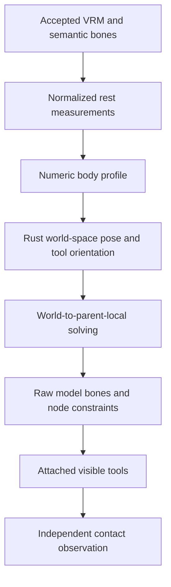

# Humanoid compatibility and evidence

**English** · [한국어](rig-compatibility.ko.md)

A VRM file's validity and a convincing drum performance are different questions.
This chapter explains the standard boundary, adapter design and evidence needed for
the latter. Exact importer budgets and coordinate conversions live in the
[rig contract](rig-contract.md); this explanation does not define another numeric API.

## What the standard provides

VRM 0.0 and 1.0 map semantic humanoid names to glTF nodes with hierarchy requirements.
Required hips/spine/head and principal arm/leg chains provide a shared reference;
optional fingers, toes, shoulders or torso joints may be absent. A valid body can
therefore lack the finger detail needed for an articulated stick grip. The
[official humanoid specification](https://github.com/vrm-c/vrm-specification/blob/master/specification/VRMC_vrm-1.0/humanoid.md)
also requires positive scale components. This application's stricter skeletal-scale
acceptance is recorded in the contract.

A debug sphere for the head is only a visualization. It does not define compatibility,
head anatomy or skin weights. Likewise a `.glb` extension alone provides neither a
semantic humanoid mapping nor a compatible binding/rest pose. The built-in reference
skeleton uses semantic Bone nodes; it is not a universal skinned character asset.

## Normalized and raw bones

Models may have different raw local rest rotations. three-vrm's normalized rig
provides a common pose convention and transfers the result to raw bones. Its
[humanoid API](https://pixiv.github.io/three-vrm/docs/classes/three-vrm.VRMHumanoid.html)
distinguishes rest-relative pose access from absolute rest transforms; passing
`normalizedRestPose` directly to `setNormalizedPose` is not interchangeable use.

Normalization solves conventions; it does not make an arm longer or automatically
preserve a stick tip on a drum. Refit the measured body and replan reach. The current
73-value output consists of world points plus tool quaternions; it is not a standard
VRM animation file or a complete array of normalized local bone rotations. The
adapter performs the local solving and raw rest-basis conversion explicitly.

Anatomical sides also need explicit treatment. The retained engine basis and native
VRM basis use opposite X signs for anatomical left. Convert positions, rotations,
contacts and limb roles consistently; applying negative scale to the skeleton is not
the adapter's conversion strategy. Include right-foot-kick and left-foot-hi-hat cases
in regressions.

## Tool attachment and grip capabilities

Keep sticks parented to actual hands through calibrated sockets. Their measured mesh
endpoints and raw-bone transforms expose errors that reading a second target variable
would miss. Available fingers provide a generic curl; optional-bone fallback must be
visible in capability reporting. Glove thickness and unusual finger/skin proportions
can still make a numerically correct attachment look wrong.

The shared palm-reference correction improved the previous T-pose-axis mismatch, but
it does not solve per-target wrist limits. Traditional grip requires asymmetric finger
and hand behavior; symmetric palms-up calibration should not be labeled as that style.
The [calibration chapter](calibration.md) explains the shared-body and tool relation.

## Determinism and secondary features

Each evaluation resets the primary pose and spring state, then applies the requested
absolute time and a zero-delta VRM update. Node constraints participate; secondary
hair/clothing dynamics do not accumulate. First-person rendering follows the VRM
mesh rules and a profile-derived view, rather than hiding an arbitrary model by name.

A future spring simulation needs deterministic sampling, baking or a documented reset
strategy before joining the playback/seek/export contract. A visually interesting
simulation in sequential playback cannot silently become a different pose on seek.

## Compatibility is a sequence of evidence

| Stage | Check | What remains unproven |
| --- | --- | --- |
| Container/preflight | Version, embedded resources, budgets, semantic references | Render correctness and motion quality |
| Profile construction | Finite transforms, lengths, side/basis conventions | All body/kit targets being reachable |
| Transform evaluation | Actual raw bones and attached markers | Skin/garment collision and perceptual naturalness |
| Browser import/render | Actual material/constraint/visibility behavior | Independent video playback |
| Calibration experiment | Same source events under controlled body changes | Arbitrary untested proportions |
| Export and external inspection | Fixed-frame media, audio time and actual decoded file | Every platform/codec combination |

Each result must identify the exact model file and tested revision. A model name is
not a file identity. The privately acquired Twist, Seed-san and AvatarSample_B examples
have different terms and do not replace a controlled two-body VRoid Studio experiment.
Do not distribute those files as fixtures merely because a local test passed.

## Research influence and limits

The 2001 Virtual Drummer work motivates preparation/contact/recovery and joint timing;
DRUMS illustrates modular motion generation; later drummer research reinforces the
separation between spatial contact and temporal/perceptual quality. Our own planner
and grip logic are independent implementations. We have not adopted their code,
data, retrieval pipeline, weights or full evaluation metrics.

Read the [research source guide](../../docs/research/references.md) for R IDs
and rights, and the complete [historical audit](../../docs/research/rig-and-studio-audit.md)
for method-by-method comparisons. The audit's original primitive baseline is historical,
not the current semantic adapter.

## Evidence routes and next boundary

- [VRM source/model record](../../docs/research/vrm-models.md): exact file identities, conditions and staged observations.
- [Rendered motion baseline](../../docs/verification/rig-motion-baseline.md): actual endpoint movement and derivative measurements, with causal limits.
- [VRM studio checks](../../docs/verification/vrm-studio-unreleased.md): actual importer, seek and encoding-path scope.
- [Calibration checks](../../docs/verification/calibration-unreleased.md): layout/body/hardware behavior.
- [Palm follow-up](../../docs/verification/palm-orientation-unreleased.md): accurate contact alongside unresolved dynamic wrist bends.

Generic humanoid GLB mapping, controlled body pairs, skin/sole calibration, explicit
styles and collision-aware natural motion remain separate work. Use those evidence
boundaries when making compatibility claims; format compliance alone is insufficient.
